<p align="center">
  
</p>

# intuicao

**Jogos de lógica, geometria e estratégia para aprender experimentando.**

O **Intuição**, projeto de **Luigi Scofano de Araujo**, reúne 19 jogos ativos que funcionam no navegador. Você pode guiar raios de luz com espelhos, equilibrar formas, coordenar animais ou disputar um tabuleiro com outra pessoa ou com os bots de DESVIO, CERCO e dos duelos ativos. Cada jogo tem regras próprias, explicações na interface e um manual neste repositório.

A ideia é transformar conceitos abstratos em escolhas visíveis: observar, imaginar uma solução, testar e entender o que mudou. Folhas, molduras e animais brasileiros em pixel art dão identidade à experiência.

> **A curiosidade é a primeira lição.**

**19 jogos ativos · 12 campanhas solo · 960 fases · 7 jogos Versus**

Dobra foi retirado em 13/11/2026, assim como Divisa, Órbita, Lastro, Vazante e Enlace anteriormente. Código, artes e progresso continuam preservados. [Retirada e recuperação de Dobra](docs/retirada-dobra-2026-11-13.md). As seções datadas, manuais e fichas abaixo documentam também o catálogo histórico; não representam disponibilidade atual.

**Inteligência artificial aplicada a jogos:** DESVIO usa busca exata de posições; CERCO combina antecipação de jogadas e avaliação estratégica. [Entenda como os bots decidem](#ia-nos-bots-dos-jogos-versus).

[Jogar no navegador · acesso público](https://intuicao-luigi-minigames.luigiscofano.chatgpt.site) · [Executar no computador](#executar-no-computador) · [Conhecer os jogos](#conheça-os-25-jogos) · [Manuais completos](docs/jogos/README.md)

O site está **aberto ao público desde 03/11/2026**: qualquer pessoa com o link pode jogar no navegador. Para executar uma cópia deste repositório, siga a instalação local abaixo.

## Conquistas com missões próprias de cada jogo

**61 conquistas ativas com emblemas SVG distintos:** dez gerais acompanham a campanha e 51 missões exploram decisões específicas dos 19 jogos ativos. Em MOSAICO, por exemplo, uma missão pede dois selos próprios no mesmo lance. Registros históricos de jogos retirados continuam preservados.

A [ampliação aprovada](docs/conquistas/MISSOES-APROVADAS-2026-11-11.md) acrescenta precisão, eficiência e sequências humanas, preservando as conquistas anteriores.

A galeria permite filtrar por jogo e por conquistas obtidas ou ainda por descobrir. Missões retroativas aproveitam conclusões atuais verificáveis; as missões de ação reconhecem jogadas humanas confirmadas. O progresso participa do backup local.

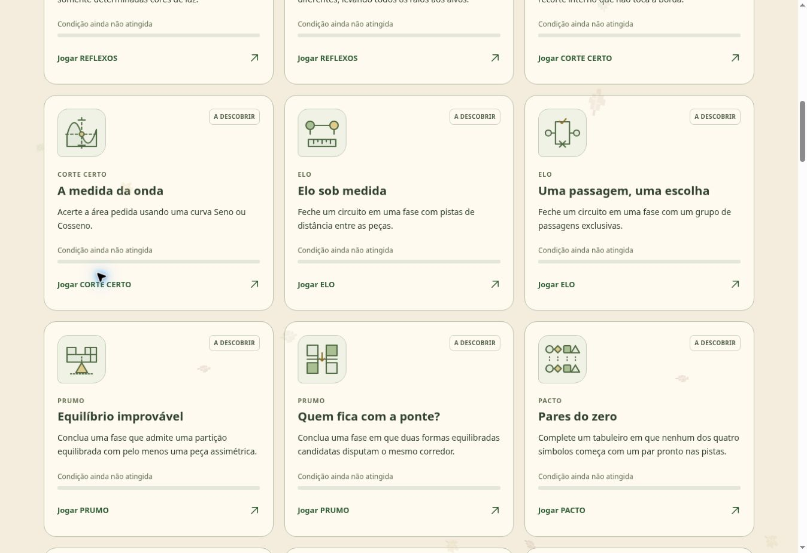

[Catálogo e critérios das missões](docs/conquistas/README.md) · [Prancha da edição inicial de 60 emblemas](docs/imagens/conquistas/emblemas.svg) · [Arquitetura e preservação do progresso](dist/achievements/README.md)

## Apresentação unificada dos jogos

Os 19 jogos ativos seguem o mesmo padrão de Como jogar e preparação. As 12 campanhas exibem Desafio diário, Modo sem parar e Níveis com apresentação comum; os 7 jogos Versus não exibem diário nem modo sem parar. Reflexos e Corte certo recebem seleção diária determinística pela data de São Paulo. Os seis jogos lógicos usam sessões contínuas separadas das campanhas.

[Escopo, preservação e verificações](docs/qa/apresentacao-unificada-2026-11-11.md) · [Funcionamento da sequência lógica](docs/qa/logica-sem-parar-2026-11-11.md)

## Oito novos duelos · edição de 11/11/2026

**ENLACE, VAZANTE, MOSAICO, QUINHÃO, ESTALO, DOBRA, ACORDE e LASTRO** ampliam a categoria Versus. Cada jogo inclui tabuleiro interativo, prévia da jogada, confirmação explícita, regras completas e retomada da partida. Há modos local, competitivo, contra o computador e treino com análise.

Os motores são puros e separados das telas. Navegação, histórico, persistência e busca ficam em módulos compartilhados, com comentários em português nas decisões e invariantes relevantes. Os oito jogos carregam sob demanda; nenhuma instalação ou serviço de IA é necessário para jogar.

[Descrições e pranchas ilustrativas](docs/versus/README.md) · [Arquitetura dos duelos](dist/versus/README.md) · [Verificações desta edição](docs/versus/VERIFICACAO.md)

## Seis novos jogos · edição de 10/11/2026

**DIVISA, PULSO, FOZ, REFÚGIO, MIRANTE e RENOVO** entram em Raciocínio lógico, com a identidade visual de CERCO e **80 fases por jogo**. LAÇO e RODÍZIO ficam fora do catálogo. As 480 novas fases possuem soluções únicas certificadas; a dificuldade é editorial e ainda não foi calibrada com jogadores.

A família compartilha seleção por faixa, retomada de tentativa, desfazer/refazer, checagem de regras, gabarito após três checagens sem sucesso, backup e conquistas. Desafio diário escolhe uma fase do catálogo existente. Modo sem parar percorre as 80 fases em uma sessão própria, retorna à primeira ao completar o ciclo e preserva o progresso da campanha. Os motores e campanhas são carregados sob demanda; a geração e a certificação ocorrem fora do navegador.

[Regras e galeria dos seis jogos](docs/logica/README.md) · [Arquitetura e contratos](dist/logica/README.md) · [Testes e limites](tests/README.md#seis-jogos-lógicos-e-integração)

## Coleção de manuais em PDF

**19 PDFs revisados · 278 páginas**, por **Luigi Scofano de Araujo**. Clique em um título para abrir o arquivo no GitHub e use a opção de download para guardar uma cópia.

Os PDFs registram a edição documental de **1º de novembro de 2026**. Complementam os guias em Markdown e preservam o contexto dessa revisão; não substituem o histórico de alterações posteriores do código.

### Manuais dos 11 jogos

| Manual | Páginas |
| --- | ---: |
| [Reflexos](docs/pdfs/jogos/Intuicao_Manual_Reflexos_2026-11-01.pdf) | 13 |
| [Corte certo](docs/pdfs/jogos/Intuicao_Manual_Corte_2026-11-01.pdf) | 13 |
| [ELO](docs/pdfs/jogos/Intuicao_Manual_Elo_2026-11-01.pdf) | 14 |
| [PRUMO](docs/pdfs/jogos/Intuicao_Manual_Prumo_2026-11-01.pdf) | 13 |
| [PACTO](docs/pdfs/jogos/Intuicao_Manual_Pacto_2026-11-01.pdf) | 13 |
| [SINTONIA](docs/pdfs/jogos/Intuicao_Manual_Sintonia_2026-11-01.pdf) | 14 |
| [REPASSE](docs/pdfs/jogos/Intuicao_Manual_Repasse_2026-11-01.pdf) | 14 |
| [ÓRBITA](docs/pdfs/jogos/Intuicao_Manual_Orbita_2026-11-01.pdf) | 14 |
| [DESVIO](docs/pdfs/jogos/Intuicao_Manual_Desvio_2026-11-01.pdf) | 11 |
| [BROTO](docs/pdfs/jogos/Intuicao_Manual_Broto_2026-11-01.pdf) | 11 |
| [CERCO](docs/pdfs/jogos/Intuicao_Manual_Cerco_2026-11-01.pdf) | 11 |

### Marca, arte e recursos

| Manual | Páginas |
| --- | ---: |
| [Manual da marca](docs/pdfs/marca-e-arte/01-manual-marca-intuicao.pdf) | 16 |
| [Design visual e artístico](docs/pdfs/marca-e-arte/02-manual-design-visual-artistico.pdf) | 19 |
| [Catálogo de sprites, ícones e acessórios](docs/pdfs/marca-e-arte/03-catalogo-sprites-icones-acessorios.pdf) | 37 |
| [Inventário de recursos e proveniência](docs/pdfs/marca-e-arte/04-inventario-recursos-proveniencia.pdf) | 23 |

### Implementação, design e manutenção

| Manual | Páginas |
| --- | ---: |
| [Arquitetura e implementação](docs/pdfs/tecnicos/16-arquitetura-implementacao-intuicao.pdf) | 12 |
| [Game design e level design](docs/pdfs/tecnicos/17-game-design-level-design-intuicao.pdf) | 12 |
| [QA e manutenção](docs/pdfs/tecnicos/18-qa-manutencao-intuicao.pdf) | 11 |
| [Visão geral e guia da coleção](docs/pdfs/tecnicos/19-visao-geral-guia-colecao-intuicao.pdf) | 7 |

## Comece por aqui

| O que você quer fazer? | Por onde começar |
| --- | --- |
| **Jogar pela primeira vez** | [Abra o projeto](#executar-no-computador) e siga [Como jogar](#como-jogar-pela-primeira-vez). |
| **Escolher um jogo** | Veja a [explicação de cada jogo com sua imagem](#conheça-os-25-jogos). |
| **Entender a IA dos bots** | Compare as [estratégias de DESVIO e CERCO](#ia-nos-bots-dos-jogos-versus) e encontre os módulos que escolhem as jogadas. |
| **Entender uma regra** | Abra o [manual do jogo](docs/jogos/README.md): há regras, exemplos e arquivos relacionados. |
| **Estudar ou modificar o código** | Comece pelo [mapa do projeto](#como-o-projeto-está-organizado) e pela [arquitetura](docs/arquitetura/README.md). |
| **Conferir testes e pendências** | Consulte o [estado do projeto](#o-que-funciona-e-o-que-ainda-está-pendente). |

## IA nos bots dos jogos Versus

**Os bots de DESVIO e CERCO usam IA clássica para jogos:** examinam o estado do tabuleiro, simulam jogadas permitidas e consideram as respostas do adversário. A decisão é calculada no próprio navegador, com algoritmos de busca e regras de avaliação; não exige uma API de IA ou um modelo treinado.

| Jogo | Como a IA escolhe | O que esperar |
| --- | --- | --- |
| **[DESVIO](#desvio)** | Busca exata com **memoização**: guarda o resultado de posições já analisadas para reutilizá-lo. Nos níveis mais simples, usa escolha pseudoaleatória ou verificações táticas. | O modo **Exato · jogo perfeito** identifica vitórias forçadas nos mapas suportados, de até 16 casas. Uma posição já perdida contra respostas perfeitas continua perdida. |
| **[CERCO](#cerco)** | Busca **minimax com poda alfa-beta**, aprofundamento progressivo e **heurísticas** de mobilidade, saídas e espaço alcançável. | O modo **Avançado · busca limitada** olha mais adiante dentro do orçamento de busca. Sua avaliação é uma estimativa estratégica, sem garantia de jogo perfeito. |
| **[BROTO](#broto)** | Duelo local entre duas pessoas; esta versão não implementa bot. | A estratégia está nas decisões dos jogadores sobre quais brotos estimular e quais flores completar. |

Os oito novos duelos usam minimax com poda alfa-beta e aprofundamento progressivo em um Web Worker. A busca respeita o jogador que realmente decide em cada estado: em QUINHÃO, escolher um cesto e preparar a próxima oferta podem pertencer à mesma pessoa. Os níveis têm limites de tempo, nós e alternativas; o nível avançado não promete jogo perfeito. O treino apresenta a jogada sugerida como prévia para o jogador confirmar ou descartar.

Uma **heurística** atribui uma nota à posição para comparar alternativas sem precisar resolver a partida inteira. No **minimax**, o bot considera tanto a sua melhor escolha quanto a melhor resposta do adversário. A **poda alfa-beta** evita explorar continuações que já não podem melhorar a decisão daquela busca.

As dificuldades e os exemplos de decisão estão junto às imagens de [DESVIO](#desvio) e [CERCO](#cerco), abaixo. Os duelos locais acontecem **no mesmo aparelho**; esta base não oferece salas multiplayer online.

## Como jogar pela primeira vez

1. **Escolha uma categoria:** Intuição, Raciocínio lógico ou Versus.
2. **Abra um jogo:** nas campanhas solo, comece pela faixa **Básico**; nos duelos, configure a partida conforme as opções do jogo.
3. **Leia o objetivo e as regras junto ao tabuleiro.** Observe o que pode mover e qual configuração precisa alcançar.
4. **Experimente uma ação e acompanhe o efeito.** Use Desfazer ou Reiniciar quando esses controles estiverem disponíveis.
5. **Conclua o desafio.** Alguns jogos reconhecem a vitória automaticamente; outros pedem Checar ou Confirmar. Nos duelos, confirme a jogada e acompanhe a vez de cada pessoa.

**Um exemplo em SINTONIA:** ao pressionar a seta para a direita, todos os animais tentam andar. Um animal encostado na parede fica parado; outro, com caminho livre, avança. Você usa essa diferença para ajustar suas posições até que todos ocupem seus destinos simultaneamente.

Para uma primeira exploração, experimente **Corte certo** para estimar áreas, **SINTONIA** para coordenar movimentos ou **BROTO** para jogar em dupla. Os manuais explicam cada regra com mais exemplos.

<a id="os-jogos-em-imagens"></a>

## Conheça os 25 jogos

Os onze jogos anteriores têm **uma captura real da interface junto à explicação de sua mecânica**. Os seis novos puzzles apresentam SVGs do estado inicial, gerados pela mesma view do jogo e identificados como tal. Clique na imagem para ampliar. As capturas foram feitas no site hospedado em **1º de novembro de 2026**; o [registro das imagens](docs/imagens/jogos/README.md) identifica cada fase ou partida. Algumas mostram tentativas ou prévias, e não soluções concluídas.

| Categoria | Vá direto ao jogo |
| --- | --- |
| Intuição | [Reflexos](#reflexos) · [Corte certo](#corte-certo) |
| Raciocínio lógico | [ELO](#elo) · [PRUMO](#prumo) · [PACTO](#pacto) · [SINTONIA](#sintonia) · [REPASSE](#repasse) · [ÓRBITA](#órbita) · [DIVISA](#divisa) · [PULSO](#pulso) · [FOZ](#foz) · [REFÚGIO](#refúgio) · [MIRANTE](#mirante) · [RENOVO](#renovo) |
| Versus | [DESVIO](#desvio) · [BROTO](#broto) · [CERCO](#cerco) · [ENLACE](#enlace) · [VAZANTE](#vazante) · [MOSAICO](#mosaico) · [QUINHÃO](#quinhão) · [ESTALO](#estalo) · [DOBRA](#dobra) · [ACORDE](#acorde) · [LASTRO](#lastro) |

### Intuição: observar formas e trajetórias

#### Reflexos

**Guie a luz até o destino.** Gire os espelhos para levar cada raio ao alvo da mesma cor e símbolo. As trajetórias de cores diferentes não podem se cruzar nem se tocar. O desafio combina reflexão, ângulos e planejamento de caminhos.

[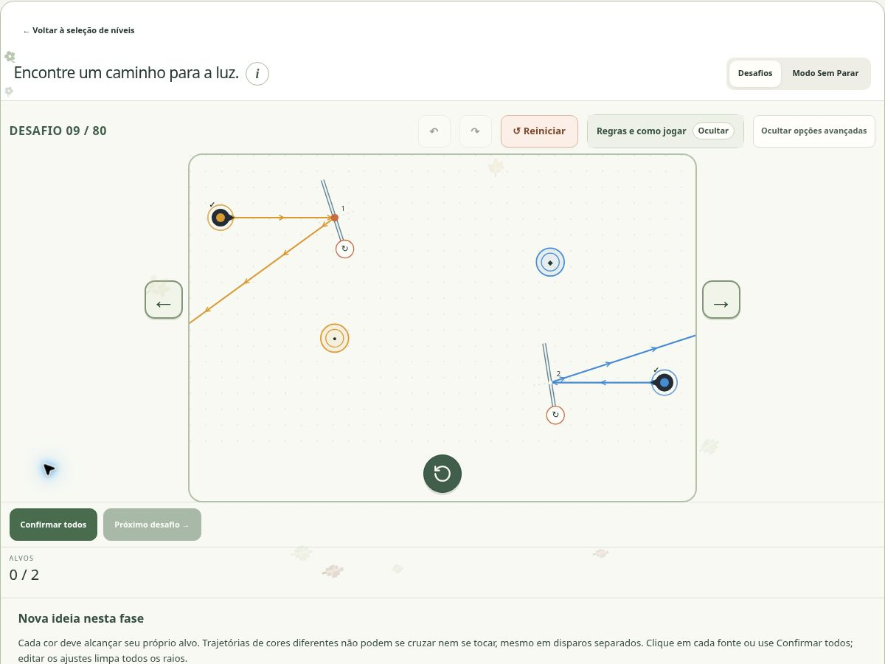](docs/imagens/jogos/reflexos.jpg)

*Na imagem: fase 9, “Duas cores, dois destinos”. Os raios foram disparados para mostrar o efeito dos ângulos escolhidos; os dois alvos ainda precisam ser alcançados.*

**O que observar:** ao girar um espelho, você altera a direção do raio refletido. Planeje o percurso de cada cor e depois confira se os caminhos respeitam as restrições entre si.

[Regras, exemplos e código de Reflexos](docs/jogos/reflexos/README.md)

#### Corte certo

**Divida uma figura na proporção pedida.** Ajuste uma linha ou curva para separar a porcentagem indicada da área útil da figura. Buracos ficam fora da conta. A atividade explora estimativa visual, áreas, proporções e porcentagens.

[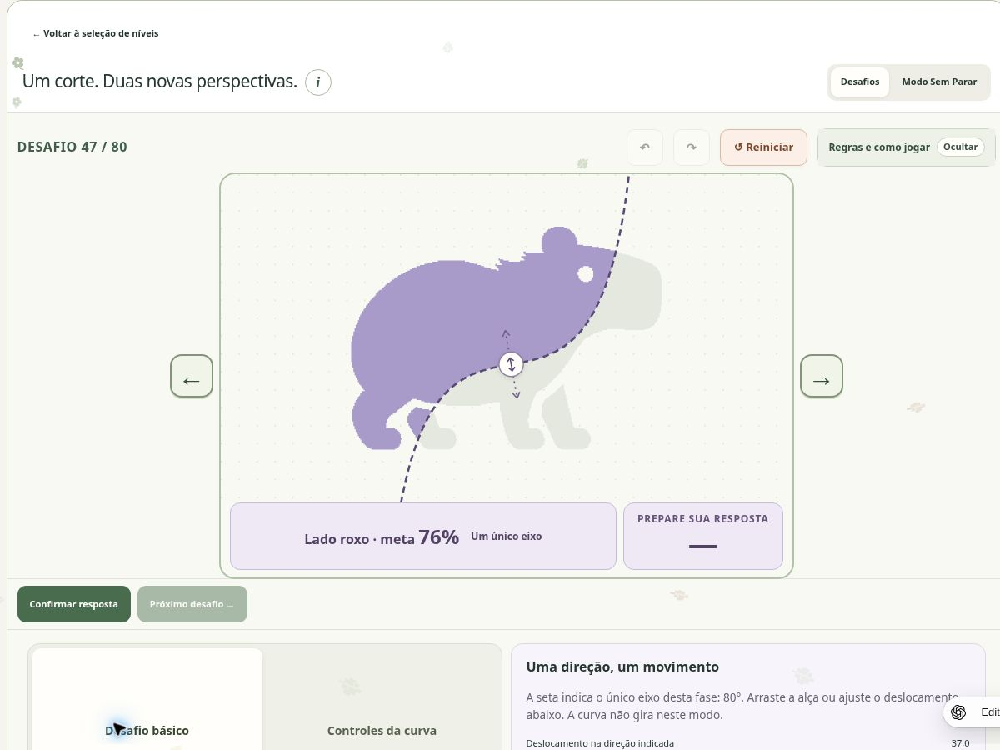](docs/imagens/jogos/corte.jpg)

*Na imagem: fase 47, “Capivara”, com curva em S e meta de 76% para o lado roxo. O corte está sendo preparado antes da confirmação.*

**O que observar:** a porcentagem depende da área ocupada pela figura, incluindo seus contornos irregulares; mover o corte pela mesma distância nem sempre desloca a mesma quantidade de área.

[Regras, exemplos e código de Corte certo](docs/jogos/corte/README.md)

### Raciocínio lógico: combinar regras e planejar ações

#### ELO

**Transforme pontos em um único circuito.** Posicione um ponto por região para que as ligações automáticas formem um circuito fechado, respeitando as pistas. Você combina deduções locais com uma condição global: todos os pontos precisam participar da mesma volta.

[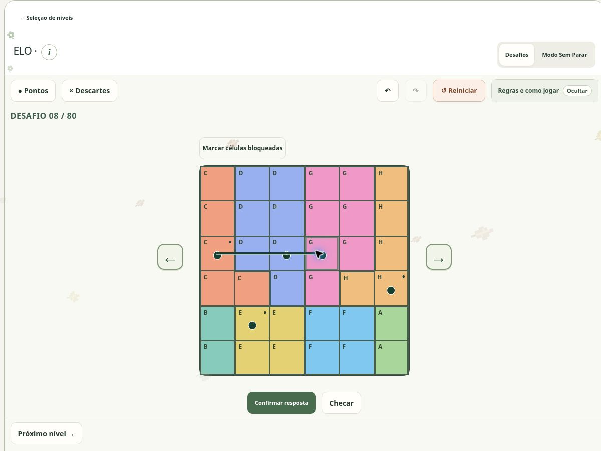](docs/imagens/jogos/elo.jpg)

*Na imagem: fase 8, “Circuito clássico”. Os pontos adicionados demonstram duas ligações horizontais; o circuito ainda está incompleto.*

**O que observar:** uma escolha que parece funcionar em uma região pode impedir o fechamento do circuito completo. Compare as possibilidades das regiões vizinhas antes de confirmar.

[Regras, exemplos e código de ELO](docs/jogos/elo/README.md)

#### PRUMO

**Construa peças que se sustentem sobre seus apoios.** Divida a grade em peças conectadas, cada uma com o centro de massa exatamente sobre o apoio correspondente. O problema une geometria, equilíbrio e distribuição de massa.

[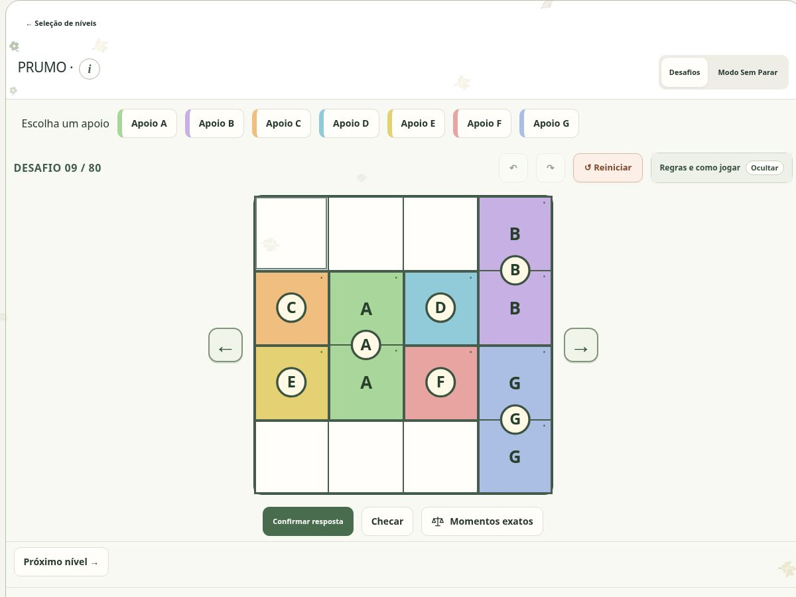](docs/imagens/jogos/prumo.jpg)

*Na imagem: fase 9, com grade 4 × 4 e sete apoios. As cores identificam as peças que precisam ser completadas.*

**O que observar:** acrescentar uma casa de um lado do apoio desloca o centro de massa. A peça precisa equilibrar sua distribuição de casas e continuar conectada.

[Regras, exemplos e código de PRUMO](docs/jogos/prumo/README.md)

#### PACTO

**Complete a grade e forme pares exatos.** Cada linha e coluna deve ter dois de cada símbolo. Além disso, cada casa precisa tocar exatamente uma casa igual pelos lados; diagonais não contam. As pistas iniciais permanecem fixas.

[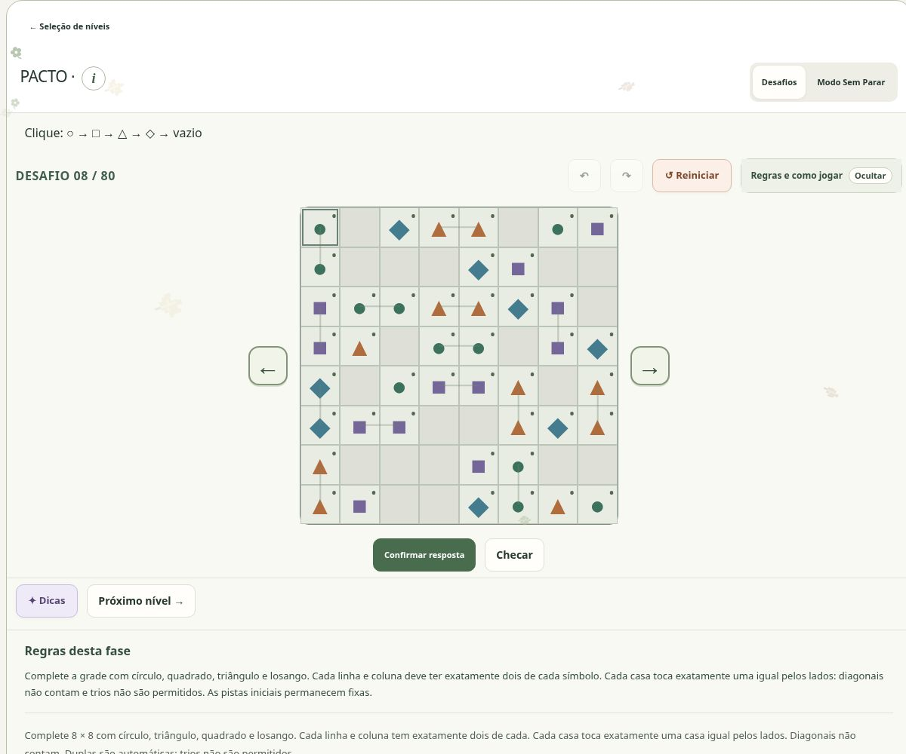](docs/imagens/jogos/pacto.jpg)

*Na imagem: configuração inicial da fase 8. As ligações indicam pares já formados entre símbolos iguais.*

**O que observar:** satisfazer a contagem de uma linha não basta se a jogada cria um trio ou deixa um símbolo sem parceiro. Contagem e vizinhança precisam funcionar juntas.

[Regras, exemplos e código de PACTO](docs/jogos/pacto/README.md)

#### SINTONIA

**Um comando, vários animais.** Use as mesmas direções para conduzir animais em tabuleiros diferentes até seus destinos ao mesmo tempo. Paredes e outros elementos fazem um mesmo comando produzir resultados diferentes em cada tabuleiro.

[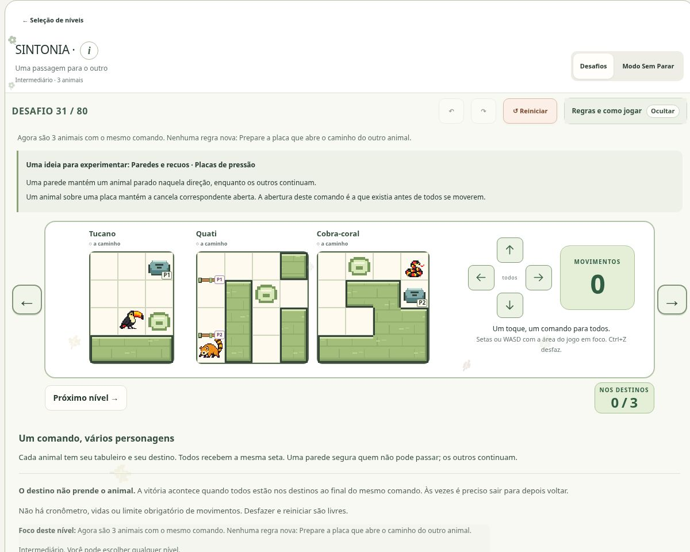](docs/imagens/jogos/sintonia.jpg)

*Na imagem: fase 31, “Uma passagem para o outro”, antes do primeiro movimento. Placas de pressão e cancelas conectam as decisões entre os tabuleiros.*

**O que observar:** um animal pode ficar parado contra uma parede enquanto os demais avançam. Use essa diferença para ajustar as posições; a vitória exige todos nos destinos ao final do mesmo comando.

[Regras, exemplos e código de SINTONIA](docs/jogos/sintonia/README.md)

#### REPASSE

**A ordem das retiradas muda o resultado.** Ao retirar uma peça, cada seta envia seu valor atual inteiro ao primeiro receptor naquela direção ou à caixa da borda. Quem recebe soma esse valor e permanece no tabuleiro. Retire tudo e alcance exatamente todas as metas.

[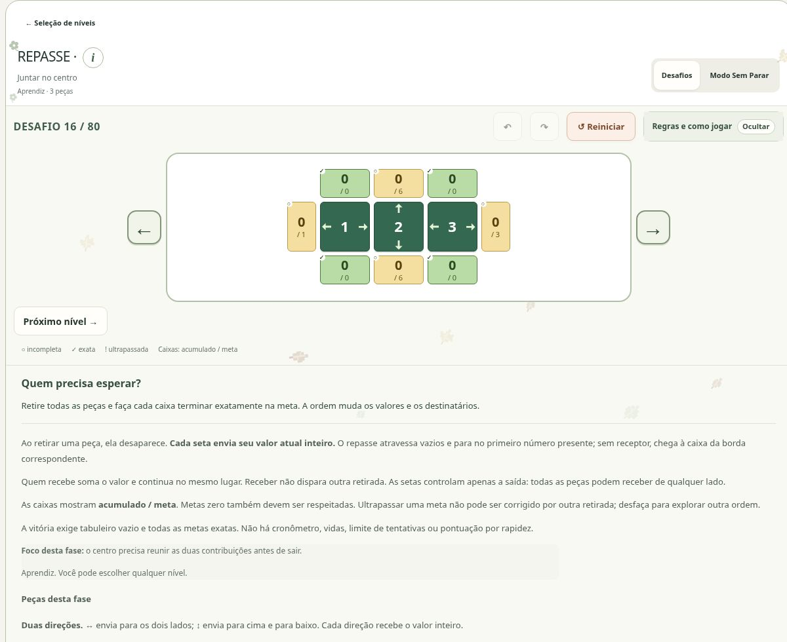](docs/imagens/jogos/repasse.jpg)

*Na imagem: fase 16, “Juntar no centro”. As peças laterais podem contribuir para o valor da peça central antes de ela sair.*

**O que observar:** retirar a peça central cedo demais muda quem receberá os próximos repasses. Planeje a sequência para completar as metas sem ultrapassá-las, incluindo as metas zero.

[Regras, exemplos e código de REPASSE](docs/jogos/repasse/README.md)

#### ÓRBITA

**Gire anéis e coordene transferências.** As peças se deslocam pelos anéis, enquanto os alvos permanecem fixos. Use as casas compartilhadas entre anéis para transferir peças e preencher todos os alvos simultaneamente.

[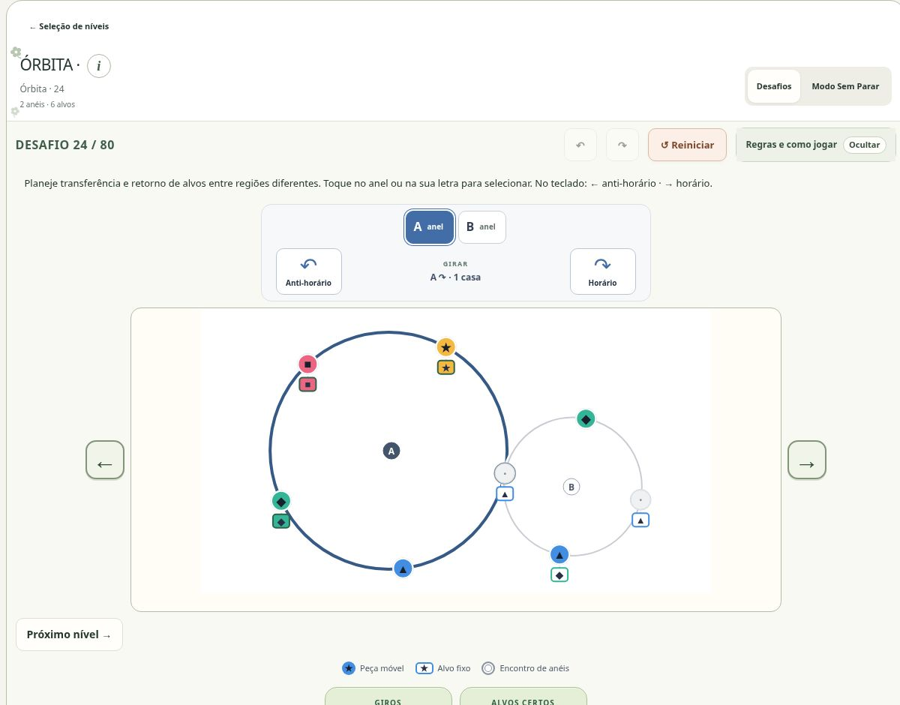](docs/imagens/jogos/orbita.jpg)

*Na imagem: fase 24, com dois anéis e seis alvos. Os símbolos distinguem as peças móveis dos marcadores de destino.*

**O que observar:** um giro pode aproximar uma peça do destino e afastar outra que já estava correta. Planeje transferência e retorno para ajustar o conjunto.

[Regras, exemplos e código de ÓRBITA](docs/jogos/orbita/README.md)

#### DIVISA

**Reparta o terreno e conte as fronteiras.** Cada letra forma um território conectado; os lados compartilhados entre cada par devem alcançar as cotas.

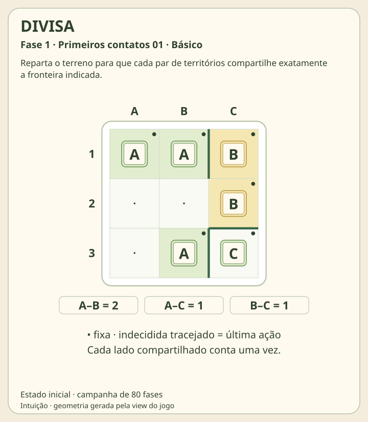

*Diagrama programático da fase 1, antes de jogar. A view e os dados são os mesmos usados no site.*

[Regras, implementação e certificação de DIVISA](dist/logica/games/divisa/README.md)

#### PULSO

**Encontre três batidas igualmente espaçadas por linha.** Cruze os intervalos das linhas com as cotas de cada coluna e preserve as pistas fixas.

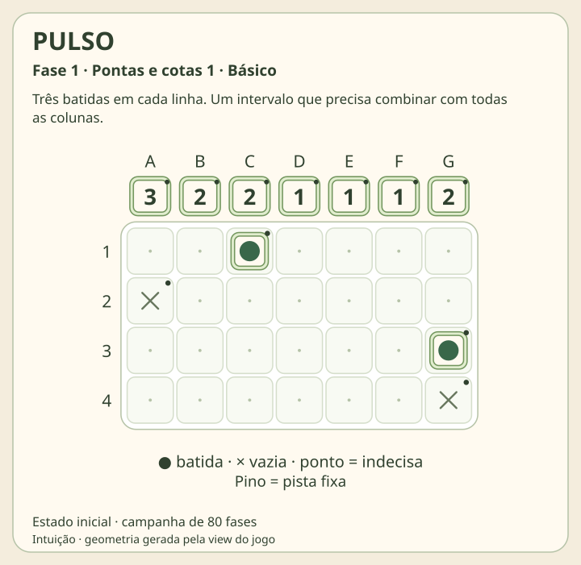

*Diagrama programático da fase 1, antes de jogar. A view e os dados são os mesmos usados no site.*

[Regras, implementação e certificação de PULSO](dist/logica/games/pulso/README.md)

#### FOZ

**Oriente todos os caminhos até a foz.** Escolha setas pelos canais, respeite as distâncias indicadas e evite ciclos. Os caminhos podem se unir.

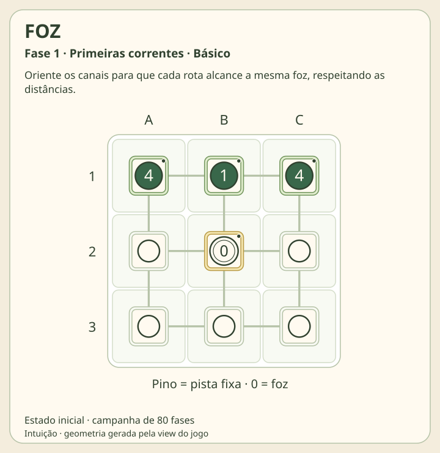

*Diagrama programático da fase 1, antes de jogar. A view e os dados são os mesmos usados no site.*

[Regras, implementação e certificação de FOZ](dist/logica/games/foz/README.md)

#### REFÚGIO

**Dê uma região a cada marco.** Cada barreira toca exatamente duas regiões livres distintas, e cada região livre contém um marco.

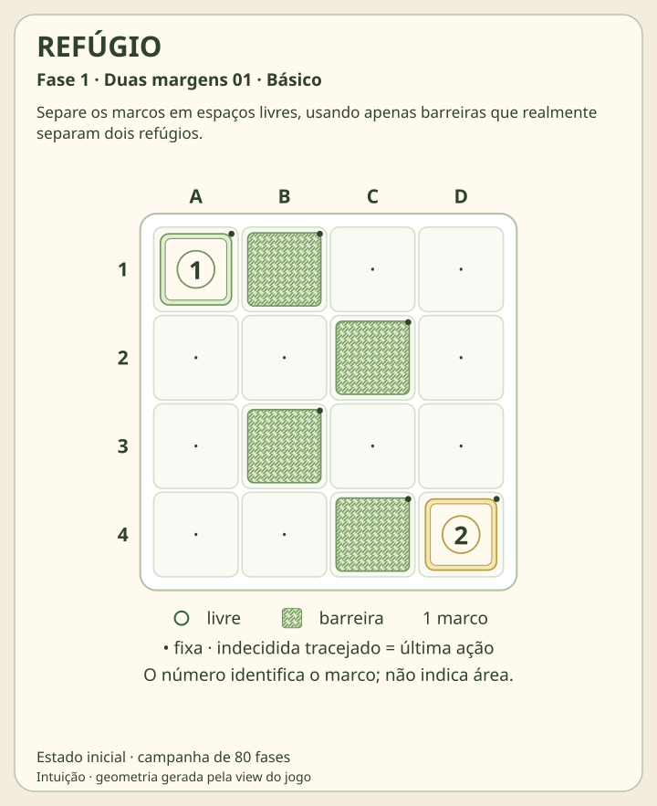

*Diagrama programático da fase 1, antes de jogar. A view e os dados são os mesmos usados no site.*

[Regras, implementação e certificação de REFÚGIO](dist/logica/games/refugio/README.md)

#### MIRANTE

**Cruze as primeiras vistas dos observadores.** Use o estoque de formas, satisfaça cada olhar e garanta que toda peça seja vista por pelo menos dois observadores.

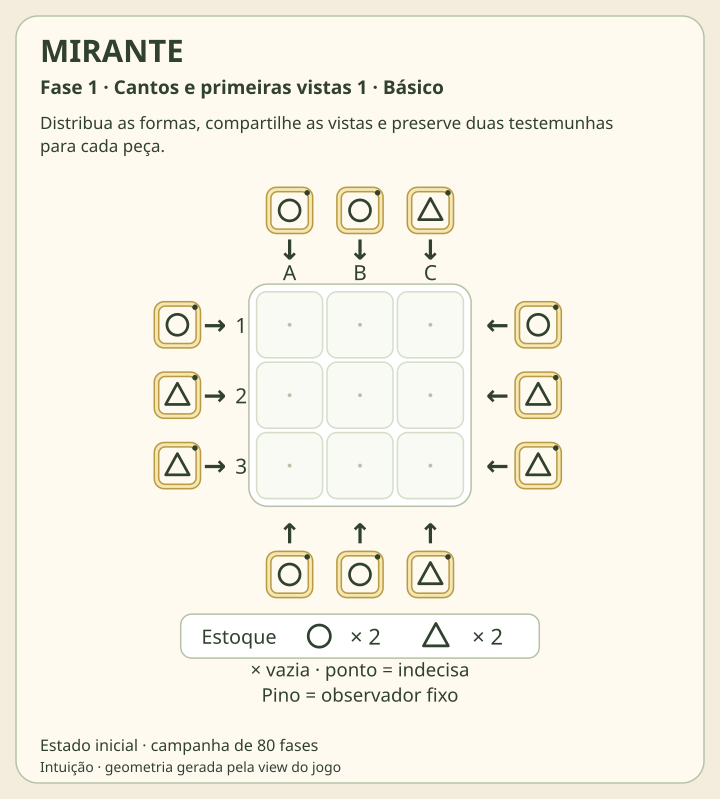

*Diagrama programático da fase 1, antes de jogar. A view e os dados são os mesmos usados no site.*

[Regras, implementação e certificação de MIRANTE](dist/logica/games/mirante/README.md)

#### RENOVO

**Ligue semente, botão e folha.** As duas ligações do botão são perpendiculares, usam todas as peças e não podem atravessar peças nem cruzar outros segmentos.

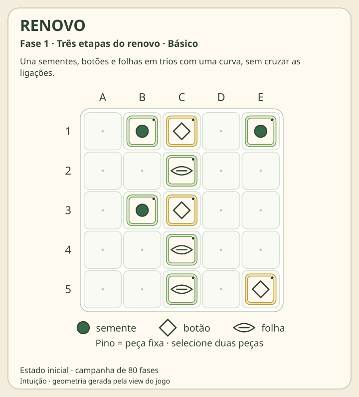

*Diagrama programático da fase 1, antes de jogar. A view e os dados são os mesmos usados no site.*

[Regras, implementação e certificação de RENOVO](dist/logica/games/renovo/README.md)

### Versus: antecipar a próxima jogada

#### DESVIO

**Escolha agora onde o adversário poderá jogar depois.** Uma casa com ↔ envia o próximo jogador à mesma linha; uma casa com ↕ o envia à mesma coluna. A casa escolhida é consumida. Quem ficar sem uma escolha legal na sua vez perde.

[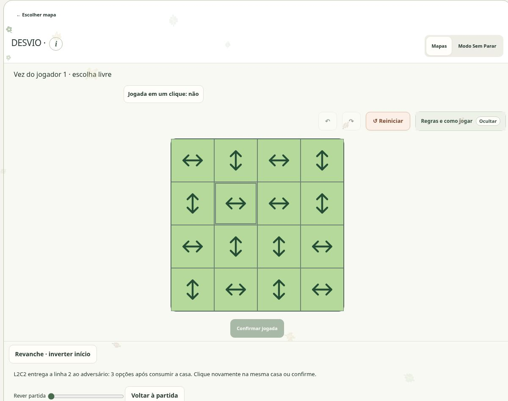](docs/imagens/jogos/desvio.jpg)

*Na imagem: mapa 1, “Referência do manual”. Confirmar a prévia em L2C2 enviaria o adversário à linha 2, com três opções restantes.*

**IA do bot — busca exata e análise de respostas.** No modo Exato, o algoritmo percorre as continuações legais até o fim da partida e reutiliza posições já calculadas por memoização. Ele identifica jogadas que entregam uma posição perdedora ao adversário e prefere uma vitória mais curta; se a derrota for inevitável contra jogo perfeito, prefere adiá-la.

| Dificuldade exibida | Estratégia implementada |
| --- | --- |
| **Explorador** | Escolhe entre jogadas legais com uma sequência pseudoaleatória reproduzível a partir da posição e da semente. |
| **Intermediário** | Prioriza vitória imediata e, quando possível, evita permitir que o adversário vença na resposta seguinte. |
| **Exato · jogo perfeito** | Resolve a posição por busca exata nos mapas suportados, de até 16 casas, considerando respostas perfeitas dos dois lados. |

O **treino com análise** também mostra respostas e permite investigar decisões da partida. Uma jogada com muitas opções disponíveis para o adversário pode ser melhor que outra com poucas: o que importa é a sequência que essas opções permitem.

[Manual de DESVIO](docs/jogos/desvio/README.md) · [Motor, análise e escolha do bot](dist/desvio.mjs)

#### BROTO

**Você planta, mas quem floresce?** Cada semente estimula o primeiro broto encontrado em cada direção horizontal e vertical. Um broto que recebe os dois eixos floresce e pontua para seu dono, mesmo que o adversário tenha completado o estímulo.

[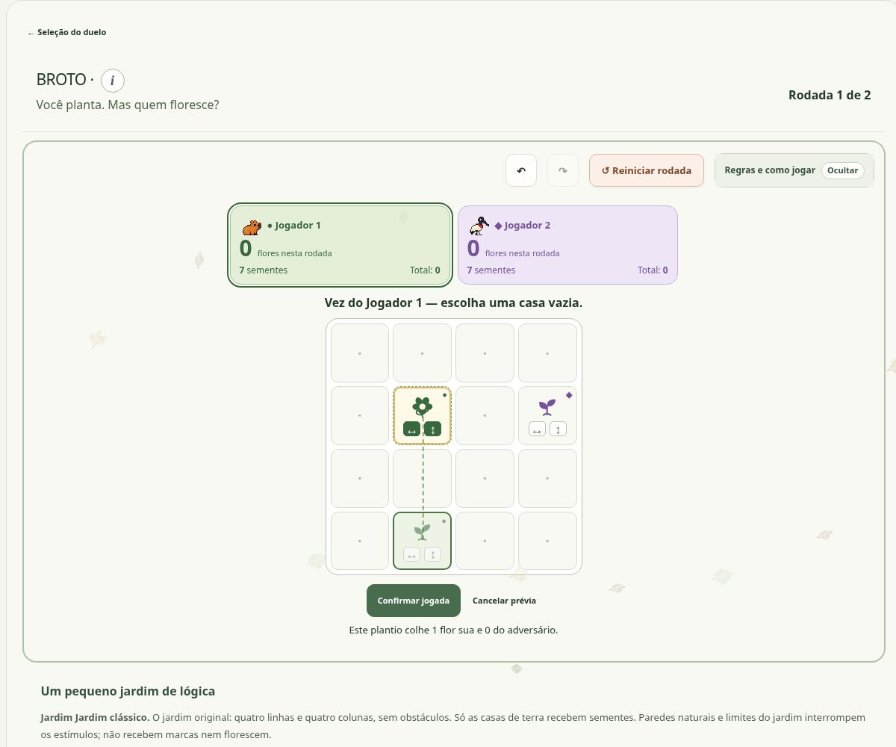](docs/imagens/jogos/broto.jpg)

*Na imagem: jardim clássico, rodada 1. A prévia em L4C2 completa o estímulo vertical do broto em L2C2 e indica uma flor para o Jogador 1.*

**Estratégia entre duas pessoas:** observe quais brotos já receberam um eixo antes de plantar. Uma ação pode beneficiar o adversário; a passagem aberta por uma flor colhida só afeta jogadas futuras. O duelo tem duas rodadas, alterna o iniciador e soma as flores para determinar o vencedor; pode haver empate.

**Modos disponíveis:** Amistoso e Competitivo, para duas pessoas no mesmo aparelho. **BROTO ainda não tem bot nesta versão.**

[Regras, exemplos e código de BROTO](docs/jogos/broto/README.md)

#### CERCO

**Cada passo fecha um caminho.** Mova uma das suas três peças para uma casa livre vizinha, na horizontal ou vertical. A casa abandonada vira uma barreira permanente para as duas equipes. Vence quem deixa o adversário sem nenhum movimento no início da vez dele.

[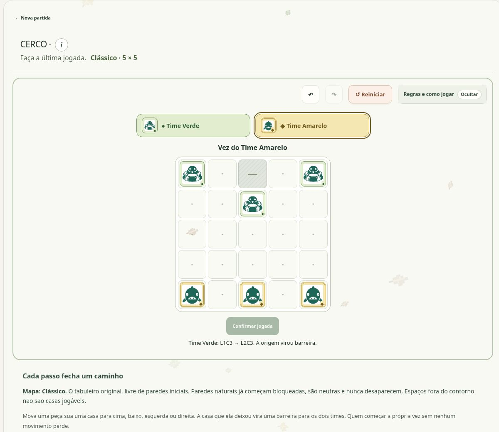](docs/imagens/jogos/cerco.jpg)

*Na imagem: mapa Clássico 5 × 5, após Verde jogar de L1C3 para L2C3. A origem virou barreira e agora é a vez do Time Amarelo.*

**IA do bot — antecipação e avaliação estratégica.** Nos níveis Intermediário e Avançado, o bot procura vitórias imediatas, verifica respostas que poderiam causar derrota imediata e compara as continuações por minimax com poda alfa-beta. A busca aprofunda progressivamente dentro de limites de profundidade e orçamento.

A avaliação considera **mobilidade** (quantas jogadas cada equipe tem), **saídas** (possibilidades de continuar andando) e **região alcançável** (espaço livre acessível). Assim, a IA tenta preservar suas opções enquanto reduz as do adversário.

| Dificuldade exibida | Estratégia implementada |
| --- | --- |
| **Explorador** | Seleciona uma jogada legal a partir de uma semente; não executa a busca estratégica dos demais níveis. |
| **Intermediário** | Combina verificação tática, avaliação de posições e busca com profundidade padrão de até 2 jogadas. |
| **Avançado · busca limitada** | Amplia o orçamento e usa profundidade padrão de até 5 jogadas; o limite de busca pode impedir alcançar toda essa profundidade. |

A busca usa um **Web Worker** quando disponível, com alternativa cooperativa no navegador para permitir que a interface continue respondendo. O bot joga com as mesmas regras das pessoas. A busca limitada não prova que uma posição seja vencedora nem garante jogo perfeito.

[Manual de CERCO](docs/jogos/cerco/README.md) · [Algoritmo do bot](dist/cerco/bot.mjs) · [Worker e cancelamento da busca](dist/cerco/service.mjs)

TRAMA e VÉRTICE aparecem em registros históricos, mas não fazem parte do catálogo ativo.

#### ENLACE

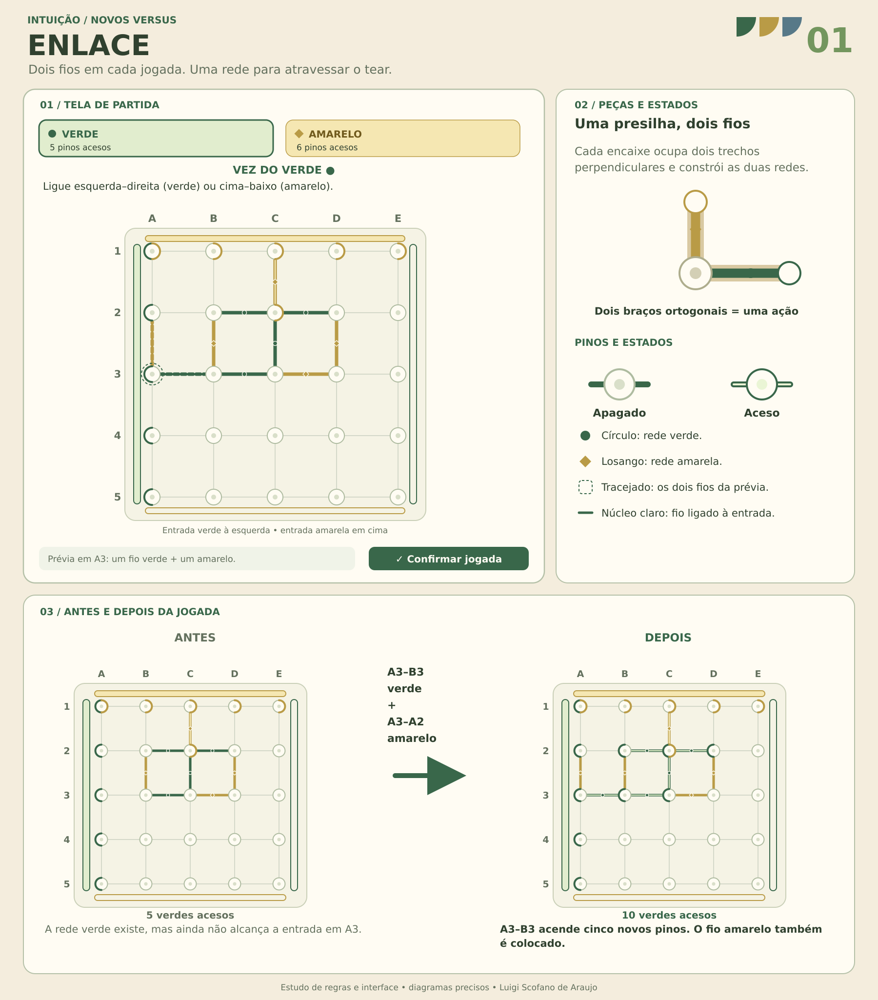

Construa uma rede em um tear 5×5. Cada presilha coloca dois fios perpendiculares: um verde e um âmbar. O Verde atravessa da esquerda para a direita; o Âmbar, de cima para baixo. Cada lance também entrega um fio ao rival, e as duas redes podem vencer simultaneamente.

A interface orienta a escolha do pino e dos dois braços, destaca a conectividade prevista e permite trocar as cores antes de confirmar.

[Regras e implementação de ENLACE](dist/versus/games/enlace/README.md)

#### VAZANTE

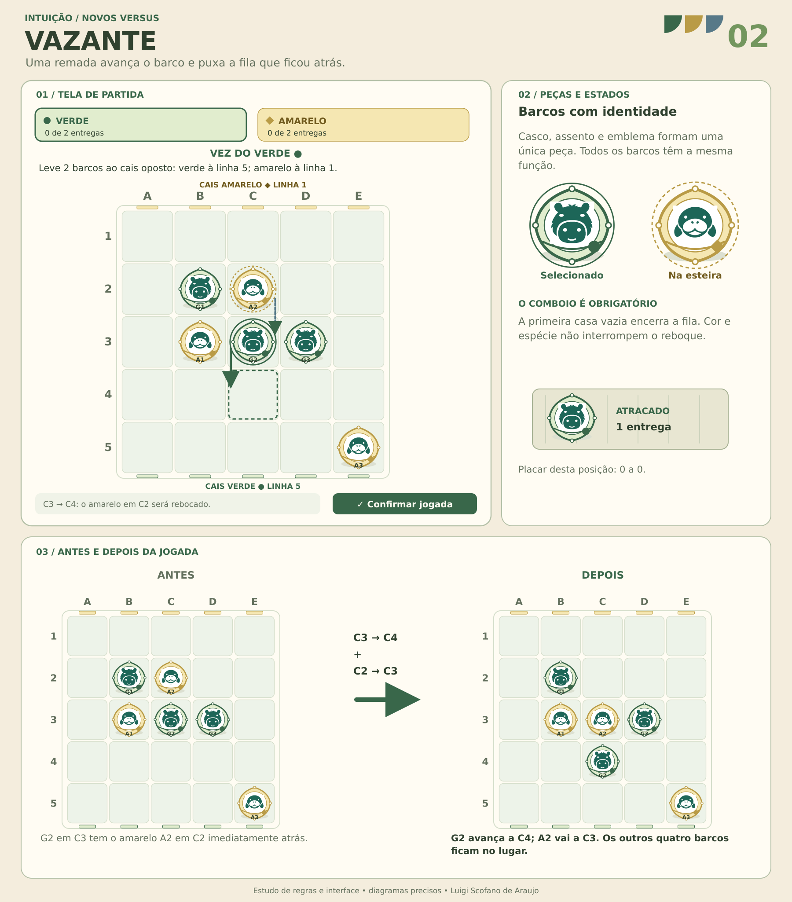

Conduza três barcos por um estuário 5×5. Uma remada ortogonal move o barco escolhido e reboca a fila contínua atrás dele, incluindo barcos adversários. Vence quem entregar dois barcos na margem oposta.

Os mascotes oficiais podem ser escolhidos na preparação; são elementos visuais. A prévia mostra o comboio inteiro e as entregas provocadas pelo movimento.

[Regras e implementação de VAZANTE](dist/versus/games/vazante/README.md)

#### MOSAICO

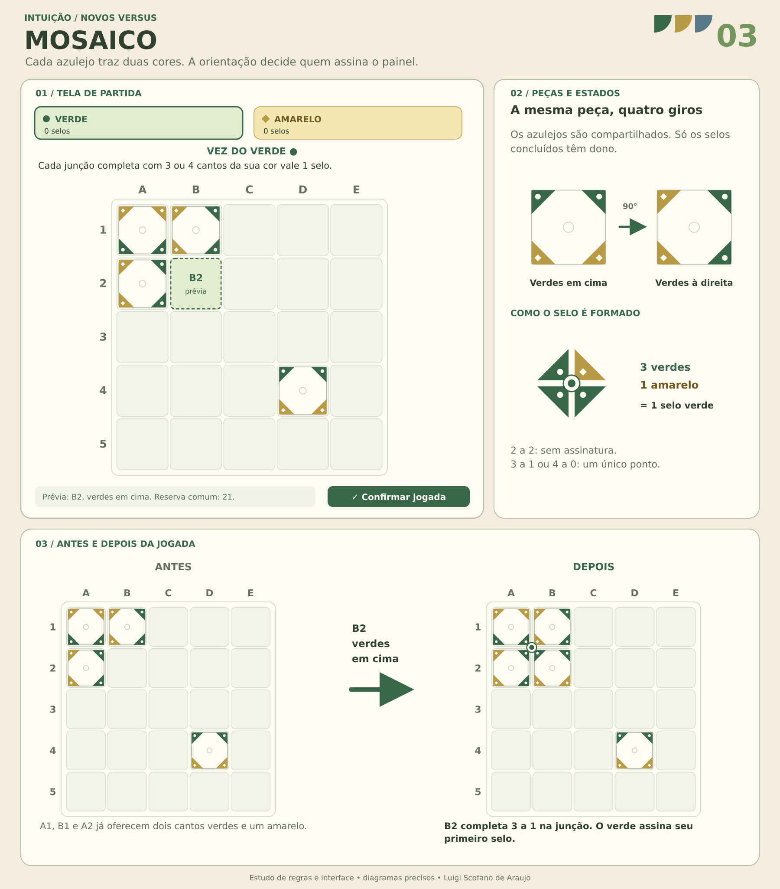

Preencha um painel 5×5 com azulejos de dois cantos verdes e dois âmbar. Ao completar uma junção de quatro azulejos, três ou quatro cantos da mesma cor concedem um selo à equipe; uma divisão 2–2 fica neutra. O placar final só é decidido após os 25 azulejos.

Escolha a orientação e a casa, compare as junções concluídas na prévia e confirme a colocação.

[Regras e implementação de MOSAICO](dist/versus/games/mosaico/README.md)

#### QUINHÃO

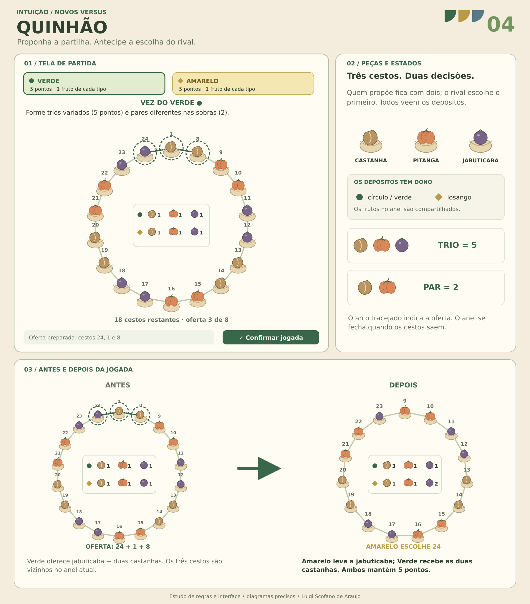

Ofereça três cestos consecutivos de um anel de 24 frutas. O rival escolhe um; quem fez a oferta recebe os outros dois. Depois, o anel fecha a lacuna e o papel de ofertante troca. Trios de frutas diferentes valem cinco pontos e pares de tipos diferentes restantes valem dois.

A interface separa oferta e escolha, identifica quem decide em cada etapa e mostra a decomposição da pontuação.

[Regras e implementação de QUINHÃO](dist/versus/games/quinhao/README.md)

#### ESTALO

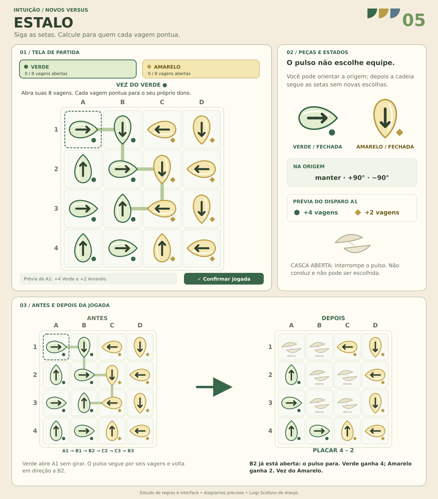

Escolha uma vagem fechada da sua cor, mantenha a seta ou gire-a um quarto de volta e dispare uma cadeia. Cada vagem aberta segue sua seta para a próxima casa, até encontrar borda ou vagem já aberta.

A cadeia inteira aparece na prévia. Só depois de resolvê-la são verificadas as oito vagens de cada cor; uma reação pode favorecer o adversário ou terminar empatada.

[Regras e implementação de ESTALO](dist/versus/games/estalo/README.md)

#### DOBRA

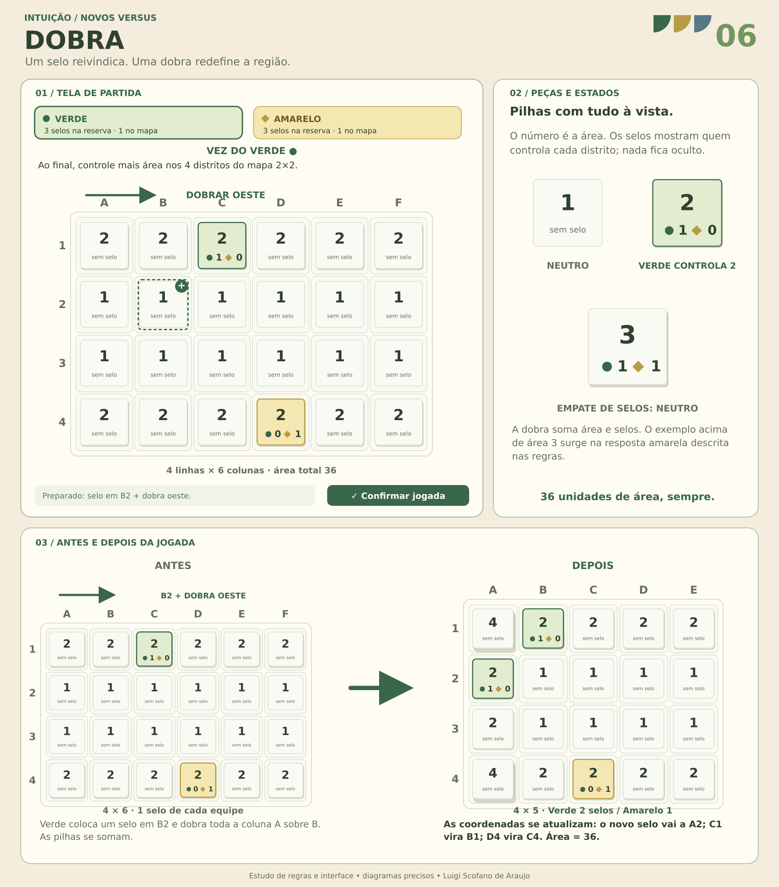

Marque um painel de um atlas 6×6 e dobre uma borda inteira sobre a faixa adjacente. Áreas e selos se somam nas pilhas. Após oito dobras, o mapa chega a 2×2: a maioria estrita de selos controla toda a área da pilha, enquanto empates permanecem neutros.

O atlas preserva exatamente 36 unidades de área. A prévia mostra a nova geometria e os totais de ambas as equipes antes da confirmação.

[Regras e implementação de DOBRA](dist/versus/games/dobra/README.md)

#### ACORDE

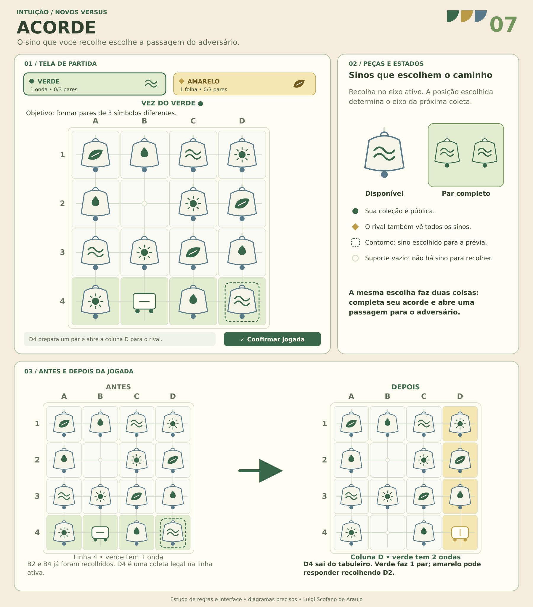

Reúna três tipos diferentes de pares entre folha, gota, onda e sol. O Verde escolhe um sino na linha ativa; o Âmbar escolhe na coluna. A casa recolhida define o eixo da resposta adversária.

O caminho pode atravessar casas vazias ou outros sinos sem recolhê-los. Coleções e eixos ficam visíveis, e os passes só aparecem quando obrigatórios.

[Regras e implementação de ACORDE](dist/versus/games/acorde/README.md)

#### LASTRO

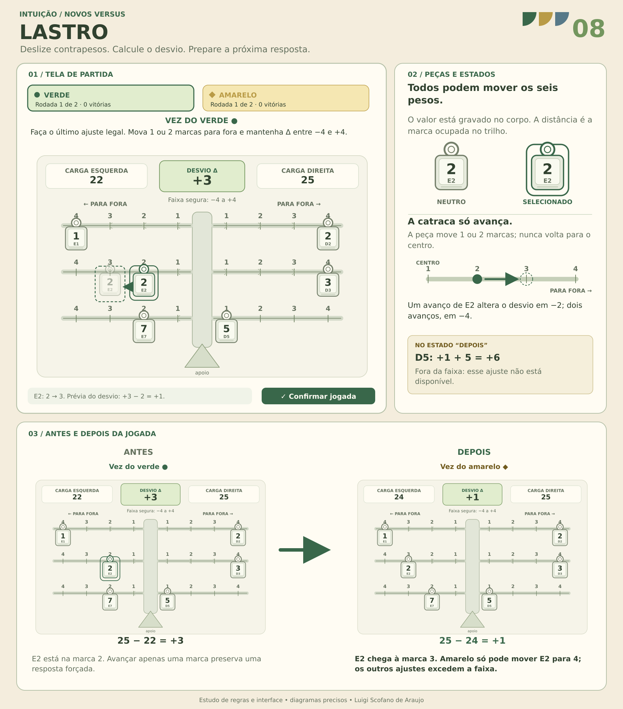

Avance um dos seis contrapesos compartilhados uma ou duas marcas para fora, mantendo o desvio da balança entre −4 e +4. Quem deixa o rival sem ajuste legal vence a rodada. São duas rodadas com início alternado; o duelo pode terminar 2–0 ou 1–1.

A interface apresenta cargas, desvio e cálculo expandível. A configuração aprovada tem vantagem forçada para quem começa sob jogo perfeito; a alternância de duas rodadas preserva a regra, sem afirmar equilíbrio estratégico.

[Regras e implementação de LASTRO](dist/versus/games/lastro/README.md)

As imagens dos oito duelos acima são pranchas conceituais aprovadas para explicar as regras; a apresentação interativa é a versão executada em `dist/versus/`.

### Como as fases estão organizadas

Cada uma das quatorze campanhas solo tem **80 fases**, distribuídas da mesma forma:

| Faixa | Fases | Quantidade |
| --- | --- | ---: |
| Básico | 1–15 | 15 |
| Aprendiz | 16–30 | 15 |
| Intermediário | 31–45 | 15 |
| Avançado | 46–60 | 15 |
| Mestre | 61–75 | 15 |
| Modo Sábio | 76–80 | 5 |
| **Total por campanha** | **1–80** | **80** |

São **14 × 80 = 1.120 fases solo**. Modos livres, desafios gerados e partidas Versus ficam fora dessa contagem. A proposta é oferecer prática e descoberta; a curva de dificuldade ainda não tem calibração completa com jogadores.

## Executar no computador

A aplicação roda no navegador. O Python apenas entrega os arquivos locais por HTTP; **não é necessário instalar pacotes npm, compilar o projeto ou configurar um banco de dados**.

### 1. Prepare o ambiente

| Ferramenta | Para que serve |
| --- | --- |
| **Navegador atualizado** | Abre os jogos e executa HTML, CSS e JavaScript. |
| **Python 3** | Inicia o servidor local de arquivos. |
| **Git** | Baixa o repositório e preserva seu histórico. Pode ser substituído pelo ZIP para jogar. |
| **Node.js 24** | Necessário apenas para as verificações e os testes descritos abaixo. |

### 2. Baixe o projeto

Abra um terminal e baixe o repositório público:

```bash
git clone https://github.com/luigiscofano/intuicao.git
cd intuicao
```

**Sem Git:** no GitHub, use **Code → Download ZIP**, extraia o arquivo e abra o terminal na pasta extraída. Para jogar, a pasta correta é aquela que contém este `README.md` e a subpasta `dist`. Alguns testes históricos exigem um clone com o histórico Git.

### 3. Inicie o servidor

**macOS ou Linux**, na pasta do projeto:

```bash
python3 -m http.server 8766 --bind 127.0.0.1 --directory dist
```

**Windows**, na pasta do projeto:

```powershell
py -m http.server 8766 --bind 127.0.0.1 --directory dist
```

### 4. Abra no navegador

Acesse **[http://127.0.0.1:8766/](http://127.0.0.1:8766/)** e escolha um jogo.

Mantenha o terminal aberto enquanto joga. Para encerrar o servidor, pressione **Ctrl+C**. O endereço `127.0.0.1` restringe o acesso ao próprio computador.

> Abra o endereço HTTP acima. Clicar diretamente em `dist/index.html` usa `file://`, que não oferece a origem necessária aos módulos e workers.

### Se algo não funcionar

| Situação | O que conferir |
| --- | --- |
| O terminal não encontra `python3` ou `py` | Confirme que o Python 3 está instalado e disponível no terminal. Reabra o terminal após instalar. |
| Aparece uma lista de arquivos em vez dos jogos | Execute o comando na raiz do projeto e mantenha `--directory dist`. |
| A porta 8766 está ocupada | Troque `8766` por `8767` no comando e no endereço do navegador. |
| Aparecem erros ao abrir o HTML | Acesse pelo servidor HTTP, sem usar `file://`. |
| Imagens ou módulos não carregam | Confira se o download está completo e se os nomes e as pastas foram preservados. |
| O progresso parece ter desaparecido | Use o mesmo endereço, porta e perfil de navegador da sessão anterior. |

Mais opções e diagnóstico: **[guia de instalação](docs/setup/README.md)**.

## Como o projeto está organizado

| Onde procurar | O que você encontra |
| --- | --- |
| **[dist/](dist/README.md)** | A aplicação: HTML, estilos, módulos JavaScript, regras e catálogos. |
| **[dist/index.html](dist/index.html)** | A estrutura inicial da página e as entradas dos módulos. |
| **[dist/app.mjs](dist/app.mjs)** | Parte da integração dos jogos e da navegação. |
| **[dist/platform-assets/](dist/platform-assets/README.md)** | Logo, fonte, folhas, sprites e outros recursos visuais. |
| **[docs/jogos/](docs/jogos/README.md)** | Um manual por jogo, com regras, exemplos e caminhos para o código. |
| **[docs/arquitetura/](docs/arquitetura/README.md)** | Como navegação, regras, conteúdo, persistência e apresentação se relacionam. |
| **[tests/](tests/README.md)** | Testes de regras, integração e preservação, além de evidências históricas. |
| **[scripts/](scripts/README.md)** | Ferramentas para verificar a documentação. |
| **[.github/](.github/guias/README.md)** | Modelos de issues e PRs e verificações do GitHub Actions. |

**Atenção ao nome `dist`: aqui ela contém o código-fonte editável do projeto.** Não a apague como se fosse uma pasta temporária de compilação.

Para acompanhar um jogo do começo ao fim, leia seu manual, localize os arquivos indicados e compare as regras com os testes correspondentes. SINTONIA, REPASSE, ÓRBITA, BROTO e CERCO têm subpastas próprias. Os seis novos puzzles ficam em [`dist/logica/games/`](dist/logica/README.md), com motores puros e uma interface compartilhada. Os oito novos duelos ficam em [`dist/versus/games/`](dist/versus/README.md), separados de seus serviços comuns. Os jogos anteriores também usam módulos no nível principal de `dist`.

A primeira parte da reforma de formatação e comentários em português foi integrada à `main` pelo [PR #30](https://github.com/luigiscofano/intuicao/pull/30). O [registro da revisão](docs/manutencao/legibilidade.md) documenta a etapa de rascunho e os 299 arquivos ainda pendentes da reforma. O merge não publicou alterações no site.

### Tecnologias e decisões de implementação

| Tecnologia ou recurso | Papel no Intuição |
| --- | --- |
| **HTML e CSS** | Estrutura das telas, controles, molduras e adaptação do layout. |
| **JavaScript em módulos `.mjs`** | Regras, estados, interação, navegação e integração dos jogos. |
| **SVG e imagens raster** | Tabuleiros, formas, símbolos, cenários e personagens. |
| **IA para jogos** | Busca exata com memoização em DESVIO; minimax, poda alfa-beta e heurísticas em CERCO. |
| **Web Workers** | Processamento separado da interface, incluindo a busca do bot de CERCO, com cancelamento e alternativa local. |
| **Armazenamento local** | Progresso no navegador, nos fluxos que oferecem persistência. |
| **Node.js e GitHub Actions** | Execução de testes e verificação dos documentos. |

O projeto permite estudar geometria computacional, grafos, busca de estados, máquinas de estado, restrições e compatibilidade de dados salvos. Uma decisão central é distinguir **a regra do jogo**, **o estado da tentativa** e **a forma de exibir o resultado**. O [guia de arquitetura](docs/arquitetura/README.md) mostra onde essas responsabilidades aparecem.

## O que funciona e o que ainda está pendente

| Área | Estado desta cópia |
| --- | --- |
| Catálogo e navegação | 25 jogos ativos, seleção de desafios e regras na interface. |
| Campanhas solo | Quatorze campanhas de 80 fases; recursos adicionais variam por jogo. |
| Duelos e IA | Onze jogos Versus: bots em DESVIO, CERCO e nos oito novos duelos; BROTO permanece local. |
| Progresso e exploração | Salvamento, Desfazer e Refazer nos fluxos que oferecem essas funções. |
| Documentação | README inicial, manuais individuais, instalação, arquitetura e manutenção. |
| Testes de motores | **95 testes aprovados** na revisão de 01/11/2026; execução automática em PRs e pushes para `main`. |
| Recorte da edição de 10/11/2026 | **224 testes aprovados, zero falhas**, cobrindo os motores anteriores, seis puzzles e integração; [evidências e limites](docs/logica/VERIFICACAO.md). |
| Qualidade ampla | Há falhas históricas e pendências; esse recorte não aprova toda a aplicação. |
| Revisão técnica posterior | A revisão `f0e7fcf` ainda precisa ser recuperada e incorporada, incluindo a correção de migração de SINTONIA ali descrita. |

O recorte de 95 testes foi reexecutado nesta preparação com Node.js 24.22.1, sem falhas. Os checks de segredos e inventário visual complementam a CI; não certificam toda a aplicação nem autorizam a redistribuição das artes. Consulte [qualidade e limitações](docs/qualidade/README.md) e as [execuções do GitHub Actions](https://github.com/luigiscofano/intuicao/actions).

<details>
<summary><strong>Histórico preservado e revisão ainda não incorporada</strong></summary>

Esta edição organiza a base `2354a3c`, preservando seus **183 commits anteriores**. As alterações posteriores foram organizadas em branches temáticas e PRs integrados em `main`; o [registro de integração](docs/github/README.md) detalha o processo.

A revisão `f0e7fcf` é conhecida por documentação externa, mas seu código não foi recuperado nesta cópia. Por isso, seus resultados de teste não são apresentados como validação do código disponível. A recuperação deve preservar o histórico e permitir a revisão das diferenças.

</details>

### Verificar a documentação e os motores

Com Node.js 24, execute os comandos na raiz do repositório.

**Links locais da documentação:**

```bash
node scripts/check-docs.mjs
```

**Recorte dos motores de BROTO, CERCO, SINTONIA, REPASSE e ÓRBITA:**

```bash
node --test tests/broto-engine.test.mjs tests/cerco-engine.test.mjs tests/sintonia-engine.test.mjs tests/repasse-engine.test.mjs tests/orbita-engine.test.mjs
```

**Seis novos motores, histórico e integração com a plataforma:**

```bash
node --test tests/logica/*.test.mjs tests/approved-game-shell.test.mjs tests/contextual-guidance.test.mjs tests/library-navigation.test.mjs tests/achievements.test.mjs tests/progress-backup.test.mjs
```

Para os oito duelos e seus serviços compartilhados:

```bash
node --test tests/versus/*.test.mjs
```

Antes de ampliar a execução, leia o [guia de testes](tests/README.md). A pasta também contém scripts de geração e verificações de revisões antigas; nem todo arquivo `.mjs` é um teste sem efeitos colaterais.

## Progresso, hospedagem e contribuição

**Onde fica meu progresso?** No navegador e no endereço usados para jogar, conforme a persistência de cada jogo. `localhost`, `127.0.0.1`, portas diferentes e o site hospedado são origens diferentes e podem mostrar saves diferentes. Limpar os dados do navegador pode apagar o progresso. Não há sincronização automática entre aparelhos.

**Uma alteração no GitHub atualiza o site?** Não. O [site hospedado](https://intuicao-luigi-minigames.luigiscofano.chatgpt.site) e a cópia deste repositório têm atualização separada. Os workflows presentes não fazem deploy.

**Como contribuir?** Leia [CONTRIBUTING.md](CONTRIBUTING.md), use uma branch para uma mudança bem delimitada e abra um PR descrevendo o problema, a solução e a validação realizada. Para mudanças em fases, IDs ou saves, consulte também o [guia de manutenção](docs/manutencao/README.md).

## Publicação e segurança

O repositório está **público desde 01/11/2026**, com histórico preservado e proteção da branch `main` por PRs e verificações obrigatórias. O projeto continua em desenvolvimento. A [revisão de segurança e publicação](docs/seguranca/README.md) registra o escopo examinado e o que falta resolver. O [inventário de recursos visuais](docs/recursos/README.md) identifica 133 arquivos e separa origem técnica de autorização de redistribuição. A [declaração de autoria](docs/recursos/declaracao-autoria.md) registra a confirmação do titular para os elementos autorais e sua autorização para manter o e-mail nos commits antigos. O histórico foi preservado. Os créditos de fontes externas e a separação entre MIT do código e direitos das artes continuam válidos.

## Autoria e licença

Copyright (c) 2026 **Luigi Scofano de Araujo**.

O código e a documentação autorais do Intuição são disponibilizados sob a **[licença MIT](LICENSE)**. Ela permite uso, cópia, modificação e distribuição, inclusive comercial, desde que o aviso de direitos autorais e o texto da licença sejam preservados nas cópias ou partes substanciais. O software é fornecido sem garantias, conforme os termos da licença.

Imagens, sprites, fontes, logos e demais recursos visuais têm seus direitos tratados separadamente e não estão incluídos automaticamente nessa licença. Materiais de terceiros conservam suas licenças e créditos próprios. Consulte o [guia dos recursos](dist/platform-assets/README.md) e o [inventário de direitos](docs/recursos/README.md) antes de redistribuí-los.

A abertura do repositório não publica uma nova versão do site nem altera as licenças dos recursos visuais.


