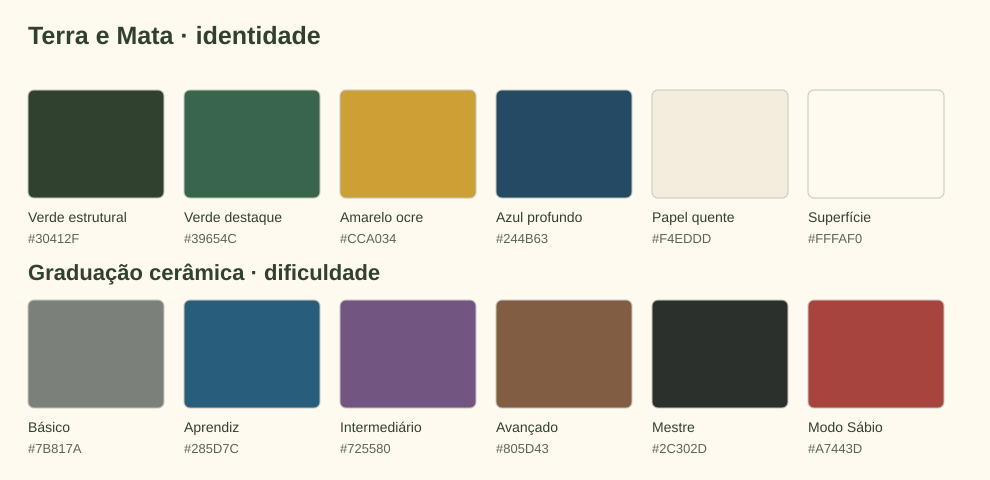
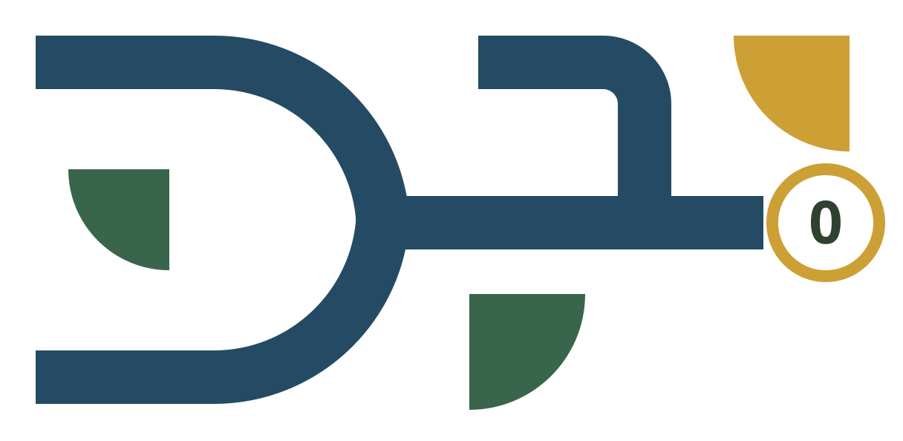
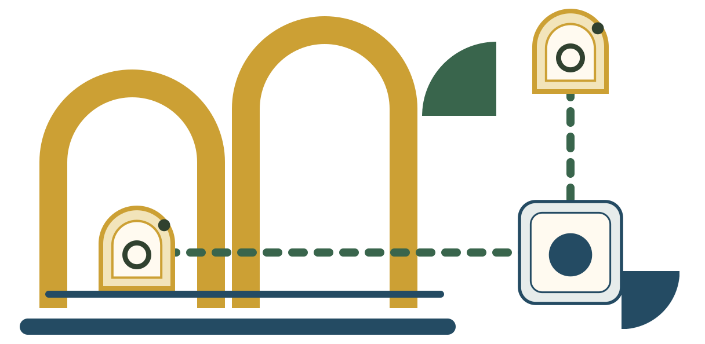
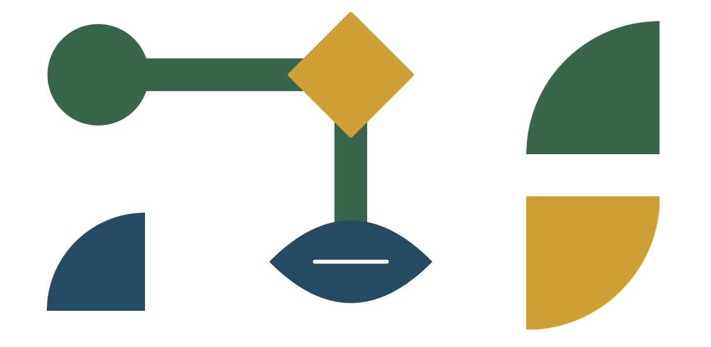
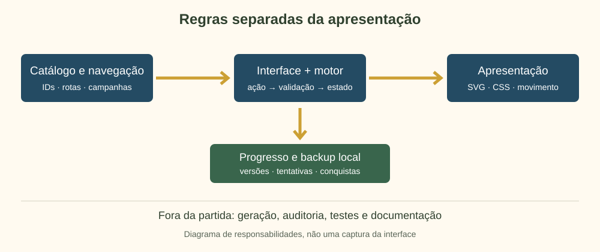

<p align="center"></p>

# Intuição

**Observar, experimentar e descobrir. Jogos de intuição, raciocínio lógico e estratégia com identidade brasileira.**

Projeto de **Luigi Scofano de Araujo**. O Intuição transforma relações abstratas em ações visíveis: orientar luz, equilibrar formas, conectar caminhos, organizar espaços e antecipar jogadas. A experiência combina regras próprias, explicações ilustradas e uma linguagem visual de azulejos, fauna e vegetação.

[Jogar no site público](https://intuicao-luigi-minigames.luigiscofano.chatgpt.site) · [Código](https://github.com/luigiscofano/intuicao) · [Documentação](docs/README.md) · [Instalação](docs/setup/README.md) · [Contribuir](CONTRIBUTING.md)

> **Catálogo conferido em 16/11/2026: 19 jogos ativos, sendo 12 campanhas e 7 Versus.** Documentos datados, PDFs e módulos retirados são preservados como histórico, não como anúncio de funcionalidades atuais. A referência é [game-catalog.mjs](dist/game-catalog.mjs).

## Navegação

- [Proposta e objetivos](#proposta-e-objetivos)
- [Os 19 jogos](#os-19-jogos)
- [Identidade visual e brasilidade](#identidade-visual-e-brasilidade)
- [Experiência e acessibilidade](#experiência-e-acessibilidade)
- [Arquitetura e tecnologias](#arquitetura-e-tecnologias)
- [Executar e testar](#executar-e-testar)
- [Dados, segurança e publicação](#dados-segurança-e-publicação)
- [Dificuldades de engenharia](#dificuldades-de-engenharia)
- [Mapa da documentação](#mapa-da-documentação)

## Proposta e objetivos

O projeto aproxima aprendizado e jogo sem exigir que o jogador comece por uma explicação abstrata. Uma tentativa revela uma consequência; a próxima pode incorporar uma hipótese melhor. Os objetivos pedagógicos são explorar percepção espacial, relações lógicas, planejamento, reconhecimento de padrões e tomada de decisão. São **intenções de design**, não resultados de aprendizagem comprovados por pesquisa acadêmica.

A coleção procura manter três compromissos:

1. **Clareza:** regras próximas do tabuleiro, seleção de níveis consistente e controles identificáveis.
2. **Identidade coerente:** os jogos têm elementos próprios, mas pertencem ao mesmo universo.
3. **Preservação:** melhorias de apresentação não devem alterar regras, identidade das fases ou progresso salvo.

A curiosidade é o fio condutor. As referências brasileiras aparecem na fauna, nas plantas, nos frutos, nos nomes e nas composições geométricas. Não são uma justificativa para acrescentar enfeites onde o jogador precisa de precisão.

## Os 19 jogos

A numeração é editorial, de 01 a 19. Os IDs técnicos permanecem estáveis para não quebrar links e saves. A presença de uma pasta antiga não significa que aquele jogo continua disponível.

| Nº | Jogo | Família | Documentação |
|---:|---|---|---|
| 01 | Reflexos | Intuição | [Manual](docs/jogos/reflexos/README.md) |
| 02 | Corte certo | Intuição | [Manual](docs/jogos/corte/README.md) |
| 03 | ELO | Intuição | [Manual](docs/jogos/elo/README.md) |
| 04 | PRUMO | Intuição | [Manual](docs/jogos/prumo/README.md) |
| 05 | PACTO | Intuição | [Manual](docs/jogos/pacto/README.md) |
| 06 | SINTONIA | Intuição | [Manual](docs/jogos/sintonia/README.md) |
| 07 | REPASSE | Intuição | [Manual](docs/jogos/repasse/README.md) |
| 08 | PULSO | Raciocínio lógico | [Motor e campanha](dist/logica/games/pulso/README.md) |
| 09 | FOZ | Raciocínio lógico | [Motor e campanha](dist/logica/games/foz/README.md) |
| 10 | REFÚGIO | Raciocínio lógico | [Motor e campanha](dist/logica/games/refugio/README.md) |
| 11 | MIRANTE | Raciocínio lógico | [Motor e campanha](dist/logica/games/mirante/README.md) |
| 12 | RENOVO | Raciocínio lógico | [Motor e campanha](dist/logica/games/renovo/README.md) |
| 13 | DESVIO | Versus | [Manual](docs/jogos/desvio/README.md) |
| 14 | BROTO | Versus | [Manual](docs/jogos/broto/README.md) |
| 15 | CERCO | Versus | [Manual](docs/jogos/cerco/README.md) |
| 16 | MOSAICO | Versus | [Implementação](dist/versus/games/mosaico/README.md) |
| 17 | QUINHÃO | Versus | [Implementação](dist/versus/games/quinhao/README.md) |
| 18 | ESTALO | Versus | [Implementação](dist/versus/games/estalo/README.md) |
| 19 | ACORDE | Versus | [Implementação](dist/versus/games/acorde/README.md) |

**Campanha e duelo não são a mesma experiência.** As campanhas oferecem níveis; os Versus trabalham com mapas, preparação de partida, turnos e vencedor. Não recebem Desafio diário nem Modo sem parar. Os detalhes de cada modo e seus limites estão nos respectivos manuais; modos contínuos não devem ser confundidos automaticamente com geração ilimitada de fases inéditas.

DIVISA, ÓRBITA, LASTRO, VAZANTE, ENLACE e DOBRA estão retirados do catálogo atual. Seus arquivos e registros continuam preservados. Veja a [retirada no código](dist/retired-games.mjs) e o [registro histórico](docs/README-historico-2026-11-16.md).

## Identidade visual e brasilidade

### Marca atual

A marca de azulejos substitui a antiga planta na apresentação do site. O lettering é preservado; a assinatura geométrica usa verde, amarelo e azul profundo. O PNG tem transparência e a proporção original deve ser mantida, sem esticar o desenho.

[Arquivo de produção](dist/platform-assets/intuicao-logo-azulejos.png) · [Registro da marca](docs/identidade/logo-site/README.md) · [Guia visual](docs/identidade/README.md)

### Terra e Mata: cor com função



| Papel | Cor de referência | Intenção |
|---|---|---|
| Verde estrutural | `#30412F` | Texto, estrutura e vínculo com a vegetação |
| Verde de destaque | `#39654C` | Ação e estados positivos |
| Amarelo ocre | `#CCA034` | Ênfase, luz e detalhes dos azulejos |
| Azul profundo | `#244B63` | Contraponto frio, foco e navegação |
| Papel quente | `#F4EDDD` | Base acolhedora que não compete com os tabuleiros |
| Superfície clara | `#FFFAF0` | Leitura e controles |

Os valores são referências presentes no código, não uma declaração de que toda folha CSS usa exclusivamente seis cores. A cascata de [Terra e Mata](dist/terra-mata.css), [coesão](dist/cohesion.css) e estilos específicos define a aparência final. Um ajuste deve ser conferido na tela, não apenas pelo primeiro valor encontrado.

### Azulejos, fauna e AIIJs

Os azulejos combinam peças geométricas e recortes transparentes. Em vez de fundos brancos colados sobre a interface, deixam a superfície aparecer. A geometria se repete na marca e em detalhes para construir continuidade.

<p>  </p>

**AIIJ** significa **Arte de Ilustração Individual do Jogo**. Cada composição introduz o tema sem substituir a leitura das peças. Água e canais em FOZ, folhas em REFÚGIO e crescimento em RENOVO vinculam o desenho ao raciocínio exigido.

| FOZ | MIRANTE | RENOVO |
|---|---|---|
|  |  |  |

São **artes reais versionadas**, não capturas de uma página nem promessas de novos recursos. Os 15 mascotes têm referências e sprites próprios; consulte o [catálogo de fauna](docs/sintonia-sprites/README.md) e a [proveniência dos recursos](docs/recursos/README.md). Preservar silhueta e proporção é mais importante que redesenhar um animal a cada tela.

Os cinco tabuleiros de Raciocínio lógico compartilham a assinatura de azulejos nos cantos superior direito e inferior esquerdo, integrada em 16/11/2026. [Escopo e verificações](docs/qualidade/assinaturas-tabuleiros.md).

### Tipografia

O sistema aprovado combina **Literata** nos títulos e **Source Sans 3** na interface. Ambas são carregadas de arquivos locais WOFF2. A marca permanece imagem, sem reconstrução improvisada do lettering. Números tabulares ajudam placares e contadores a manter estabilidade visual.

Fontes de verdade: [typography.css](dist/typography.css) e [fontes locais](dist/assets/fonts/README.md). A fonte pixel existente é um recurso específico/histórico, não a fonte universal da interface.

### Dificuldade não é cor decorativa

A graduação visual remete à progressão de faixas do jiu-jítsu, adaptada à estética cerâmica: cinza representando a faixa branca, azul, roxo, marrom, preto e vermelho. Os nomes permanecem visíveis para não depender apenas da cor.

| Faixa | Cor |
|---|---|
| Básico | cinza `#7B817A` |
| Aprendiz | azul `#285D7C` |
| Intermediário | roxo `#725580` |
| Avançado | marrom `#805D43` |
| Mestre | preto `#2C302D` |
| Modo Sábio | vermelho `#A7443D` |

A [paleta compartilhada](dist/difficulty-palette.mjs) deriva a graduação do nome, não da posição do grupo. A dificuldade é editorial; certificação de uma solução não equivale a calibração com jogadores.

## Experiência e acessibilidade

- **Tabuleiro como protagonista:** dimensionamento e controles devem privilegiar a partida, sem saltos conforme textos variam.
- **Instruções em duas profundidades:** resumo e explicação expandida, acompanhados de exemplos animados.
- **Controles coerentes:** confirmar, desfazer, refazer e retornar preservam o contrato específico de cada jogo.
- **Resposta independente de cor:** rótulos, símbolos e indicadores ajudam a distinguir intenção e resultado.
- **Movimento:** preferência por movimento reduzido é tratada pelo [módulo compartilhado](dist/motion-preference.mjs).
- **Teclado:** elementos interativos precisam manter nome acessível e foco visível.
- **Conquistas:** progresso e missões integram o backup; veja os [critérios documentados](docs/conquistas/README.md).

A acessibilidade é um processo de verificação, não uma garantia absoluta de conformidade. A cobertura e suas limitações estão em [qualidade](docs/qualidade/README.md) e [testes](tests/README.md).

## Arquitetura e tecnologias



O site é uma **aplicação estática modular**. HTML, CSS, JavaScript ES Modules, SVG, PNG, JSON e fontes locais são servidos diretamente. Não há framework obrigatório, instalação npm ou backend de partidas nesta base.

> **Atenção:** `dist/` é código-fonte editável e versionado. Não apague como saída descartável de build.

| Camada | Entradas | Responsabilidade |
|---|---|---|
| Inicialização | [index.html](dist/index.html), [app.mjs](dist/app.mjs) | Composição e abertura |
| Catálogo | [game-catalog.mjs](dist/game-catalog.mjs) | Ordem e índices públicos |
| Interface comum | [collection-ui.mjs](dist/collection-ui.mjs), [action-sidebar.mjs](dist/action-sidebar.mjs) | Controles sem redefinir regras |
| Motores | [Lógica](dist/logica/README.md), [Versus](dist/versus/README.md), pastas próprias | Ações válidas, transições e resultado |
| Conteúdo | Campanhas e catálogos de mapas | Definições, IDs e versões |
| Busca | Workers e serviços dos jogos | Análise com orçamento e cancelamento |
| Estado | [Backup](dist/progress-backup.mjs), [proteção de gravação](dist/progress-write-guard.mjs) | Persistência e restauração |
| Apresentação | CSS, SVG e assets | Desenho, layout e movimento |
| Ferramentas | [tools](tools/README.md), [scripts](scripts/README.md), [tests](tests/README.md) | Geração offline, auditoria e regressão |

**JavaScript** executa jogos e verificações Node.js; **HTML/CSS** estruturam e apresentam; **SVG/PNG/WOFF2** fornecem arte e tipografia; **JSON** guarda definições e intercâmbio; **Python**, usado em ferramentas offline, não faz parte do runtime. [Arquitetura detalhada](docs/arquitetura/README.md).

### Bots e análise

Os oponentes computacionais são algoritmos locais de busca e avaliação. O Versus compartilhado documenta minimax, poda alfa-beta, aprofundamento e orçamento. DESVIO e CERCO têm implementações próprias. Isso não implica um serviço remoto, pagamento por jogada ou infalibilidade: orçamento esgotado deve ser distinguido de uma solução demonstrada. [Contrato dos duelos](dist/versus/CONTRACT.md).

## Executar e testar

Clone e sirva `dist` por HTTP; não abra os módulos diretamente por `file://`.

```bash
git clone https://github.com/luigiscofano/intuicao.git
cd intuicao
python3 -m http.server 8766 --bind 127.0.0.1 --directory dist
```

No Windows com Python instalado, use `py -m http.server 8766 --bind 127.0.0.1 --directory dist`. Alternativamente use um servidor estático de sua preferência. Abra http://127.0.0.1:8766/. Python é uma opção de servidor, não dependência do navegador.

Verificações de entrada em Node.js:

```bash
node scripts/check-docs.mjs
node scripts/check-assets.mjs
node --test tests/game-catalog-indices.test.mjs tests/progress-backup.test.mjs
```

Não substituem toda a suíte. Os [workflows reais](.github/workflows/README.md) definem grupos adicionais para motores, interface, regras e segurança. Confira os resultados do commit exato no PR. O verificador documental confirma destinos locais; não certifica links externos, âncoras ou conteúdo semântico.

## Dados, segurança e publicação

O progresso é local ao navegador/origem. Limpar armazenamento, mudar aparelho, perfil ou domínio pode tornar os dados indisponíveis. Exporte um backup antes de testes ou mudanças de origem. Esta base não garante sincronização de conta.

O [backup](dist/progress-backup.mjs) e as validações de importação preservam versões, tentativas e conclusões assistidas. Não renumere IDs de armazenamento ao modificar só o número editorial. Use dados fictícios, nunca saves pessoais como fixtures públicas.

**GitHub guarda o código; a hospedagem serve o site.** Merge não prova implantação. Os workflows não devem ser apresentados como deploy automático. Publicar exige conferir commit, pacote, ambiente e resultado da implantação. A configuração existente não autoriza criar outro projeto de hospedagem.

[Segurança](SECURITY.md) · [Manutenção](docs/manutencao/README.md) · [Limites e privacidade](docs/seguranca/README.md)

## Dificuldades de engenharia

| Desafio | Decisão e consequência |
|---|---|
| Muitos jogos, experiência única | Compartilhar controles e contratos sem forçar regras diferentes à mesma implementação |
| Responsividade | Separar tamanho do tabuleiro de textos e controles variáveis |
| Busca custosa | Workers, cancelamento e limites; resposta antiga não deve mudar uma tela nova |
| Progresso | IDs e versões, replay e validação; não confiar apenas na posição do catálogo |
| Atual versus histórico | Lista ativa única, retirados preservados e relatórios datados identificados |
| Cascata de estilos | Conferir ordem e telas reais, evitando corrigir uma tela quebrando outra |
| Recursos grandes | Respeitar limites de publicação e finais de linha: [gitattributes](.gitattributes) conserva LF nos registros grandes |
| Arte e licenças | Inventário e proveniência; código aberto não torna automaticamente toda imagem livre de restrições |

São problemas observáveis na estrutura e evolução do projeto, não uma alegação de que toda limitação foi eliminada. Os [relatórios de qualidade](docs/qualidade/README.md) registram evidências por revisão.

## Mapa da documentação

| Quero entender… | Começar por… |
|---|---|
| Marca, cores, fontes e narrativa | [Identidade](docs/identidade/README.md) |
| Regras | [Manuais](docs/jogos/README.md), [Lógica](docs/logica/README.md), [Versus](docs/versus/README.md) |
| Código | [Arquitetura](docs/arquitetura/README.md) |
| Instalação | [Setup](docs/setup/README.md) |
| Verificações | [Qualidade](docs/qualidade/README.md), [Testes](tests/README.md) |
| Artes e créditos | [Recursos](docs/recursos/README.md), [Assets](dist/platform-assets/README.md) |
| Desenvolvimento | [Contribuição](CONTRIBUTING.md), [GitHub](docs/github/README.md) |
| Uma pasta específica | [Índice de pastas](docs/indice-pastas.md) |
| Edições anteriores | [README histórico](docs/README-historico-2026-11-16.md), [PDFs](docs/pdfs/README.md) |

Perfil, Ateliê e coleção de medalhas 3D não são apresentados como funcionalidades publicadas: propostas e provas de conceito devem permanecer distintas do produto disponível.

## Licença e créditos

Código e documentação seguem a [licença MIT](LICENSE). Consulte separadamente [inventário e proveniência](docs/recursos/README.md) para artes, fontes e materiais associados; não presuma permissão irrestrita sobre todo arquivo visual. Conserve os avisos e créditos aplicáveis.

**Autor: Luigi Scofano de Araujo.**
