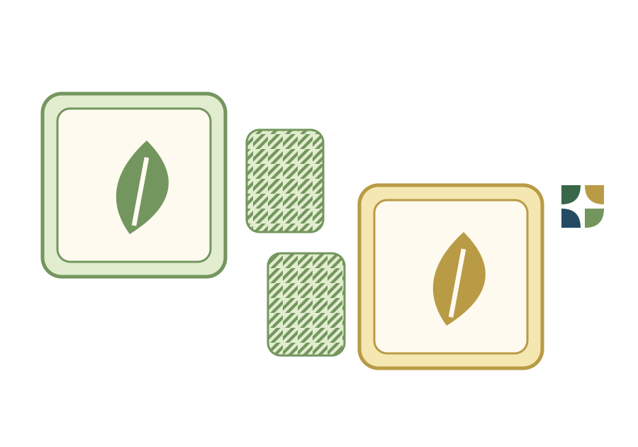

# REFÚGIO

Jogo individual de separação por barreiras com função local. Módulos puros sem
DOM, armazenamento ou resolução automática da campanha no carregamento. O host
administra navegação, histórico, reinício, tentativas e gabarito explícito.

## Regras e invariantes

1. Cada casa é livre ou barreira; pistas são imutáveis e marcos são livres.
2. Cada região livre conectada por lados contém exatamente um marco.
3. Cada barreira toca por lados exatamente **duas regiões livres diferentes**.

Tocar três casas de apenas duas regiões é permitido. Tocar duas casas da mesma
região é insuficiente. Tocar três regiões é proibido. Números identificam marcos:
não indicam área ou ordem. O exterior não conta como região e diagonais nunca
conectam. As barreiras não precisam estar conectadas; não há proibição separada
de bloco 2 × 2 nem objetivo de minimizar a quantidade global de barreiras.

## Dados, estado e interface do motor

Um nível contém `rows`, `cols`, `markers: { index, label }[]` e `givens`.
As casas são indexadas por linhas: `row * cols + col`. Valores de `givens` e
`state.cells`: `null` = indecidida, `0` = livre, `1` = barreira. Marcos têm `0`
fixo. A solução armazenada serve somente à ação de gabarito: nenhum validador
consulta `solution`.

O `id` é `refugio-` seguido dos primeiros 16 caracteres do SHA-256 da definição
com chaves ordenadas. Alterar nomes editoriais ou reordenar níveis não invalida
a identidade do desafio.

O estado é `{ cells: (number | null)[], lastChanged: number | null }`.
`lastChanged` controla o tracejado da última ação. Todas as operações são puras;
início e solução devolvem cópias. Ferramentas: `cycle`, `free`, `wall`, `erase`.
O ciclo é indecidida → livre → barreira → indecidida. Ação inválida ou tentativa
de alterar pista devolve o estado anterior, sem mutação.

`isStateValid` verifica formato e pistas, permitindo tentativas erradas e estados
parciais para restauração. Rejeita arrays esparsos, valores fora do domínio,
tamanhos incorretos e marcos/barreiras fixas alterados. `checkState` separa ausência
de indecisões (`complete`) de satisfação das três regras (`valid`). O motor
encontra componentes livres e conta componentes distintos ao redor de cada
barreira; não confunde essa contagem com número de casas adjacentes.

## Geração e certificado de unicidade

São 80 níveis, distribuídos 15/15/15/15/15/5 nas seis faixas do Intuição. Os dois
exemplos aprovados estão preservados como fixtures e nos níveis 1 e 31. Somente o
tutorial inicial já apresenta todas as barreiras: cada um dos outros 79 níveis
exige descobrir ao menos uma barreira.

O gerador constrói um banco de separadores válidos em grades de 3 × 3 a 5 × 5,
com duas a quatro regiões. Escolhe um marco em cada componente e remove pistas
apenas quando a enumeração confirma uma solução única. Rejeita qualquer
**geometria final de barreiras repetida**, mesmo sob rotação/reflexão. Mudar a
posição ou o número de um marco não permite reutilizar a mesma geometria.

O enumerador propaga somente condições necessárias: marcos já reunidos, regiões
livres sem caminho possível a um marco, falta de dois contatos possíveis para
uma barreira, redundância por reencontro dos seus vizinhos e três regiões com
marcos diferentes tocando a mesma barreira. O restante é percorrido por busca
binária. Para rejeitar um candidato basta achar a segunda solução; o certificado
de unicidade só é emitido quando toda a busca compatível foi esgotada e restou uma.

## Progressão e roteiro auditável

O roteiro lógico é separado da enumeração. Cada decisão recebe uma justificativa
pelas condições acima. Quando necessário, analisa uma hipótese com suas
consequências e, no máximo, uma segunda escolha dentro da contradição. Níveis que
precisem de busca mais profunda no roteiro são rejeitados.

| Faixa | Relações trabalhadas | Profundidade registrada |
| --- | --- | --- |
| Básico | Dois marcos; contatos possíveis, primeiras separações e acesso ao marco | 0 em 15 níveis |
| Aprendiz | Pelo menos duas famílias de dedução; redundância ou separação combinada com bolsão | 0 em 15 níveis |
| Intermediário | Gargalos, reencontros e primeiras contradições; exemplo aprovado na fase 31 | 0 em 5; 1 em 10 |
| Avançado | Três ou quatro marcos; proibir três refúgios ou combinar uma contradição curta | 0 em 1; 1 em 14 |
| Mestre | 11–18 decisões pendentes e cadeias com contradição | 1 em 14; 2 em 1 |
| Modo Sábio | 16–18 decisões; duas ou mais exclusões por contradição, ou profundidade 2 | 1 em 4; 2 em 1 |

As contagens descrevem **o roteiro produzido**, não a mínima dificuldade humana
possível. Outra técnica pode encurtar a solução. `decisions` conta casas
determinadas, `propagationPasses` conta passagens do algoritmo e `maxDepth`
registra escolhas dentro da prova de contradição. Não se usa tempo de CPU como
nota de dificuldade. As faixas são editoriais; ainda não houve teste com jogadores.

O relatório contém a sequência completa de casas, valores concluídos, condições
que eliminaram a alternativa e profundidade. A verificação pode reproduzir cada
roteiro sem consultar o gabarito.

## Renderização e integração

O SVG mantém a placa branca de cantos 17, células claras com cantos 9 e intervalo
4, peças sálvia/âmbar de centro creme e dupla moldura. Marcos usam números;
barreiras usam hachura; livres usam círculo. Não há animais inventados nem cor
como única informação. Pino no canto identifica pista; tracejado identifica
a última alteração; ponto central identifica indecisão.

Todas as casas têm `data-cell`, `role="button"`, `tabindex="0"` e nome acessível
em português. Pistas recebem `aria-disabled="true"`. O host deve tratar
Enter/Espaço e importar `view.css` para o foco visível. Não há handlers inline.

## Reproduzir e conferir

Na raiz do checkout:

```sh
python3 tools/logica/refugio-generate.py
python3 tools/logica/refugio-generate.py --verify
node --test tests/logica/refugio.test.mjs
node tests/logica/refugio-independent.mjs
```

Semente: `20261110032`. Python somente com biblioteca padrão. Relatório:
`tests/logica/refugio-certificates.json`. Os testes conferem todos os gabaritos,
distribuição e diversidade geométrica, identidade dos níveis, imutabilidade,
reinício, saves e marcações fixas. Enumeram independentemente os 1.024 estados
de cada fixture. Os negativos isolam região sem marco, marcos reunidos, barreira
redundante e barreira tocando três regiões. Positivos confirmam três casas de
apenas duas regiões, diagonais separadas, barreiras desconectadas e um bloco
2 × 2 de barreiras válido, evitando importar regras de Nurikabe.

Uma segunda auditoria em JavaScript enumera literalmente todos os estados
binários compatíveis com as pistas, sem as podas do gerador. Conferiu
**1.624.720 configurações** dos 80 níveis e encontrou uma solução em cada um.
Resultado: `tests/logica/refugio-independent-results.json`.

Parentesco visual discutido na concepção: Nurikabe,
https://www.nikoli.co.jp/en/puzzles/nurikabe/. REFÚGIO não utiliza suas áreas
numéricas, parede preta conectada ou proibição de 2 × 2. O núcleo é o separador
localmente irredutível. Não se afirma ineditismo mundial.

## Identidade visual aprovada — novembro de 2026

A skin **Folhas** preserva a grade, paleta sálvia/âmbar, molduras, hachuras,
legendas e áreas de toque do visual anterior. Acrescenta apenas:

- duas pequenas assinaturas de azulejo na margem externa;
- folhas no centro dos marcos, com o número menor no canto inferior direito;
- uma AIIJ transparente que repete as folhas, as molduras e as barreiras.



O seletor **Normal / Folhas** troca somente a apresentação. A escolha utiliza
`intuicao:refugio:skin:v1`, separada do progresso, e não reinicia fases nem cria
jogadas, tentativas ou conquistas. O visual Normal conserva o SVG anterior.
Os marcos continuam anunciados por número no nome acessível; as folhas e os
azulejos são decorativos, sem significado adicional nas regras.

A seleção e a AIIJ são específicas do Refúgio. Nenhum motor, catálogo,
gerador ou formato de save foi alterado. Verificação da camada visual:

```sh
node --test tests/logica/refugio-visual-approved.test.mjs
```
