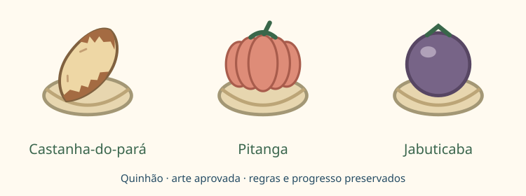

# QUINHÃO

Jogo de partilha para duas pessoas: o proponente oferece três cestos consecutivos do anel, o adversário escolhe um, e o proponente recebe os outros dois. Os cestos retirados deixam de fazer parte da vizinhança. Depois de oito partilhas, cada equipe recebeu 12 frutos.

A preparação e a pontuação reproduzem a proposta aprovada: 24 cestos, oito frutos de cada tipo, trios distintos valendo 5 e pares distintos nas sobras valendo 2. A sequência inicial é castanha, castanha, pitanga, pitanga, jabuticaba, jabuticaba, repetida quatro vezes.

## Organização

- `engine.mjs`: regras determinísticas, validação das ações, pontuação e avaliação para o bot.
- `view.mjs`: anel de cestos, depósitos públicos, escolha do visitante e descrição das prévias.
- `view.css`: apresentação responsiva, símbolos redundantes de equipe e estados de interação.
- `index.mjs`: metadados e regras completas disponíveis na interface.
- `tests/versus/quinhao.test.mjs`: exemplos, conservação dos recursos, etapas, imutabilidade e encerramento.

## Estado e ações

`baskets` conserva os identificadores originais de 1 a 24. A ordem do vetor representa a ordem circular dos cestos restantes. `inventories[player][fruit]` usa a ordem castanha, pitanga, jabuticaba. `round` conta partilhas completas; `moveCount` conta decisões confirmadas, portanto chega a 16.

A oferta usa `{ type: 'offer', start: 24 }`: o cesto indicado e seus dois sucessores formam o trio. A escolha usa `{ type: 'choose', basket: 24 }` e precisa apontar um dos três cestos oferecidos.

**`player` indica quem decide, não uma alternância artificial por ação.** Após uma escolha, a mesma pessoa passa a propor a próxima oferta. O controlador e a busca do bot devem consultar esse campo em cada estado.

A visualização prepara a ação ao tocar no cesto. Ela não altera o motor; confirmação, histórico, persistência e bot pertencem ao controlador compartilhado. Na última oferta, tocar em qualquer um dos três cestos produz a mesma ação canônica.

`selectionForMove(state, move)` recupera o cesto indicado por uma dica do treino, tanto na oferta quanto na escolha. A pessoa pode comparar outro cesto antes de confirmar a decisão.

## Exemplo verificado

1. Verde oferece 2–3–4; Âmbar escolhe 3.
2. Âmbar oferece 5–6–7; Verde escolhe 5. Ambos passam a ter um fruto de cada tipo, valendo 5 pontos.
3. Verde oferece 24–1–8, agora vizinhos; Âmbar escolhe 24. Verde fica com `[3, 1, 1]` e Âmbar com `[1, 1, 2]`.
4. Âmbar oferece 9–10–11; Verde escolhe 9. Os depósitos ficam `[3, 2, 1]` e `[1, 2, 3]`, ambos com 7 pontos.

## Verificação

Execute `node --test tests/versus/quinhao.test.mjs` a partir da raiz do projeto. Os testes usam estados congelados e partilhas completas para conferir que nenhum fruto desaparece, que os totais por tipo permanecem em oito e que finais de vitória e empate seguem a pontuação.

Equilíbrio e frequência de empates exigem partidas com pessoas. As regras aprovadas foram mantidas; a implementação não introduz novos pesos ou desempates.

## Identidade dos frutos (revisão aprovada)

A castanha é agora identificada como **castanha-do-pará (*Bertholletia excelsa*)**,
representada sem casca dura, com polpa marfim e película marrom irregular.
A pitanga (*Eugenia uniflora*) mantém o estilo de formas simples e contornos finos,
com gomos mais estreitos e vermelho claro. A jabuticaba não mudou.

`fruit-art.mjs` compartilha os vetores entre os cestos, depósitos, escolhas e
celebração de vitória. Os SVGs decorativos não duplicam o nome acessível dos
controles. Índices numéricos, saves, pontuação, ordem dos frutos e regras são
inalterados; o nome interno genérico do motor continua compatível.

