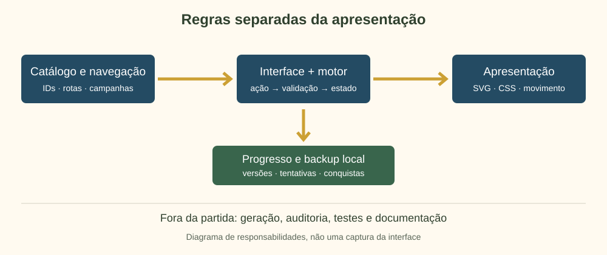

# Arquitetura e leitura do código

O site é uma **aplicação estática modular**. HTML, CSS, JavaScript ES Modules, SVG, PNG, JSON e fontes locais são servidos diretamente. Não há framework obrigatório, instalação npm ou backend de partidas nesta base.

> **Atenção:** `dist/` é código-fonte editável e versionado. Não apague como saída descartável de build.

| Camada | Entradas | Responsabilidade |
|---|---|---|
| Inicialização | [index.html](../../dist/index.html), [app.mjs](../../dist/app.mjs) | Composição e abertura |
| Catálogo | [game-catalog.mjs](../../dist/game-catalog.mjs) | Ordem e índices públicos |
| Interface comum | [collection-ui.mjs](../../dist/collection-ui.mjs), [action-sidebar.mjs](../../dist/action-sidebar.mjs) | Controles sem redefinir regras |
| Motores | [Lógica](../../dist/logica/README.md), [Versus](../../dist/versus/README.md), pastas próprias | Ações válidas, transições e resultado |
| Conteúdo | Campanhas e catálogos de mapas | Definições, IDs e versões |
| Busca | Workers e serviços dos jogos | Análise com orçamento e cancelamento |
| Estado | [Backup](../../dist/progress-backup.mjs), [proteção de gravação](../../dist/progress-write-guard.mjs) | Persistência e restauração |
| Apresentação | CSS, SVG e assets | Desenho, layout e movimento |
| Ferramentas | [tools](../../tools/README.md), [scripts](../../scripts/README.md), [tests](../../tests/README.md) | Geração offline, auditoria e regressão |

**JavaScript** executa jogos e verificações Node.js; **HTML/CSS** estruturam e apresentam; **SVG/PNG/WOFF2** fornecem arte e tipografia; **JSON** guarda definições e intercâmbio; **Python**, usado em ferramentas offline, não faz parte do runtime. [Arquitetura detalhada](../../docs/arquitetura/README.md).

### Organização do código: fronteiras reais

A estrutura nasceu de famílias de jogos diferentes. Não se presume que todos passem pelo mesmo motor: Reflexos e Corte certo usam módulos da entrada; ELO, PRUMO e PACTO usam a coleção; Sintonia, Repasse, Broto e Cerco mantêm adaptadores próprios; cinco campanhas ativas compartilham a infraestrutura de `logica`; quatro duelos ativos usam a infraestrutura de `versus`. Módulos retirados continuam versionados e não devem reaparecer por uma enumeração de diretório.

| Responsabilidade | Código de referência | Contrato |
|---|---|---|
| Catálogo público | [game-catalog](../../dist/game-catalog.mjs), [retired-games](../../dist/retired-games.mjs) | ID estável e disponibilidade explícita; ordem editorial não é chave de save |
| Carregamento | [rota lógica](../../dist/logica/route.mjs), [rota Versus](../../dist/versus/route.mjs) | Importar sob demanda e invalidar respostas de uma tela abandonada |
| Definição do desafio | Campanhas e mapas dos jogos | Geometria, pistas, estoque e condições iniciais; não é a tentativa do usuário |
| Motor | [exemplo Renovo](../../dist/logica/games/renovo/engine.mjs), [exemplo Quinhão](../../dist/versus/games/quinhao/engine.mjs) | Aplicar ações e verificar estado segundo as regras, sem depender de decoração |
| Sessão | [lógica](../../dist/logica/session.mjs), [Versus](../../dist/versus/session.mjs), [coleção](../../dist/collection-state.mjs) | Coordenar tentativa e histórico, sem alterar uma regra para atender ao layout |
| Apresentação | Views de cada jogo, CSS e módulos comuns | Renderizar o estado e encaminhar intenção; não declarar vitória pela animação |
| Persistência | [lógica](../../dist/logica/storage.mjs), [Versus](../../dist/versus/storage.mjs) | Validar envelope, versão e identidade antes de restaurar |
| Assistência | [serviço de busca](../../dist/versus/search-service.mjs), [worker](../../dist/versus/search-worker.mjs) | Limites de tempo/nós e cancelamento; uma busca parcial não prova unicidade |

### Fluxo de uma jogada

1. A interface traduz o clique, toque ou tecla em uma intenção específica do jogo.
2. A sessão consulta/aplica a regra apropriada; a definição do mapa não se confunde com seu estado atual.
3. O estado válido alimenta histórico, renderização e persistência conforme a família.
4. A condição de término é determinada pela regra. [Feedback de níveis](../../dist/level-feedback.mjs) e [vitória](../../dist/game-victory.mjs) apresentam o resultado; não substituem o motor.
5. Uma resposta atrasada de carregamento ou análise não deve reabrir uma tela abandonada. A rota lógica usa uma revisão para invalidar esse retorno.

### Estruturas de dados e desfazer/refazer

O histórico da coleção usa `{ past, present, future }`, com cópias estruturadas e limite de 300 estados anteriores. Uma alteração nova limpa o futuro; desfazer e refazer movem o cursor lógico sem redefinir pistas. Essa é uma implementação específica de [collection-state.mjs](../../dist/collection-state.mjs), não uma promessa de que todas as famílias armazenam a mesma estrutura.

A família lógica usa `intuicao.logica.v1`: jogos, conclusões por ID/versão, sessões e última visualização. A normalização limita tamanho, quantidade de sessões e campos reconhecidos; a restauração ainda passa pelo motor da fase. Versus guarda ações e cursor para reproduzir a partida. [Contrato detalhado](../../dist/versus/CONTRACT.md).

### Persistência e importação segura

O [backup](../../dist/progress-backup.mjs) reconhece um formato próprio e versões de envelopes; limita o arquivo a 16 MiB e registros a 8 MiB. Chaves históricas podem ser preservadas mesmo quando o jogo sai do catálogo. Não confundir guardar um save com publicar novamente o jogo.

[progress-write-guard](../../dist/progress-write-guard.mjs) compara uma revisão de restauração e pode congelar gravações, impedindo uma aba antiga de sobrescrever o estado recém-importado. Isso não é autenticação, sincronização de conta nem proteção contra edição deliberada do armazenamento local.

### Geração, importação de fases e provas

Campanhas versionadas, mapas de duelo e desafios gerados são camadas distintas. [endless-collection](../../dist/endless-collection.mjs) usa geração determinística com semente, limites e validação pela regra. Encontrar uma resposta conhecida **não** equivale a provar resposta única. [collection-json](../../dist/collection-json.mjs) valida tipos, faixas e identidade de fases importadas; o worker mantém o processamento separado da interação principal quando aplicável.

As ferramentas em [tools](../../tools/README.md) e os relatórios certificados guardam geração/auditoria offline. O navegador não precisa executar todos esses programas para abrir o site. Fases não devem ser alteradas silenciosamente mantendo a mesma identidade quando isso invalidar o progresso salvo.

### Qualidade, distribuição e limites

Os testes de motores verificam regras; testes de histórico/backup verificam preservação; testes de DOM/CSS verificam contratos da interface. Capturas e testes estruturais não são equivalentes a uma auditoria completa de acessibilidade ou a jogar todas as fases.

A hospedagem recebe arquivos estáticos de `dist`, conforme [.openai/hosting.json](../../.openai/hosting.json). A cadeia correta é branch temática → verificações do commit → PR → merge → publicação separada → conferência da versão pública. A configuração não implica que o merge sozinho publique. Nenhuma alteração de documentação deve reconfigurar a hospedagem ou introduzir um backend sem necessidade.

### Bots e análise

Os oponentes computacionais são algoritmos locais de busca e avaliação. O Versus compartilhado documenta minimax, poda alfa-beta, aprofundamento e orçamento. DESVIO e CERCO têm implementações próprias. Isso não implica um serviço remoto, pagamento por jogada ou infalibilidade: orçamento esgotado deve ser distinguido de uma solução demonstrada. [Contrato dos duelos](../../dist/versus/CONTRACT.md).

[Apresentação](../../README.md) · [Testes](../../tests/README.md)
