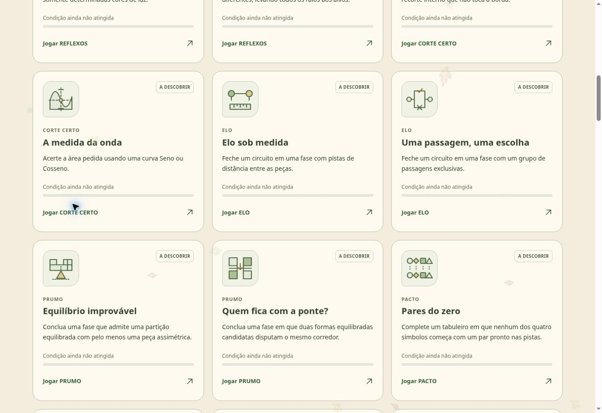

# Conquistas do Intuição

**Luigi Scofano de Araujo · edição de 11 de novembro de 2026**

O sistema reúne **60 conquistas**: dez marcos gerais e **duas missões específicas para cada um dos 25 jogos**. Os emblemas são SVGs próprios, com formas diferentes relacionadas ao requisito: portais, fios, barcos, selos, vagens, dobras, sinos e contrapesos.

[Ver a prancha dos 60 emblemas](../imagens/conquistas/emblemas.svg) · [Arquitetura e manutenção](../../dist/achievements/README.md)

## Como usar

Abra **Conquistas** na navegação do site. A tela começa em **Missões dos jogos**; escolha um jogo e, se desejar, filtre por **Conquistadas** ou **A descobrir**. Cada cartão apresenta o requisito completo e um link para o jogo. A seção **Gerais** conserva os dez marcos de progresso das campanhas.

## O que comprova uma conquista

As **28 missões de campanha** usam a conclusão salva de uma fase oficial atual que possui a característica indicada. Conclusões assistidas também contam. Não são inferidas velocidade, número de tentativas ou decisões que o registro antigo não contém. As seis campanhas lógicas usam um índice leve com identidade e versão da fase; o índice é gerado e comparado com os catálogos completos na verificação automatizada.

As **22 missões Versus** observam a transição produzida por uma jogada humana confirmada. Valem as decisões de qualquer participante humano no mesmo navegador e as jogadas confirmadas em treino. Sugestões podem orientar a escolha; prévias, ações automáticas do computador, retomadas e desfazer/refazer não registram descobertas. Mapas importados dos jogos antigos ficam excluídos; os mapas de DESVIO gerados pelo próprio site podem contar.

Uma missão de ação é registrada uma única vez. Desfazer depois não remove o registro, e repetir o feito não cria uma conquista duplicada. Partidas antigas não comprovam retroativamente ações específicas que nunca foram registradas.

O progresso pertence ao navegador e integra o backup existente. Abrir a galeria não modifica os saves. Registros incompatíveis ou ilegíveis são preservados, e o jogo continua funcionando quando o navegador impede o armazenamento.

## Missões das campanhas

| Jogo | Missão | Condição |
| --- | --- | --- |
| REFLEXOS | **Passaporte de luz** | Conclua uma fase com portais que aceitam somente determinadas cores de luz. |
| REFLEXOS | **Três cores, três caminhos** | Conclua uma fase com fontes de três cores diferentes, levando todos os raios aos alvos. |
| CORTE CERTO | **O peso do vazio** | Acerte a área pedida em uma figura com um recorte interno que não toca a borda. |
| CORTE CERTO | **A medida da onda** | Acerte a área pedida usando uma curva Seno ou Cosseno. |
| ELO | **Elo sob medida** | Feche um circuito em uma fase com pistas de distância entre as peças. |
| ELO | **Uma passagem, uma escolha** | Feche um circuito em uma fase com um grupo de passagens exclusivas. |
| PRUMO | **Equilíbrio improvável** | Conclua uma fase que admite uma partição equilibrada com pelo menos uma peça assimétrica. |
| PRUMO | **Quem fica com a ponte?** | Conclua uma fase em que duas formas equilibradas candidatas disputam o mesmo corredor. |
| PACTO | **Pares do zero** | Complete um tabuleiro em que nenhum dos quatro símbolos começa com um par pronto nas pistas. |
| PACTO | **Linha em branco** | Complete um tabuleiro que começa com uma linha inteira sem pistas. |
| SINTONIA | **Ajuda do outro lado** | Conclua uma fase em que um botão de um animal controla uma cancela em outro tabuleiro. |
| SINTONIA | **Até a próxima parada** | Leve todos os animais aos destinos em uma fase com casas de gelo. |
| REPASSE | **Quatro destinos** | Conclua uma fase com uma peça que repassa seu valor para as quatro direções. |
| REPASSE | **Passar o bastão** | Conclua uma fase de troca de receptor: a retirada de uma peça prepara quem receberá o próximo repasse. |
| ÓRBITA | **Engrenagens em acordo** | Conclua uma fase com um comando que gira dois ou mais anéis juntos. |
| ÓRBITA | **Chave em órbita** | Conclua uma fase em que um sensor exige um símbolo na posição certa para liberar um comando. |
| DIVISA | **Vizinhos à distância** | Complete um mapa com uma cota zero: dois territórios não podem compartilhar fronteira. |
| DIVISA | **Quatro territórios** | Reparta um mapa entre quatro territórios, respeitando todas as cotas de fronteira. |
| PULSO | **Três compassos** | Complete um painel cuja solução combina três espaçamentos diferentes entre as batidas. |
| PULSO | **Pausa longa** | Complete um painel cuja solução tem um trio com pelo menos duas casas vazias entre cada batida. |
| FOZ | **Rio de sete passos** | Conclua uma fase com uma pista que pede ao menos sete canais até a foz. |
| FOZ | **Três águas se encontram** | Conclua uma fase cuja solução reúne três canais em uma casa antes da foz. |
| REFÚGIO | **Abrigo no coração** | Conclua uma fase cuja solução contém um refúgio que não encosta em nenhuma borda. |
| REFÚGIO | **Cada um no seu lugar** | Separe quatro marcos em quatro refúgios, mantendo todas as barreiras necessárias. |
| MIRANTE | **Todos os olhares** | Conclua uma fase cuja solução tem uma peça vista por quatro observadores. |
| MIRANTE | **A segunda testemunha** | Conclua uma fase em que exigir duas testemunhas por peça é indispensável para a solução única. |
| RENOVO | **Raízes de longo alcance** | Conclua uma fase cuja solução tem um trio com dois braços de pelo menos duas casas e comprimentos diferentes. |
| RENOVO | **Quatro direções de vida** | Conclua uma fase cuja solução contém trios nas quatro orientações de ângulo reto. |

## Missões dos duelos

| Jogo | Missão | Condição |
| --- | --- | --- |
| BROTO | **Colheita em dobro** | Colha duas ou mais flores da sua equipe em um único plantio. |
| BROTO | **Quatro ventos** | Alcance um broto em cada uma das quatro direções com um único plantio. |
| CERCO | **Porta fechada** | Deixe uma peça adversária sem saída, enquanto outra peça da mesma equipe ainda pode jogar. |
| CERCO | **Última fresta** | Vença uma partida quando sua equipe tinha exatamente um movimento legal antes da jogada final. |
| DESVIO | **Passagem estreita** | Deixe exatamente uma escolha ao adversário enquanto ainda restam pelo menos cinco casas livres no mapa. |
| DESVIO | **Sobram casas, falta caminho** | Vença esgotando o destino obrigatório, com pelo menos quatro casas ainda livres em outras linhas ou colunas. |
| ENLACE | **Corrente acesa** | Acenda pelo menos 3 novos pinos da sua cor com a mesma presilha. |
| ENLACE | **De margem a margem** | Vença conectando sua entrada à margem oposta na jogada que você confirmou. |
| VAZANTE | **Comboio misto** | Reboque pelo menos um barco adversário na esteira de uma remada sua. |
| VAZANTE | **Três na corrente** | Mova pelo menos 3 barcos na mesma remada, avançando o líder uma linha em direção ao seu cais. |
| MOSAICO | **Dupla assinatura** | Complete pelo menos 2 selos da sua cor ao colocar um único azulejo. |
| MOSAICO | **Quatro cantos, uma voz** | Complete um selo com os 4 cantos da sua cor. |
| QUINHÃO | **O fruto que faltava** | Escolha um fruto que complete um novo trio de castanha, pitanga e jabuticaba na sua colheita. |
| QUINHÃO | **Três sabores** | Ofereça 3 cestos vizinhos que contenham os 3 tipos de fruta. |
| ESTALO | **Efeito em cadeia** | Abra pelo menos 5 vagens na mesma cadeia, com mais vagens suas do que adversárias. |
| ESTALO | **Sem desvio** | Abra pelo menos 3 vagens suas em uma cadeia sem abrir nenhuma vagem adversária. |
| DOBRA | **Terras reunidas** | Reúna, com uma dobra, um distrito de área 6 ou maior controlado pelos seus selos. |
| DOBRA | **A última dobra** | Comece a última jogada atrás em área controlada e vença o atlas depois de dobrar. |
| ACORDE | **Par e silêncio** | Complete um novo par e deixe o adversário sem sino no próximo eixo, obrigando-o a passar. |
| ACORDE | **Três vozes** | Vença recolhendo o sino que completa pares de 3 símbolos diferentes. |
| LASTRO | **Volta ao centro** | Faça um ajuste que transforme um desvio diferente de zero em equilíbrio exato: Δ = 0. |
| LASTRO | **Até a última marca** | Vença uma rodada ao avançar um contrapeso até a marca 4. |

## Dez conquistas gerais preservadas

| Conquista | Condição |
| --- | --- |
| Primeira descoberta | Concluir um nível de campanha. |
| Dez descobertas | Concluir dez níveis diferentes. |
| Caminho de descobertas | Concluir cinquenta níveis diferentes. |
| Cem possibilidades | Concluir cem níveis diferentes. |
| Além do primeiro olhar | Concluir um nível Avançado, Mestre ou Modo Sábio. |
| Muitas formas de pensar | Concluir ao menos um nível em cada uma das 14 campanhas. |
| Um caminho completo | Concluir os 80 níveis de uma campanha atual. |
| Novas perspectivas | Concluir um nível em cada uma das seis etapas de dificuldade. |
| Metade do laboratório | Concluir 560 níveis diferentes das campanhas atuais. |
| Um laboratório inteiro | Concluir os 1.120 níveis das campanhas atuais. |

Os identificadores das conquistas gerais continuam os mesmos. Cada nível conta uma vez e a versão atual da campanha determina a evidência de conclusão.

## Verificação desta edição

A implementação foi conferida por testes de motores, campanhas, missões, armazenamento, backup, filtros e avisos acessíveis. Todos os 50 objetivos possuem evidência de alcançabilidade: fases oficiais para as campanhas e sequências de movimentos legais desde o início para os duelos.

Na conferência real do navegador, ESTALO abriu seis vagens na sequência de A1, com ganho 4–2. A prévia não exibiu conquista; confirmar desbloqueou **Efeito em cadeia**, e recarregar preservou o registro. Em BROTO, cinco plantios legais desbloquearam **Colheita em dobro** somente após a confirmação final.

A inspeção visual foi realizada no viewport desktop disponível. O layout contém regras responsivas, mas não houve emulação móvel nessa conferência. Dificuldade e frequência de desbloqueio ainda podem ser ajustadas a partir de partidas de pessoas reais; a implementação não atribui raridades fictícias aos emblemas.
