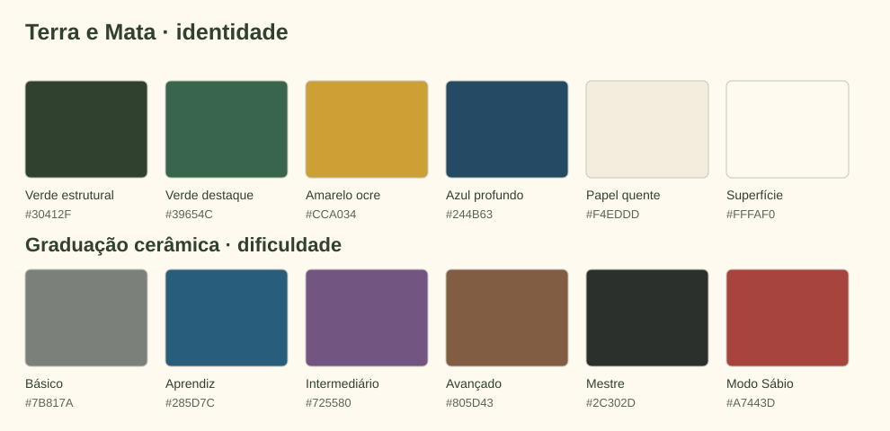
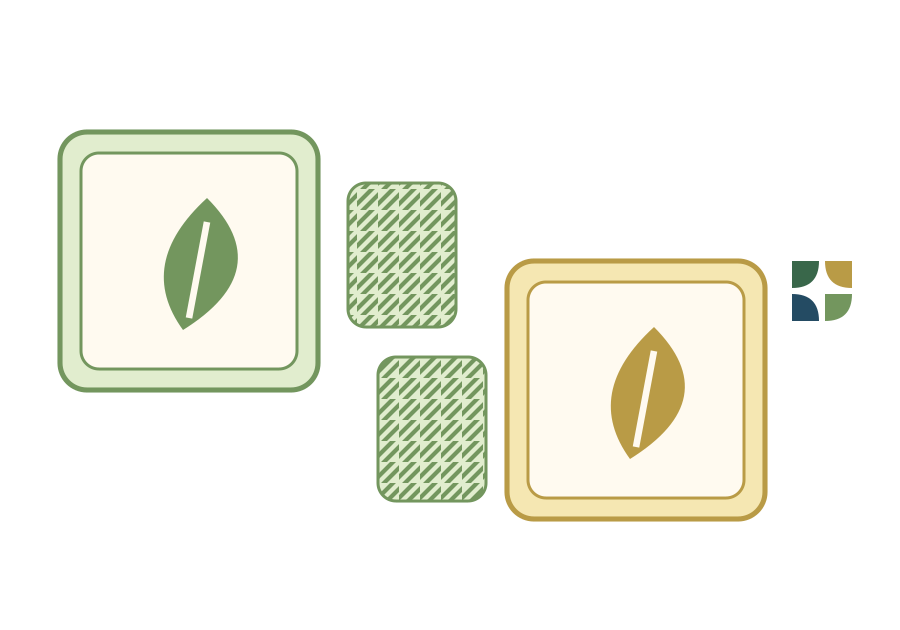

# docs/identidade

Guia da identidade atual: azulejos, verde/amarelo/azul, fontes locais, fauna e AIIJs. A marca anterior continua no histórico; o ícone do futuro aplicativo não significa que um app foi lançado.

[Visão geral](../../README.md) · [Mapa da documentação](../indice-pastas.md)

## Conteúdo

- [app-futuro/](app-futuro/README.md)
- [logo-site/](logo-site/README.md)
- [VERIFICACAO-2026-11-11.md](VERIFICACAO-2026-11-11.md)

## Manutenção

Atualize este índice ao alterar o conteúdo da pasta. Verifique os links com `node scripts/check-docs.mjs` a partir da raiz. Testes de código e publicação devem seguir o fluxo específico do projeto. Registros históricos conservam sua data e não representam automaticamente o estado publicado.

## Princípios de composição

A brasilidade parte de elementos concretos do projeto: fauna reconhecível, formas vegetais, água, frutos e azulejos. As AIIJs introduzem a ideia de cada jogo; o centro da partida deve continuar legível. Não inventar referências a artistas ou movimentos como origem histórica sem evidência.

## Marca e aplicações

O PNG da marca atual tem 1800 × 420 pixels, transparência e proporção 30:7. Preserve a proporção e não acrescente a antiga planta. A versão do futuro app é uma aplicação distinta, não substitui o lettering no site.

## Cores

Os azulejos usam verde, amarelo ocre e azul profundo. A base quente suaviza o contraste sem tornar todas as superfícies pastel. Cores das dificuldades têm significado específico e não devem ser reutilizadas arbitrariamente como estado de acerto. Confira dificuldade, seleção e conclusão separadamente.

## Fontes

Literata é a família editorial dos títulos; Source Sans 3, a família da interface. Arquivos locais e font-display swap mantêm leitura durante o carregamento. Algarismos tabulares evitam oscilação dos contadores. [Implementação](../../dist/typography.css).

## Arte e transparência

AIIJ significa Arte de Ilustração Individual do Jogo. Não confundir essa composição com regras, alvos ou objetos clicáveis. Azulejos PNG mantêm alfa, sem retângulos brancos. SVGs são adequados a contornos e geometrias editáveis. Preserve a arte dos mascotes original ao reutilizá-la.

## Revisão visual

1. Compare marca, cores e tipografia entre biblioteca, regras, seleção, tabuleiro e diálogos.
2. Verifique a cascata completa: um CSS antigo pode ter valores sobrescritos.
3. Confira desktop, tela estreita, teclado e movimento reduzido.
4. Não troque estética por regra: largura, cor e desenho não alteram vitória, turno ou progresso.
5. Use capturas sem dados pessoais nem ponteiro sobre o conteúdo. Identifique edição e não publique mockup como tela existente.
