# AIIJs dos 19 jogos

[Identidade](../README.md) · [Projeto](../../../README.md) · [Manuais dos jogos](../../jogos/README.md)

AIIJ significa **Arte de Ilustração Individual do Jogo**. Esta coleção reúne as **19 artes aprovadas** dos 19 jogos atuais, com links para os arquivos reais versionados. A ilustração introduz a identidade do jogo, não representa um botão, solução ou tabuleiro. As seis artes preexistentes foram preservadas e as treze novas composições foram aprovadas individualmente.

| Reflexos | Corte certo | ELO |
|---|---|---|
| [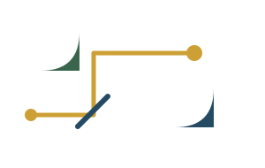](../../../dist/platform-assets/light-aiij-aprovada.svg) | [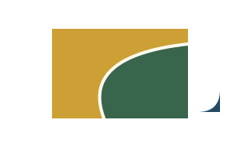](../../../dist/platform-assets/cut-aiij-aprovada.svg) | [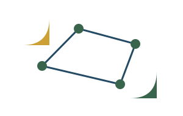](../../../dist/platform-assets/elo-aiij-aprovada.svg) |

| PRUMO | PACTO | SINTONIA |
|---|---|---|
| [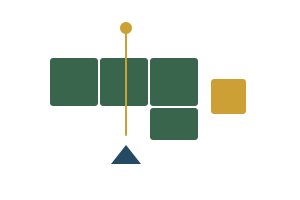](../../../dist/platform-assets/prumo-aiij-aprovada.svg) | [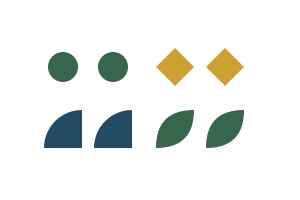](../../../dist/platform-assets/pacto-aiij-aprovada.svg) | [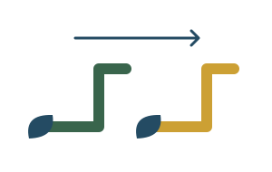](../../../dist/platform-assets/sintonia-aiij-aprovada.svg) |

| REPASSE | PULSO | FOZ |
|---|---|---|
| [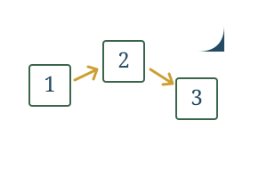](../../../dist/platform-assets/repasse-aiij-aprovada.svg) | [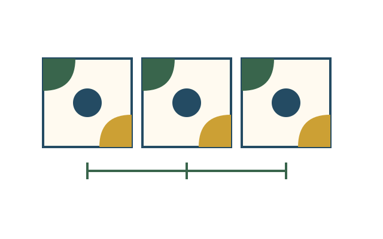](../../../dist/platform-assets/pulso-aiij-azulejo.svg) | [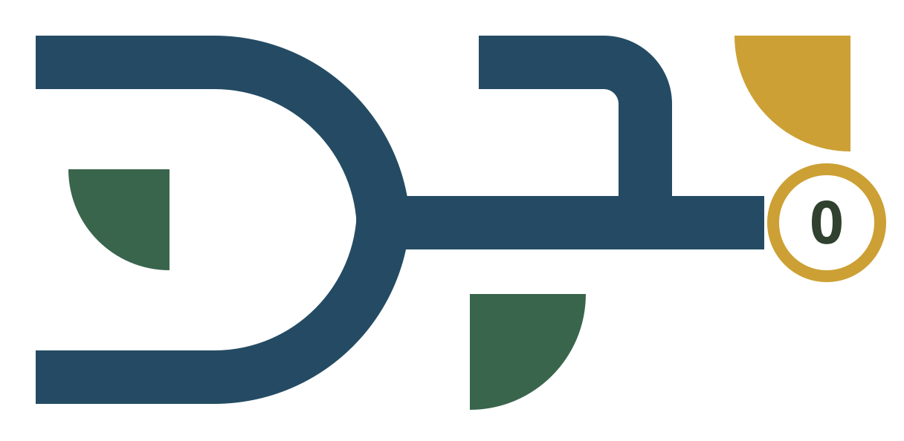](../../../dist/platform-assets/foz-aiij-mosaico.svg) |

| REFÚGIO | MIRANTE | RENOVO |
|---|---|---|
| [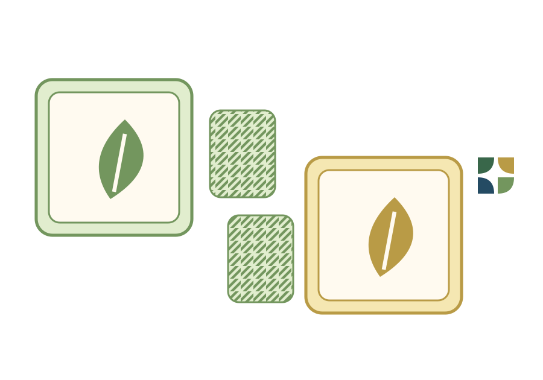](../../../dist/platform-assets/refugio-aiij-folhas.svg) | [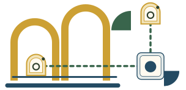](../../../dist/platform-assets/mirante-aiij-a.svg) | [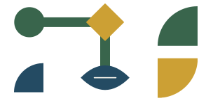](../../../dist/platform-assets/renovo-aiij-c1.svg) |

| DESVIO | BROTO | CERCO |
|---|---|---|
| [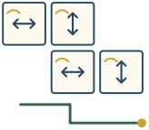](../../../dist/assets/desvio-aiij.svg) | [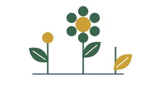](../../../dist/platform-assets/broto-aiij-aprovada.svg) | [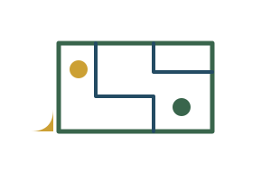](../../../dist/platform-assets/cerco-aiij-aprovada.svg) |

| MOSAICO | QUINHÃO | ESTALO |
|---|---|---|
| [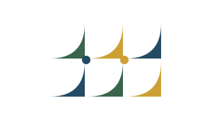](../../../dist/platform-assets/mosaico-aiij-aprovada.svg) | [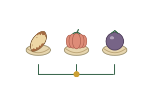](../../../dist/platform-assets/quinhao-aiij-aprovada.svg) | [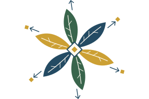](../../../dist/platform-assets/estalo-aiij-aprovada.svg) |

| ACORDE |
|---|
| [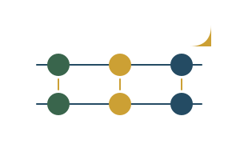](../../../dist/platform-assets/acorde-aiij-aprovada.svg) |

## Inventário por jogo

| Jogo | Arquivo original | Manual |
|---|---|---|
| Reflexos | [dist/platform-assets/light-aiij-aprovada.svg](../../../dist/platform-assets/light-aiij-aprovada.svg) | [Abrir](../../jogos/reflexos/README.md) |
| Corte certo | [dist/platform-assets/cut-aiij-aprovada.svg](../../../dist/platform-assets/cut-aiij-aprovada.svg) | [Abrir](../../jogos/corte/README.md) |
| ELO | [dist/platform-assets/elo-aiij-aprovada.svg](../../../dist/platform-assets/elo-aiij-aprovada.svg) | [Abrir](../../jogos/elo/README.md) |
| PRUMO | [dist/platform-assets/prumo-aiij-aprovada.svg](../../../dist/platform-assets/prumo-aiij-aprovada.svg) | [Abrir](../../jogos/prumo/README.md) |
| PACTO | [dist/platform-assets/pacto-aiij-aprovada.svg](../../../dist/platform-assets/pacto-aiij-aprovada.svg) | [Abrir](../../jogos/pacto/README.md) |
| SINTONIA | [dist/platform-assets/sintonia-aiij-aprovada.svg](../../../dist/platform-assets/sintonia-aiij-aprovada.svg) | [Abrir](../../jogos/sintonia/README.md) |
| REPASSE | [dist/platform-assets/repasse-aiij-aprovada.svg](../../../dist/platform-assets/repasse-aiij-aprovada.svg) | [Abrir](../../jogos/repasse/README.md) |
| PULSO | [dist/platform-assets/pulso-aiij-azulejo.svg](../../../dist/platform-assets/pulso-aiij-azulejo.svg) | [Abrir](../../jogos/pulso/README.md) |
| FOZ | [dist/platform-assets/foz-aiij-mosaico.svg](../../../dist/platform-assets/foz-aiij-mosaico.svg) | [Abrir](../../jogos/foz/README.md) |
| REFÚGIO | [dist/platform-assets/refugio-aiij-folhas.svg](../../../dist/platform-assets/refugio-aiij-folhas.svg) | [Abrir](../../jogos/refugio/README.md) |
| MIRANTE | [dist/platform-assets/mirante-aiij-a.svg](../../../dist/platform-assets/mirante-aiij-a.svg) | [Abrir](../../jogos/mirante/README.md) |
| RENOVO | [dist/platform-assets/renovo-aiij-c1.svg](../../../dist/platform-assets/renovo-aiij-c1.svg) | [Abrir](../../jogos/renovo/README.md) |
| DESVIO | [dist/assets/desvio-aiij.svg](../../../dist/assets/desvio-aiij.svg) | [Abrir](../../jogos/desvio/README.md) |
| BROTO | [dist/platform-assets/broto-aiij-aprovada.svg](../../../dist/platform-assets/broto-aiij-aprovada.svg) | [Abrir](../../jogos/broto/README.md) |
| CERCO | [dist/platform-assets/cerco-aiij-aprovada.svg](../../../dist/platform-assets/cerco-aiij-aprovada.svg) | [Abrir](../../jogos/cerco/README.md) |
| MOSAICO | [dist/platform-assets/mosaico-aiij-aprovada.svg](../../../dist/platform-assets/mosaico-aiij-aprovada.svg) | [Abrir](../../jogos/mosaico/README.md) |
| QUINHÃO | [dist/platform-assets/quinhao-aiij-aprovada.svg](../../../dist/platform-assets/quinhao-aiij-aprovada.svg) | [Abrir](../../jogos/quinhao/README.md) |
| ESTALO | [dist/platform-assets/estalo-aiij-aprovada.svg](../../../dist/platform-assets/estalo-aiij-aprovada.svg) | [Abrir](../../jogos/estalo/README.md) |
| ACORDE | [dist/platform-assets/acorde-aiij-aprovada.svg](../../../dist/platform-assets/acorde-aiij-aprovada.svg) | [Abrir](../../jogos/acorde/README.md) |

## Uso e manutenção

Preserve proporções, transparência, cores e contornos. A arte fica separada do espaço de interação. Alterações exigem revisão visual e aprovação; não recolorir ou gerar variantes para substituir a referência silenciosamente.

O catálogo documenta arquivos aprovados. A exibição deve ser conferida no integrador [game-aiij.mjs](../../../dist/game-aiij.mjs) e no componente específico de Desvio. Publicação do site e merge no GitHub são etapas distintas.

[Direitos e proveniência](../../recursos/README.md): esta apresentação não concede nova licença de reutilização das artes.
