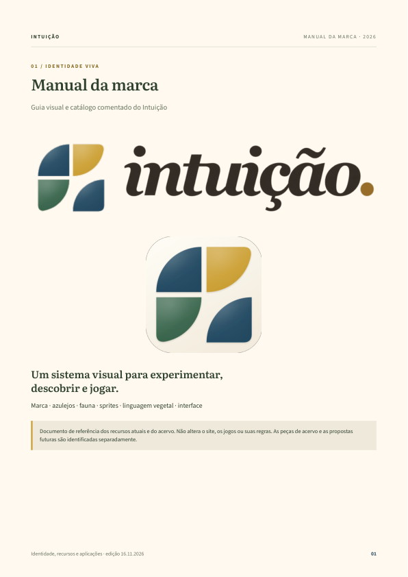

# Manual da marca Intuição

[Baixar o manual em PDF](Intuicao_Manual_da_Marca_2026.pdf) · [Fonte editorial HTML](manual.html) · [Inventário desta edição](inventario-manual.json)



## Escopo e edição

<details>
<summary>Expandir Escopo e edição</summary>

Edição de **16/11/2026, 45 páginas**. Documenta o acervo real da marca: logo atual, ícone aprovado do futuro aplicativo, paleta, tipografia, azulejos, 15 mascotes nas quatro apresentações (frente/lado, verde sobre branco/branco sobre verde), 16 sprites do roster atual de Sintonia, versões de animações legadas (explicitamente rotuladas), 33 acessórios, folhas, flores, frutos, seis AIIJs da base consultada e treze novas aprovadas, pictogramas de navegação/controle e 74 desenhos de conquistas.

Inclui quatro capturas reais: biblioteca, Refúgio, Renovo e Sintonia, sem ponteiro e sem dados pessoais de jogador. A edição diferencia recursos atuais, acervo histórico e propostas futuras. A coleção das 19 AIIJs está aprovada e integrada no GitHub: seis preservadas, oito novas no PR #136, três no PR #138, Sintonia A conceitual no PR #141 e Estalo A abstrata no PR #142. A implantação pública das últimas artes não é certificada por este documento.


</details>

## Revisão solicitada pelo titular

<details>
<summary>Expandir Revisão solicitada pelo titular</summary>

- Removida somente a página visual “A prancha de sprites original”, indicada no comentário. O asset de origem do site não foi removido.
- “Quadros e variações” identifica claramente as animações legadas.
- Mantido o roster ativo de Sintonia: `animal-roster.mjs` → `assets/chibi-user-roster.svg`, 4 × 4, 16 animais incluindo Quati.
- Acrescentadas treze novas AIIJs aprovadas; coleção completa com os 19 jogos, sem usar prévias descartadas.


</details>

## Origem e fidelidade

<details>
<summary>Expandir Origem e fidelidade</summary>

- Base de assets: main e18f2b53 (PR #133).
- Capturas: runtime main 5a5081 incorporado ao checkout documental 66aed842, em sessão de teste limpa.
- Pranchas inversas: imagens extraídas dos PDFs originais `Intuicao_Icones_Fauna_Frente_Branco_sobre_Verde.pdf` e `Intuicao_Icones_Fauna_Lado_Branco_sobre_Verde.pdf`.
- Pranchas positivas extraídas dos documentos originais: comparação de pixels idêntica aos PNGs atuais `fauna-green-original.png` e `fauna-side-original.png`.
- Os recortes preservam coordenadas e máscaras de `dist/fauna-art.mjs`. Nenhum mascote foi redesenhado.
- Os SVGs de amostra são saídas de módulos reais; a roseta usa as cores de conquista obtida de `dist/achievements.css`.


</details>

## Organização

<details>
<summary>Expandir Organização</summary>

- `manual.html`: fonte diagramada, com referências relativas ao acervo do repositório.
- `Intuicao_Manual_da_Marca_2026.pdf`: documento final.
- `assets/`: pranchas originais, recortes, capturas e metadados usados na composição.
- `assets/exported/`: amostras de vetores produzidas pelos módulos reais.
- `assets/screens/`: capturas reais da aplicação.
- `inventario-manual.json`: hashes de integridade e revisões de referência.


</details>

## Reproduzir

<details>
<summary>Expandir Reproduzir</summary>

A partir desta pasta, com Python e WeasyPrint 70.0 instalados:

```bash
python render_manual.py
```

O HTML utiliza fontes locais do repositório, Literata e Source Sans 3. Não precisa de navegador pessoal nem rede para renderizar. Após qualquer edição, renderizar todas as páginas, conferir recortes/contraste, paginação e links. Atualizar a data, o sumário e o inventário quando houver mudança.


</details>

## Validação

<details>
<summary>Expandir Validação</summary>

PDF A4 com 45 páginas. Páginas renderizadas e inspecionadas; verificação de limites de texto, numeração, imagens e contraste. As capturas não contêm cursor nem dados pessoais de jogador. Recursos gráficos e código do site não foram alterados por este documento.


</details>

## Direitos

<details>
<summary>Expandir Direitos</summary>

Preserva o regime do repositório: [inventário e autoria](../../recursos/README.md). A declaração de titularidade não equivale a verificação independente; há 11 pendências documentais no inventário de origem consultado. Marca, imagens e sprites não são liberados automaticamente pela MIT do código. As fontes mantêm suas licenças OFL. O manual não concede nova licença de uso do acervo.

</details>

