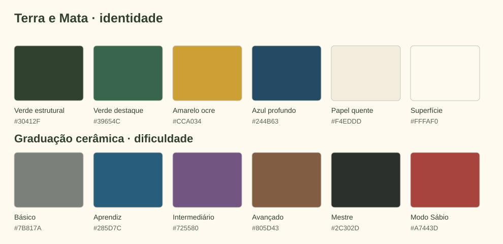
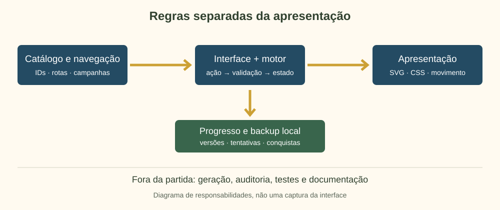

# Pranchas documentais da identidade

[Guia visual](../../identidade/README.md) · [Visão geral](../../../README.md)

## Paleta

Valores copiados de terra-mata.css, cohesion.css e difficulty-palette.mjs. Não são uma captura da tela nem certificação de contraste de todas as combinações.

## Arquitetura

Diagrama explicativo da separação de camadas. SVGs sem scripts, recursos remotos, dados pessoais ou cursor. Para atualizar, preserve viewBox, título e descrição acessível.
