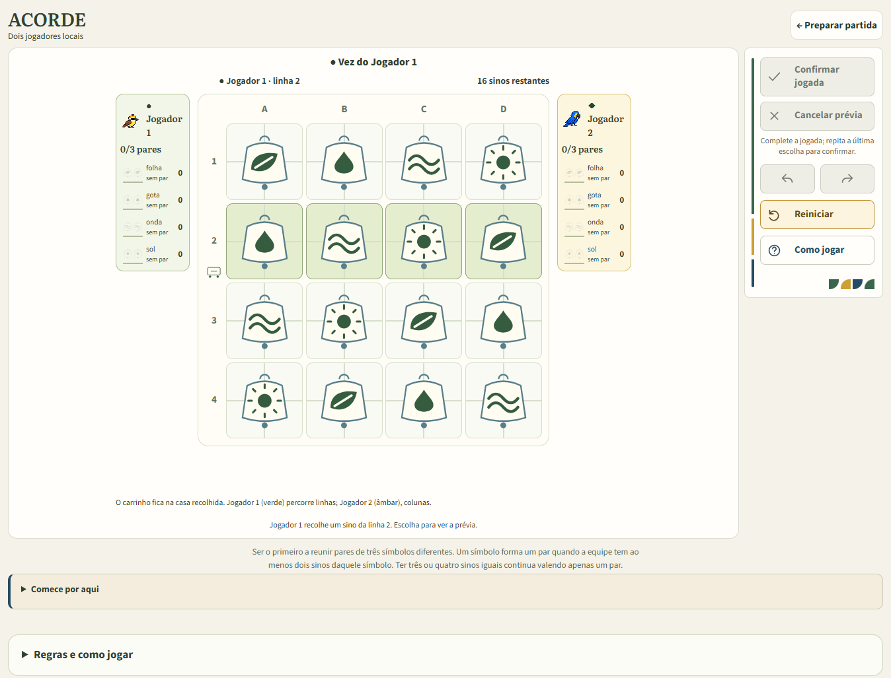

# ACORDE

[Catálogo atual](../README.md) · [Projeto](../../../README.md) · [Arquitetura](../../arquitetura/README.md)

Reúna seus pares e escolha o próximo eixo do rival.

## Área de jogo atual

*Captura local do código atual, com estado de demonstração, sem cursor ou dados pessoais. [Proveniência e limites](../../imagens/galeria-atual/README.md). Não representa uma solução nem comprova todos os estados da partida.*

## Objetivo

**Recolha sinos até formar um par de cada um de três símbolos diferentes.**

## Como começar

1. Verde recolhe na linha indicada; Âmbar recolhe na coluna indicada.
2. Escolha um sino. A casa dele define a coluna ou linha da próxima pessoa.
3. Dois sinos iguais formam um par. Complete pares de três tipos diferentes para vencer.

## Regras completas

1. O Verde escolhe um sino na linha do carrinho; o Âmbar, na coluna. O eixo disponível fica destacado. Escolha um sino e confirme.
2. O sino vai para sua coleção, e o carrinho fica na casa escolhida. Essa posição define as opções do outro jogador.
3. Um par são dois sinos com o mesmo símbolo. Você vence ao ter pares de três símbolos diferentes, por exemplo: duas folhas, duas gotas e dois sóis.
4. Se não houver sino no seu eixo, passe a vez. Se os dois passarem seguidamente ou os sinos acabarem, vence quem tiver pares de mais tipos. Quantidades iguais empatam.

## Exemplo de raciocínio

Verde recolhe o sino de B2. Agora Âmbar escolhe um sino da coluna B.

## O que observar

A proposta é explorar decisões visíveis e consequências previsíveis em uma partida de duas pessoas, sem depender de reflexos ou precisão do mouse.

Não conclua uma solução apenas pela aparência. Leia as pistas da fase e confira a condição de término acima. O resultado depende do estado completo da partida, não de uma peça isolada. Mapas e grades disponíveis são os oferecidos pela preparação atual; não há campanha, desafio diário nem modo sem parar nesta família.

## Proposta pedagógica

Relacionar uma coleta imediata às opções que ela oferece ao adversário.

Essas são intenções de design e oportunidades de prática, não resultados acadêmicos medidos.

## Identidade visual e leitura

As cores, peças e ilustrações ajudam a distinguir estados e ações. A arte não concede poderes ou altera as regras. Veja a [galeria da identidade](../../identidade/README.md) e os [recursos de fauna e flora](../../../README.md#fauna-flora-e-objetos-com-funcao).

## Onde está implementado

- [dist/versus/games/acorde/engine.mjs](../../../dist/versus/games/acorde/engine.mjs)
- [dist/versus/games/acorde/view.mjs](../../../dist/versus/games/acorde/view.mjs)
- [dist/versus/games/acorde/maps.mjs](../../../dist/versus/games/acorde/maps.mjs)
- [dist/versus/CONTRACT.md](../../../dist/versus/CONTRACT.md)

As regras desta página foram confrontadas com os textos publicados em [game-info-content.mjs](../../../dist/game-info-content.mjs), os [guias rápidos](../../../dist/rules-quick-start.mjs) e os adaptadores próprios da família. Quantidades dependentes de mapa não devem ser tratadas como constantes universais.

## Preservação e verificação

O progresso usa o armazenamento local e o [backup compartilhado](../../../dist/progress-backup.mjs). Não reutilize número editorial como identificador de save. Ao alterar este jogo, confira ações válidas e inválidas, retorno à seleção, desfazer/refazer quando oferecidos, conclusão ou término, restauração e telas estreitas.

[Guia de testes](../../../tests/README.md) · [Qualidade](../../qualidade/README.md). Uma captura demonstra apresentação, não comprova sozinha toda a mecânica. As regras documentadas devem acompanhar o código, não substituir testes do motor.
