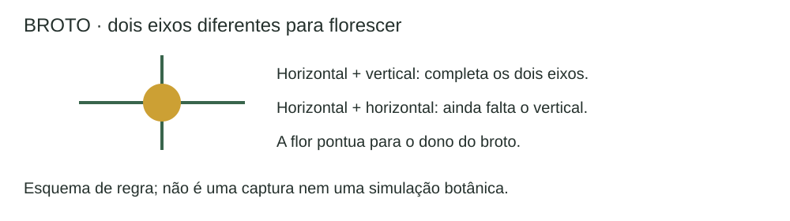

# BROTO

[Catálogo atual](../README.md) · [Projeto](../../../README.md) · [Arquitetura](../../arquitetura/README.md)

Plante sementes, complete estímulos e escolha quem floresce.

## Objetivo

**Faça suas sementes florescerem. Vence quem colher mais flores nas duas rodadas.**

## Como começar

1. Plante em uma casa vazia. A semente estimula o primeiro broto em cada direção.
2. Um broto floresce quando recebe estímulos horizontal e vertical. O dono ganha um ponto e a flor sai.
3. Cada pessoa planta oito sementes por rodada. Após duas rodadas, vence quem somar mais flores.

## Regras completas

1. Escolha uma casa vazia, veja a prévia e confirme o plantio. Cada pessoa tem oito sementes por rodada.
2. A semente nova estimula o primeiro broto que encontra para cima, baixo, esquerda e direita. O estímulo atravessa espaços vazios, mas não vai na diagonal nem volta para a semente nova.
3. Para florescer, um broto precisa receber estímulo dos dois eixos: horizontal ↔ e vertical ↕. Receber duas vezes o mesmo eixo não basta.
4. A flor vale um ponto para o dono do broto, mesmo quando foi o adversário que a completou. Depois, ela sai do tabuleiro, sem devolver uma semente à reserva.
5. Os brotos atingidos são definidos antes da colheita. Uma passagem aberta pela retirada de uma flor só ajuda a partir da próxima jogada.
6. Após os 16 plantios, brotos que não floresceram não pontuam. Na segunda rodada, o outro jogador começa. Some as flores das duas rodadas: mais flores vence; totais iguais empatam.

## Exemplo de raciocínio

O broto já tem estímulo horizontal. Plantar abaixo dá o vertical e faz nascer uma flor.

*Esquema de regra, não uma fase completa nem uma captura do site.*

## O que observar

A proposta é explorar decisões com consequências compartilhadas: uma semente pode preparar um broto próprio, completar uma flor adversária ou abrir passagem para uma jogada futura.

Não conclua uma solução apenas pela aparência. Leia as pistas da fase e confira a condição de término acima. O resultado depende do estado completo da partida, não de uma peça isolada. Mapas e grades disponíveis são os oferecidos pela preparação atual; não há campanha, desafio diário nem modo sem parar nesta família.

## Proposta pedagógica

Praticar antecipação e planejamento por turnos, acompanhando os efeitos imediatos de um plantio e as possibilidades que ele deixa para a próxima pessoa.

Essas são intenções de design e oportunidades de prática, não resultados acadêmicos medidos.

## Identidade visual e leitura

As cores, peças e ilustrações ajudam a distinguir estados e ações. A arte não concede poderes ou altera as regras. Veja a [galeria da identidade](../../identidade/README.md) e os [recursos de fauna e flora](../../../README.md#fauna-flora-e-objetos-com-funcao).

## Onde está implementado

- [dist/broto/engine.mjs](../../../dist/broto/engine.mjs)
- [dist/broto/ui.mjs](../../../dist/broto/ui.mjs)
- [dist/broto/README.md](../../../dist/broto/README.md)

As regras desta página foram confrontadas com os textos publicados em [game-info-content.mjs](../../../dist/game-info-content.mjs), os [guias rápidos](../../../dist/rules-quick-start.mjs) e os adaptadores próprios da família. Quantidades dependentes de mapa não devem ser tratadas como constantes universais.

## Preservação e verificação

O progresso usa o armazenamento local e o [backup compartilhado](../../../dist/progress-backup.mjs). Não reutilize número editorial como identificador de save. Ao alterar este jogo, confira ações válidas e inválidas, retorno à seleção, desfazer/refazer quando oferecidos, conclusão ou término, restauração e telas estreitas.

[Guia de testes](../../../tests/README.md) · [Qualidade](../../qualidade/README.md). Uma captura demonstra apresentação, não comprova sozinha toda a mecânica. As regras documentadas devem acompanhar o código, não substituir testes do motor.

## Referência técnica complementar

Os links abaixo preservam o mapa técnico documentado do jogo. Relatórios datados mantêm o escopo da revisão original, não certificam automaticamente a versão atual.

## Como a implementação funciona

Os primeiros receptores nas direções cardeais são encontrados antes das colheitas. Retirar uma flor durante a resolução não produz uma segunda onda no mesmo lance. As rodadas e a soma final são estados distintos.

| Arquivo principal | Responsabilidade |
| --- | --- |
| [engine.mjs](../../../dist/broto/engine.mjs) | Motor / validação |
| [maps.mjs](../../../dist/broto/maps.mjs) | Catálogo / conteúdo |
| [route.mjs](../../../dist/broto/route.mjs) | Interface / integração |
| [ui.mjs](../../../dist/broto/ui.mjs) | Interface / integração |

### Pontos de entrada no código

- `broto/engine.mjs`: `createBroto`, `legalBrotoMoves`, `applyBrotoMove`, `previewBrotoMove`, `undoBroto`, `redoBroto`, `resetBrotoRound`, `nextBrotoRound`, `rematchBroto`, `restoreBroto`.
- `broto/maps.mjs`: `getBrotoMap`.
- `broto/route.mjs`: `createBrotoRoute`.
- `broto/ui.mjs`: `initBroto`.

Os nomes acima são extraídos dos exports presentes nesta base. Antes de chamar uma função, confira parâmetros, retornos e casos de erro no módulo e em seus testes; não assuma que todos os jogos compartilham a mesma assinatura.

## Roteiro para estudar ou alterar

1. Leia as regras e identifique a condição de vitória ou encerramento.
2. Acompanhe a representação de fase/mapa e de estado no módulo principal.
3. Localize o caminho entre ação do usuário, validação, transição e renderização.
4. Observe como reset, undo/redo e restauração são oferecidos nesta interface.
5. Encontre um teste da regra alterada e reproduza um caso mínimo antes de editar.
6. Quando houver catálogo novo, confira IDs, soluções, contagem e impacto no save.

## Verificação e riscos específicos

Jogador 1 inicia novo duelo e revanche; a segunda rodada alterna o iniciador. Verificar resolução simultânea, pontuação por dono, reservas e restauração por replay. Os sete mapas são variações de duelo, não níveis de campanha.

Use o [guia de testes](../../../tests/README.md) para diferenciar testes de regras, mocks de DOM e snapshots de entrega. Estes arquivos relacionados são pontos de investigação, não uma declaração de que todos passam na versão atual:

- [broto-engine.test.mjs](../../../tests/broto-engine.test.mjs)
- [broto-integration.test.mjs](../../../tests/broto-integration.test.mjs)
- [broto-maps.test.mjs](../../../tests/broto-maps.test.mjs)
- [broto-player-one-start.test.mjs](../../../tests/broto-player-one-start.test.mjs)
- [broto-registration.test.mjs](../../../tests/broto-registration.test.mjs)
- [broto-round-result-inside.test.mjs](../../../tests/broto-round-result-inside.test.mjs)

Quando a mudança é visual, valide entrada no jogo, leitura das regras, interação principal, retorno e tamanhos de tela. Quando toca regras ou saves, acrescente casos de entradas inválidas, repetição da ação e restauração. Não conclua que uma busca encontrou solução única se ela esgotou seu orçamento.

## Documentação de referência

- [docs/broto-review.md](../../../docs/broto-review.md)
- [docs/broto-player-one-start-2026-10-31.md](../../../docs/broto-player-one-start-2026-10-31.md)
