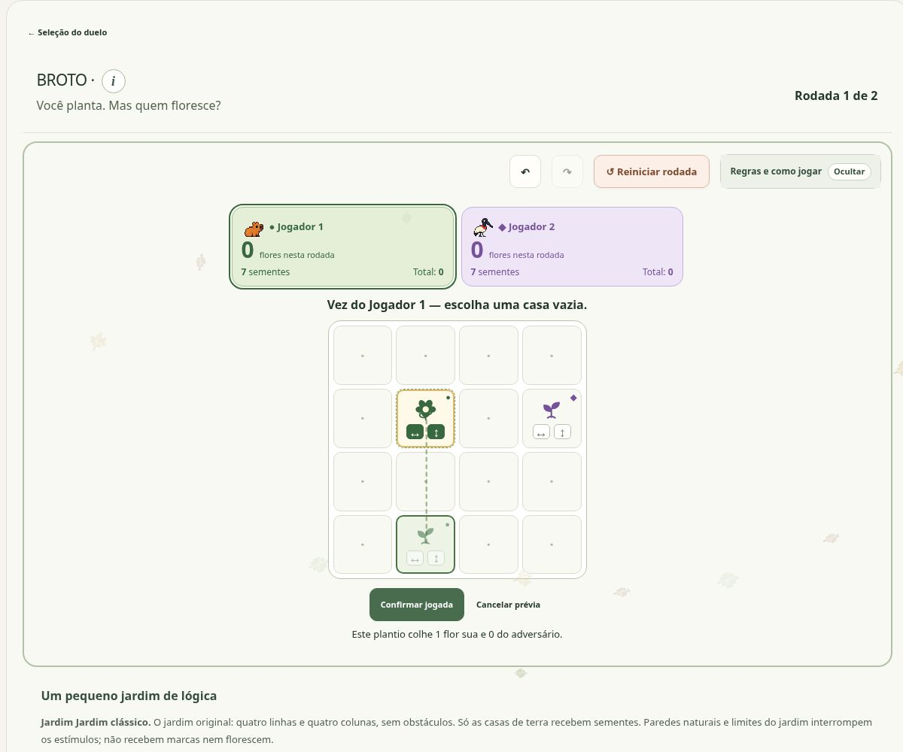

# BROTO

[Catálogo dos jogos](../README.md) · [Apresentação](../../../README.md) · [Arquitetura](../../arquitetura/README.md)

**Estímulos por eixos e efeitos compartilhados.** Categoria: Versus.

## O que o jogo faz

Plante sementes, complete estímulos e escolha quem floresce.

Você planta. Mas quem floresce? Um duelo local para duas pessoas: cada plantio pode completar flores suas ou do adversário.

## O jogo em imagem

*Na imagem: jardim clássico, rodada 1. A prévia em L4C2 completa o estímulo vertical do broto em L2C2 e indica uma flor para o Jogador 1.*

Clique na imagem para ampliar. Captura real do site em **1º de novembro de 2026**; [origem e contexto das imagens](../../imagens/jogos/README.md).

## Problema e proposta pedagógica

Praticar antecipação e planejamento por turnos, acompanhando os efeitos imediatos de um plantio e as possibilidades que ele deixa para a próxima pessoa.

A proposta é explorar decisões com consequências compartilhadas: uma semente pode preparar um broto próprio, completar uma flor adversária ou abrir passagem para uma jogada futura.

Esses objetivos descrevem a intenção de prática do jogo. Não são resultados de um estudo de aprendizagem com usuários.

## Como abrir

Execute o servidor pelo [guia de instalação](../../setup/README.md), abra a página inicial, escolha **Versus** e depois **BROTO**. O jogo participa da aplicação integrada; abrir um arquivo `.mjs` isolado não inicia sua interface.

## Regras e interação

1. Plante uma semente em qualquer casa vazia do tabuleiro 4 × 4. Escolha a casa, observe a prévia e confirme a jogada.
2. A semente nova estimula somente o primeiro broto encontrado em cada direção horizontal e vertical, atravessando casas vazias. Não há estímulos diagonais nem devolução de estímulos.
3. Um broto floresce quando recebe os dois eixos: horizontal ↔ e vertical ↕. Repetir um eixo não substitui o outro. A flor vale um ponto para o dono da peça, mesmo quando o adversário a completa.
4. Todas as peças atingidas são determinadas antes da colheita. A peça colhida sai do tabuleiro; a passagem aberta só vale em jogadas futuras. Colher não devolve sementes.
5. Cada pessoa tem oito sementes por rodada. Depois dos dezesseis plantios, os brotos restantes não pontuam. O duelo tem duas rodadas, com iniciador alternado; vence quem somar mais flores. Totais iguais dão empate.

## Exemplo de raciocínio

Um broto que já recebeu estímulo horizontal floresce ao receber o vertical. Repetir o horizontal não completa a flor. Se a peça pertence ao adversário, o ponto é dele, mesmo que o seu plantio tenha produzido o estímulo final.

O exemplo ilustra uma regra, não uma fase específica do catálogo. Para reproduzir uma fase concreta, use sua definição e seu ID junto com a solução de referência correspondente.

## Conteúdo ativo

Duelo em duas rodadas, sete mapas e oito sementes por jogador em cada rodada. Jogador 1 abre novos duelos e revanches; a segunda rodada troca o iniciador.

A posição exibida na seleção não é a identidade persistente da definição. Alterar uma fase pode exigir um novo ID, enquanto registros da fase anterior continuam arquivados. Referências antigas de catálogo precisam ser lidas junto do commit em que eram vigentes.

## Como a implementação funciona

Os primeiros receptores nas direções cardeais são encontrados antes das colheitas. Retirar uma flor durante a resolução não produz uma segunda onda no mesmo lance. As rodadas e a soma final são estados distintos.

| Arquivo principal | Responsabilidade |
| --- | --- |
| [engine.mjs](../../../dist/broto/engine.mjs) | Motor / validação |
| [maps.mjs](../../../dist/broto/maps.mjs) | Catálogo / conteúdo |
| [route.mjs](../../../dist/broto/route.mjs) | Interface / integração |
| [ui.mjs](../../../dist/broto/ui.mjs) | Interface / integração |

### Pontos de entrada no código

- `broto/engine.mjs`: `createBroto`, `legalBrotoMoves`, `applyBrotoMove`, `previewBrotoMove`, `undoBroto`, `redoBroto`, `resetBrotoRound`, `nextBrotoRound`, `rematchBroto`, `restoreBroto`.
- `broto/maps.mjs`: `getBrotoMap`.
- `broto/route.mjs`: `createBrotoRoute`.
- `broto/ui.mjs`: `initBroto`.

Os nomes acima são extraídos dos exports presentes nesta base. Antes de chamar uma função, confira parâmetros, retornos e casos de erro no módulo e em seus testes; não assuma que todos os jogos compartilham a mesma assinatura.

## Roteiro para estudar ou alterar

1. Leia as regras e identifique a condição de vitória ou encerramento.
2. Acompanhe a representação de fase/mapa e de estado no módulo principal.
3. Localize o caminho entre ação do usuário, validação, transição e renderização.
4. Observe como reset, undo/redo e restauração são oferecidos nesta interface.
5. Encontre um teste da regra alterada e reproduza um caso mínimo antes de editar.
6. Quando houver catálogo novo, confira IDs, soluções, contagem e impacto no save.

## Verificação e riscos específicos

Jogador 1 inicia novo duelo e revanche; a segunda rodada alterna o iniciador. Verificar resolução simultânea, pontuação por dono, reservas e restauração por replay. Os sete mapas são variações de duelo, não níveis de campanha.

Use o [guia de testes](../../../tests/README.md) para diferenciar testes de regras, mocks de DOM e snapshots de entrega. Estes arquivos relacionados são pontos de investigação, não uma declaração de que todos passam na versão atual:

- [broto-engine.test.mjs](../../../tests/broto-engine.test.mjs)
- [broto-integration.test.mjs](../../../tests/broto-integration.test.mjs)
- [broto-maps.test.mjs](../../../tests/broto-maps.test.mjs)
- [broto-player-one-start.test.mjs](../../../tests/broto-player-one-start.test.mjs)
- [broto-registration.test.mjs](../../../tests/broto-registration.test.mjs)
- [broto-round-result-inside.test.mjs](../../../tests/broto-round-result-inside.test.mjs)

Quando a mudança é visual, valide entrada no jogo, leitura das regras, interação principal, retorno e tamanhos de tela. Quando toca regras ou saves, acrescente casos de entradas inválidas, repetição da ação e restauração. Não conclua que uma busca encontrou solução única se ela esgotou seu orçamento.

## Documentação de referência

- [docs/broto-review.md](../../../docs/broto-review.md)
- [docs/broto-player-one-start-2026-10-31.md](../../../docs/broto-player-one-start-2026-10-31.md)

## Estado e limites

Guia da base `2354a3c`, reorganizada sem mudar código executável. Revisões posteriores só devem ser descritas depois de incorporadas e verificadas. Nenhuma publicação do site decorre deste manual. A organização local ainda precisa ser enviada ao repositório privado e passar pela revisão remota.
