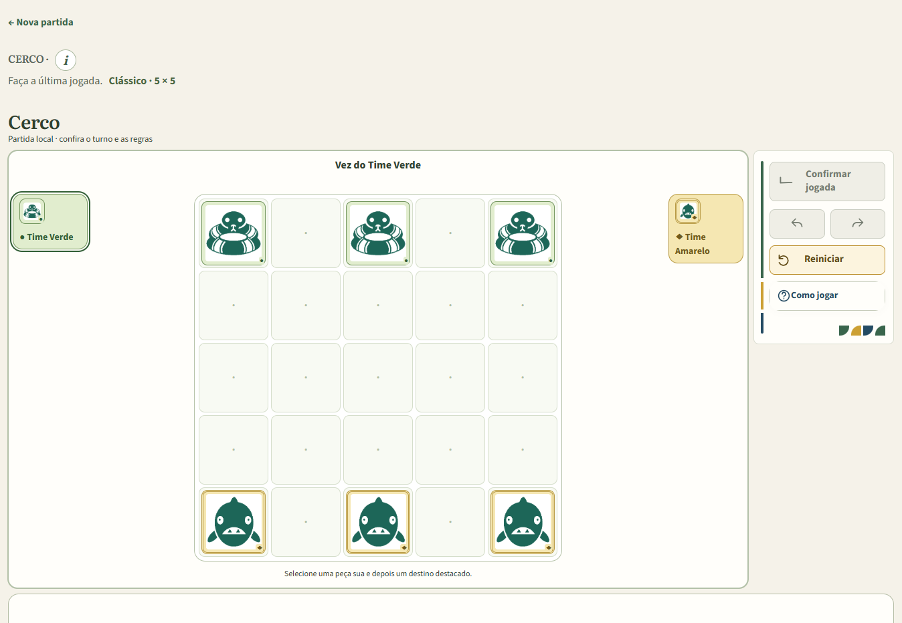
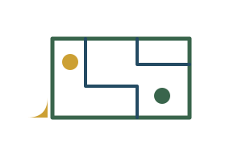

# CERCO

[Catálogo atual](../README.md) · [Projeto](../../../README.md) · [Arquitetura](../../arquitetura/README.md)

Mova suas peças, feche caminhos e deixe o adversário sem saída.

## Área de jogo atual

Expandir Área de jogo atual

*Captura local do código atual, com estado de demonstração, sem cursor ou dados pessoais. [Proveniência e limites](../../imagens/galeria-atual/README.md). Não representa uma solução nem comprova todos os estados da partida.*

## Objetivo

Expandir Objetivo

**Feche os caminhos do rival sem deixar suas próprias peças presas.**

## Como começar

Expandir Como começar

1. Escolha uma peça sua e mova uma casa para cima, baixo, esquerda ou direita.
2. O destino precisa estar vazio. A casa de onde você saiu vira uma barreira.
3. Quem começar a vez sem conseguir mover nenhuma peça perde. Não há saltos nem capturas.

## Regras completas

Expandir Regras completas

1. Escolha uma das suas três peças e uma casa vizinha vazia, sem barreira. Mova uma casa para cima, baixo, esquerda ou direita e confirme.
2. A casa que você deixou vira uma barreira permanente para os dois times. O destino não vira barreira.
3. Não vale mover na diagonal, saltar, empurrar, capturar ou passar a vez. Todas as peças continuam no tabuleiro.
4. Quem não consegue mover nenhuma das três peças na sua vez perde. Uma peça presa não encerra a partida se outra ainda puder sair.
5. Na preparação, escolha a grade e o mapa. O Verde começa a primeira partida; a revanche alterna quem começa. Os mascotes mudam só o visual, não os movimentos.

## Exemplo de raciocínio

Expandir Exemplo de raciocínio

Verde anda uma casa para baixo. A origem fecha; nenhuma peça é capturada.

## O que observar

Expandir O que observar

A proposta é tornar visíveis as consequências de uma decisão: mover uma peça também fecha uma passagem, e cada equipe precisa conservar alguma saída para sua próxima vez.

Não conclua uma solução apenas pela aparência. Leia as pistas da fase e confira a condição de término acima. O resultado depende do estado completo da partida, não de uma peça isolada. Mapas e grades disponíveis são os oferecidos pela preparação atual; não há campanha, desafio diário nem modo sem parar nesta família.

## Proposta pedagógica

Expandir Proposta pedagógica

Praticar planejamento por turnos e leitura de caminhos, observando como a casa abandonada altera as opções de ambos os times.

Essas são intenções de design e oportunidades de prática, não resultados acadêmicos medidos.

## Identidade visual e leitura

Expandir Identidade visual e leitura

As cores, peças e ilustrações ajudam a distinguir estados e ações. A arte não concede poderes ou altera as regras. Veja a [galeria da identidade](../../identidade/README.md) e os [recursos de fauna e flora](../../../README.md#fauna-flora-e-objetos-com-funcao).

## Onde está implementado

Expandir Onde está implementado

- [dist/cerco/engine.mjs](../../../dist/cerco/engine.mjs)
- [dist/cerco/ui.mjs](../../../dist/cerco/ui.mjs)
- [dist/cerco/README.md](../../../dist/cerco/README.md)

As regras desta página foram confrontadas com os textos publicados em [game-info-content.mjs](../../../dist/game-info-content.mjs), os [guias rápidos](../../../dist/rules-quick-start.mjs) e os adaptadores próprios da família. Quantidades dependentes de mapa não devem ser tratadas como constantes universais.

## Preservação e verificação

Expandir Preservação e verificação

O progresso usa o armazenamento local e o [backup compartilhado](../../../dist/progress-backup.mjs). Não reutilize número editorial como identificador de save. Ao alterar este jogo, confira ações válidas e inválidas, retorno à seleção, desfazer/refazer quando oferecidos, conclusão ou término, restauração e telas estreitas.

[Guia de testes](../../../tests/README.md) · [Qualidade](../../qualidade/README.md). Uma captura demonstra apresentação, não comprova sozinha toda a mecânica. As regras documentadas devem acompanhar o código, não substituir testes do motor.

## Referência técnica complementar

Expandir Referência técnica complementar

Os links abaixo preservam o mapa técnico documentado do jogo. Relatórios datados mantêm o escopo da revisão original, não certificam automaticamente a versão atual.

## Como a implementação funciona

Expandir Como a implementação funciona

O tabuleiro perde uma casa transitável a cada movimento. A condição terminal depende de toda a equipe. O catálogo tem quatro tamanhos, de 5×5 a 8×8, com sete mapas por tamanho; o bot tem orçamento e heurísticas.

| Arquivo principal | Responsabilidade |
| --- | --- |
| [engine.mjs](../../../dist/cerco/engine.mjs) | Motor / validação |
| [maps.mjs](../../../dist/cerco/maps.mjs) | Catálogo / conteúdo |
| [bot.mjs](../../../dist/cerco/bot.mjs) | Interface / integração |
| [service.mjs](../../../dist/cerco/service.mjs) | Interface / integração |
| [ui.mjs](../../../dist/cerco/ui.mjs) | Interface / integração |

### Pontos de entrada no código

- `cerco/engine.mjs`: `createCerco`, `cercoNeighbors`, `legalCercoMoves`, `applyCercoMove`, `previewCercoMove`, `undoCerco`, `redoCerco`, `resetCerco`, `rematchCerco`, `restoreCerco`.
- `cerco/maps.mjs`: `getCercoMapsForSize`, `getCercoMapVariant`, `getCercoMap`.
- `cerco/bot.mjs`: `evaluateCerco`, `chooseCercoMove`, `chooseCercoMoveAsync`.
- `cerco/service.mjs`: `createCercoSearch`.
- `cerco/ui.mjs`: `initCerco`.

Os nomes acima são extraídos dos exports presentes nesta base. Antes de chamar uma função, confira parâmetros, retornos e casos de erro no módulo e em seus testes; não assuma que todos os jogos compartilham a mesma assinatura.

## Roteiro para estudar ou alterar

Expandir Roteiro para estudar ou alterar

1. Leia as regras e identifique a condição de vitória ou encerramento.
2. Acompanhe a representação de fase/mapa e de estado no módulo principal.
3. Localize o caminho entre ação do usuário, validação, transição e renderização.
4. Observe como reset, undo/redo e restauração são oferecidos nesta interface.
5. Encontre um teste da regra alterada e reproduza um caso mínimo antes de editar.
6. Quando houver catálogo novo, confira IDs, soluções, contagem e impacto no save.

## Verificação e riscos específicos

Expandir Verificação e riscos específicos

Cobrir conservação das seis peças, barreira apenas na origem, ausência de diagonal/captura e fim por mobilidade zero do time. Mascotes são visuais e não concedem habilidades diferentes.

Use o [guia de testes](../../../tests/README.md) para diferenciar testes de regras, mocks de DOM e snapshots de entrega. Estes arquivos relacionados são pontos de investigação, não uma declaração de que todos passam na versão atual:

- [cerco-bot.test.mjs](../../../tests/cerco-bot.test.mjs)
- [cerco-default-mascots.test.mjs](../../../tests/cerco-default-mascots.test.mjs)
- [cerco-engine.test.mjs](../../../tests/cerco-engine.test.mjs)
- [cerco-grid-sizes.test.mjs](../../../tests/cerco-grid-sizes.test.mjs)
- [cerco-grid-ui-preservation.test.mjs](../../../tests/cerco-grid-ui-preservation.test.mjs)
- [cerco-integration.test.mjs](../../../tests/cerco-integration.test.mjs)
- [cerco-maps.test.mjs](../../../tests/cerco-maps.test.mjs)
- [cerco-registration.test.mjs](../../../tests/cerco-registration.test.mjs)
- [cerco-victory-center.test.mjs](../../../tests/cerco-victory-center.test.mjs)

Quando a mudança é visual, valide entrada no jogo, leitura das regras, interação principal, retorno e tamanhos de tela. Quando toca regras ou saves, acrescente casos de entradas inválidas, repetição da ação e restauração. Não conclua que uma busca encontrou solução única se ela esgotou seu orçamento.

## Documentação de referência

Expandir Documentação de referência

- [docs/cerco-review.md](../../../docs/cerco-review.md)
- [docs/cerco-grid-sizes-2026-11-01.md](../../../docs/cerco-grid-sizes-2026-11-01.md)

## AIIJ aprovada

Expandir AIIJ aprovada

Arquivo real aprovado, preservado em sua proporção original e com transparência. Esta ilustração pertence à identidade do jogo; não altera regras, controles, peças nem progresso. Não usar como miniatura do tabuleiro.

[Ver as 19 AIIJs e orientações de uso](../../identidade/aiij/README.md).

