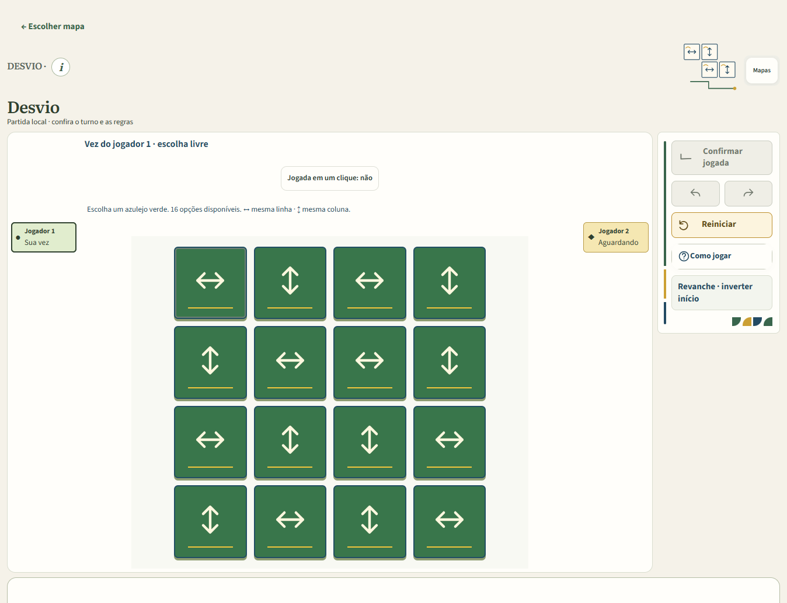
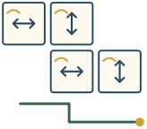

# DESVIO

[Catálogo atual](../README.md) · [Projeto](../../../README.md) · [Arquitetura](../../arquitetura/README.md)

Um duelo de estratégia por turnos em que cada escolha limita as opções do adversário.

## Área de jogo atual

Expandir Área de jogo atual

*Captura local do código atual, com estado de demonstração, sem cursor ou dados pessoais. [Proveniência e limites](../../imagens/galeria-atual/README.md). Não representa uma solução nem comprova todos os estados da partida.*

## Objetivo

Expandir Objetivo

**Deixe o adversário sem casa disponível para escolher.**

## Como começar

Expandir Como começar

1. Escolha uma casa disponível e confirme. Ela não poderá ser usada de novo.
2. ↔ manda o rival para a mesma linha; ↕ manda para a mesma coluna.
3. Na sua vez, escolha dentro do destino indicado. Casas usadas não bloqueiam a passagem.

## Regras completas

Expandir Regras completas

1. Na partida comum, a primeira escolha é livre. Depois, escolha uma casa disponível na linha ou coluna destacada e confirme.
2. A seta ↔ manda o adversário para a mesma linha. A seta ↕ manda para a mesma coluna.
3. A casa escolhida sai das opções. Casas usadas não bloqueiam passagem: você pode escolher qualquer casa disponível na linha ou coluna indicada.
4. Os jogadores alternam as escolhas. Quem chega à sua vez sem opção perde.

## Exemplo de raciocínio

Expandir Exemplo de raciocínio

Escolher ↔ no centro deixa ao rival apenas as outras casas da mesma linha.

## O que observar

Expandir O que observar

A proposta pedagógica é explorar as consequências de uma decisão: cada escolha retira uma opção do tabuleiro e determina quais escolhas o outro jogador terá.

Não conclua uma solução apenas pela aparência. Leia as pistas da fase e confira a condição de término acima. O resultado depende do estado completo da partida, não de uma peça isolada. Mapas e grades disponíveis são os oferecidos pela preparação atual; não há campanha, desafio diário nem modo sem parar nesta família.

## Proposta pedagógica

Expandir Proposta pedagógica

Praticar antecipação, planejamento por turnos e comparação de alternativas, considerando não só a própria jogada, mas também as respostas do adversário.

Essas são intenções de design e oportunidades de prática, não resultados acadêmicos medidos.

## Identidade visual e leitura

Expandir Identidade visual e leitura

As cores, peças e ilustrações ajudam a distinguir estados e ações. A arte não concede poderes ou altera as regras. Veja a [galeria da identidade](../../identidade/README.md) e os [recursos de fauna e flora](../../../README.md#fauna-flora-e-objetos-com-funcao).

## Onde está implementado

Expandir Onde está implementado

- [dist/desvio.mjs](../../../dist/desvio.mjs)
- [dist/desvio-map-catalog.mjs](../../../dist/desvio-map-catalog.mjs)

As regras desta página foram confrontadas com os textos publicados em [game-info-content.mjs](../../../dist/game-info-content.mjs), os [guias rápidos](../../../dist/rules-quick-start.mjs) e os adaptadores próprios da família. Quantidades dependentes de mapa não devem ser tratadas como constantes universais.

## Preservação e verificação

Expandir Preservação e verificação

O progresso usa o armazenamento local e o [backup compartilhado](../../../dist/progress-backup.mjs). Não reutilize número editorial como identificador de save. Ao alterar este jogo, confira ações válidas e inválidas, retorno à seleção, desfazer/refazer quando oferecidos, conclusão ou término, restauração e telas estreitas.

[Guia de testes](../../../tests/README.md) · [Qualidade](../../qualidade/README.md). Uma captura demonstra apresentação, não comprova sozinha toda a mecânica. As regras documentadas devem acompanhar o código, não substituir testes do motor.

## Referência técnica complementar

Expandir Referência técnica complementar

Os links abaixo preservam o mapa técnico documentado do jogo. Relatórios datados mantêm o escopo da revisão original, não certificam automaticamente a versão atual.

## Como a implementação funciona

Expandir Como a implementação funciona

O estado guarda casas disponíveis, jogador e restrição de linha/coluna. O motor rejeita callbacks com jogador ou turno desatualizados. A análise estratégica avalia a posição do jogador da vez.

| Arquivo principal | Responsabilidade |
| --- | --- |
| [desvio.mjs](../../../dist/desvio.mjs) | Interface / integração |
| [desvio-hints.mjs](../../../dist/desvio-hints.mjs) | Interface / integração |
| [collection-state.mjs](../../../dist/collection-state.mjs) | Progresso / compatibilidade |
| [collection-ui.mjs](../../../dist/collection-ui.mjs) | Interface / integração |

### Pontos de entrada no código

- `desvio.mjs`: `createDesvio`, `legalDesvioMoves`, `applyDesvioMove`, `analyzeDesvio`, `explainDesvioMove`, `chooseDesvioBotMove`, `replayDesvio`, `revancheDesvio`, `firstDesvioMistake`, `createDesvioChallenge`.
- `desvio-hints.mjs`: `buildDesvioContextHint`.
- `collection-state.mjs`: `createHistory`, `commitHistory`, `undoHistory`, `redoHistory`, `dailyIndex`, `loadCollection`, `saveCollection`, `recordEvent`.
- `collection-ui.mjs`: `initCollection`.

Os nomes acima são extraídos dos exports presentes nesta base. Antes de chamar uma função, confira parâmetros, retornos e casos de erro no módulo e em seus testes; não assuma que todos os jogos compartilham a mesma assinatura.

## Roteiro para estudar ou alterar

Expandir Roteiro para estudar ou alterar

1. Leia as regras e identifique a condição de vitória ou encerramento.
2. Acompanhe a representação de fase/mapa e de estado no módulo principal.
3. Localize o caminho entre ação do usuário, validação, transição e renderização.
4. Observe como reset, undo/redo e restauração são oferecidos nesta interface.
5. Encontre um teste da regra alterada e reproduza um caso mínimo antes de editar.
6. Quando houver catálogo novo, confira IDs, soluções, contagem e impacto no save.

## Verificação e riscos específicos

Expandir Verificação e riscos específicos

Cobrir primeira escolha livre, casas consumidas, restrição de destino e derrota por ausência de jogada. Não apresentar bot ou treino local como multiplayer pela internet.

Use o [guia de testes](../../../tests/README.md) para diferenciar testes de regras, mocks de DOM e snapshots de entrega. Estes arquivos relacionados são pontos de investigação, não uma declaração de que todos passam na versão atual:

- [desvio-context-hints-tests.mjs](../../../tests/desvio-context-hints-tests.mjs)

Quando a mudança é visual, valide entrada no jogo, leitura das regras, interação principal, retorno e tamanhos de tela. Quando toca regras ou saves, acrescente casos de entradas inválidas, repetição da ação e restauração. Não conclua que uma busca encontrou solução única se ela esgotou seu orçamento.

## Documentação de referência

Expandir Documentação de referência

- [dist/CONTROLES-DIRETOS.md](../../../dist/CONTROLES-DIRETOS.md)
- [dist/INTERACAO-DIRETA-MATRIZ.md](../../../dist/INTERACAO-DIRETA-MATRIZ.md)

## AIIJ aprovada

Expandir AIIJ aprovada

Arquivo real aprovado, preservado em sua proporção original e com transparência. Esta ilustração pertence à identidade do jogo; não altera regras, controles, peças nem progresso. Não usar como miniatura do tabuleiro.

[Ver as 19 AIIJs e orientações de uso](../../identidade/aiij/README.md).

