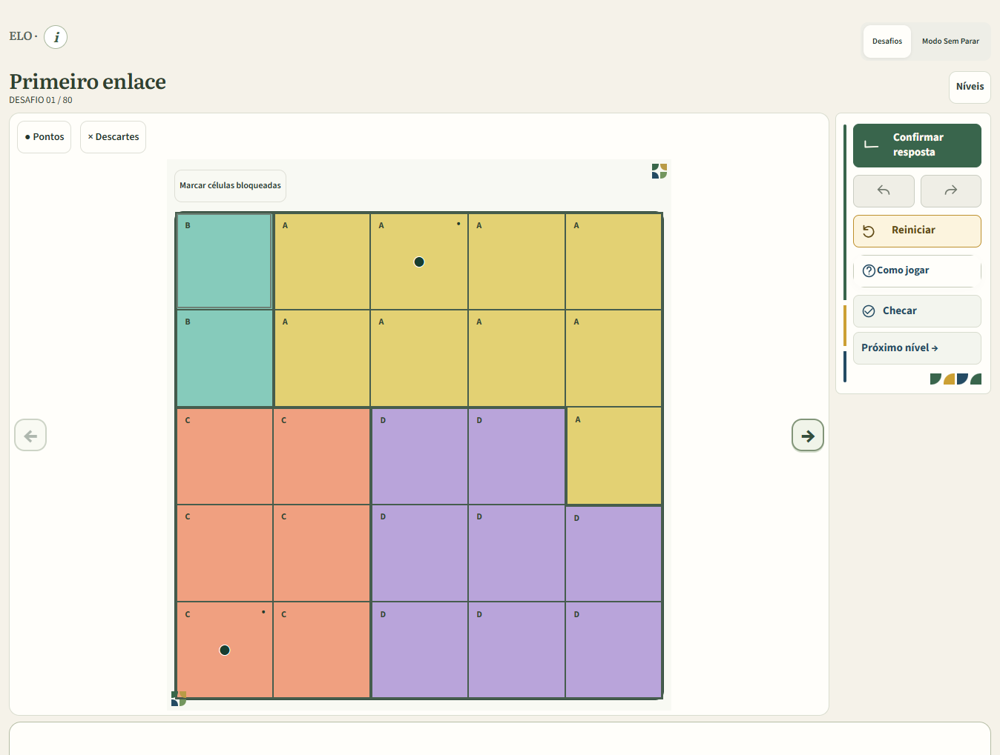
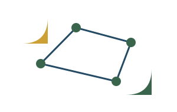

# ELO

[Catálogo atual](../README.md) · [Projeto](../../../README.md) · [Arquitetura](../../arquitetura/README.md)

Um puzzle de lógica em que pontos de regiões diferentes formam um circuito fechado.

## Área de jogo atual

*Captura local do código atual, com estado de demonstração, sem cursor ou dados pessoais. [Proveniência e limites](../../imagens/galeria-atual/README.md). Não representa uma solução nem comprova todos os estados da partida.*

## Objetivo

**Coloque um ponto em cada região e forme um único caminho fechado.**

## Como começar

1. Toque nas casas para colocar pontos. Preserve os pontos fixos.
2. Pontos alinhados se ligam automaticamente na horizontal ou vertical.
3. Cada ponto precisa de duas ligações, sem cruzamentos. Siga também as pistas da fase.

## Regras completas

1. Coloque exatamente um ponto em cada região. Os pontos fixos não podem ser movidos.
2. As ligações aparecem sozinhas: cada ponto se liga ao primeiro que encontra em cada direção horizontal ou vertical. Fronteiras e anotações X não bloqueiam as ligações.
3. Cada ponto precisa ter duas ligações. Juntas, elas devem formar um único circuito, sem cruzamentos fora dos pontos. Trechos retos valem; não é preciso usar todas as casas.
4. Algumas fases pedem curvas ou retas em pontos específicos, quantidades de pontos em linhas ou colunas, ou uma soma dos comprimentos das duas ligações de uma região.
5. Uma passagem marcada precisa ser atravessada por uma ligação, sem colocar ponto nela. Trechos vedados não podem ser usados. Nos grupos de escolha, atravesse apenas uma das passagens.
6. Outras pistas pedem ligação direta entre regiões, ordem dos marcos ou número de travessias de uma linha. A ordem pode ser lida nos dois sentidos e permite outras regiões entre os marcos. Confira as pistas da fase e confirme.

## Exemplo de raciocínio

O quarto ponto fecha o circuito: todos ficam ligados em uma só volta.

## O que observar

A proposta pedagógica é transformar conexões simples em um problema de planejamento: cada escolha precisa respeitar sua região e, ao mesmo tempo, contribuir para uma estrutura única.

Não conclua uma solução apenas pela aparência. Leia as pistas da fase e confira a condição de término acima. Pistas fixas e a identidade da fase devem ser preservadas. Dicas ou solução assistida não equivalem a uma conclusão independente.

## Proposta pedagógica

Praticar dedução lógica, visão espacial e articulação entre condições locais e globais, acompanhando como mover um ponto altera o circuito inteiro.

Essas são intenções de design e oportunidades de prática, não resultados acadêmicos medidos.

## Identidade visual e leitura

As cores, peças e ilustrações ajudam a distinguir estados e ações. A arte não concede poderes ou altera as regras. Veja a [galeria da identidade](../../identidade/README.md) e os [recursos de fauna e flora](../../../README.md#fauna-flora-e-objetos-com-funcao).

## Onde está implementado

- [dist/elo-rules.mjs](../../../dist/elo-rules.mjs)
- [dist/elo-campaign.mjs](../../../dist/elo-campaign.mjs)
- [dist/elo-progress.mjs](../../../dist/elo-progress.mjs)

As regras desta página foram confrontadas com os textos publicados em [game-info-content.mjs](../../../dist/game-info-content.mjs), os [guias rápidos](../../../dist/rules-quick-start.mjs) e os adaptadores próprios da família. Quantidades dependentes de mapa não devem ser tratadas como constantes universais.

## Preservação e verificação

O progresso usa o armazenamento local e o [backup compartilhado](../../../dist/progress-backup.mjs). Não reutilize número editorial como identificador de save. Ao alterar este jogo, confira ações válidas e inválidas, retorno à seleção, desfazer/refazer quando oferecidos, conclusão ou término, restauração e telas estreitas.

[Guia de testes](../../../tests/README.md) · [Qualidade](../../qualidade/README.md). Uma captura demonstra apresentação, não comprova sozinha toda a mecânica. As regras documentadas devem acompanhar o código, não substituir testes do motor.

## Referência técnica complementar

Os links abaixo preservam o mapa técnico documentado do jogo. Relatórios datados mantêm o escopo da revisão original, não certificam automaticamente a versão atual.

## Como a implementação funciona

O circuito pode ser visto como um grafo: pontos são vértices e alinhamentos válidos são arestas. Grau dois em cada vértice é necessário, mas ainda é preciso verificar conectividade global e ausência de cruzamentos.

| Arquivo principal | Responsabilidade |
| --- | --- |
| [elo-rules.mjs](../../../dist/elo-rules.mjs) | Motor / validação |
| [geometry-games.mjs](../../../dist/geometry-games.mjs) | Motor / validação |
| [elo-campaign.mjs](../../../dist/elo-campaign.mjs) | Catálogo / conteúdo |
| [elo-progress.mjs](../../../dist/elo-progress.mjs) | Progresso / compatibilidade |
| [collection-ui.mjs](../../../dist/collection-ui.mjs) | Interface / integração |

### Pontos de entrada no código

- `elo-rules.mjs`: `eloPointAllowed`, `eloEdges`, `eloCrossing`, `validateElo`, `analyzeEloLocal`, `solveElo`.
- `geometry-games.mjs`: `supportCells`, `initialGeometryState`, `validateGeometry`, `geometryShapes`, `prumoDomains`, `solveGeometry`, `geometryHint`, `geometryCandidates`, `geometryLocalAnalysis`.
- `elo-progress.mjs`: `migrateEloProgress`.
- `collection-ui.mjs`: `initCollection`.

Os nomes acima são extraídos dos exports presentes nesta base. Antes de chamar uma função, confira parâmetros, retornos e casos de erro no módulo e em seus testes; não assuma que todos os jogos compartilham a mesma assinatura.

## Roteiro para estudar ou alterar

1. Leia as regras e identifique a condição de vitória ou encerramento.
2. Acompanhe a representação de fase/mapa e de estado no módulo principal.
3. Localize o caminho entre ação do usuário, validação, transição e renderização.
4. Observe como reset, undo/redo e restauração são oferecidos nesta interface.
5. Encontre um teste da regra alterada e reproduza um caso mínimo antes de editar.
6. Quando houver catálogo novo, confira IDs, soluções, contagem e impacto no save.

## Verificação e riscos específicos

Cobrir ponto fixo, exatamente um ponto por região, cruzamentos, múltiplos ciclos, pistas especiais e anotações X. Uma anotação não se transforma em parede nem bloqueia a ligação automática.

Use o [guia de testes](../../../tests/README.md) para diferenciar testes de regras, mocks de DOM e snapshots de entrega. Estes arquivos relacionados são pontos de investigação, não uma declaração de que todos passam na versão atual:

- [elo-campaign-apply-editorial.mjs](../../../tests/elo-campaign-apply-editorial.mjs)
- [elo-campaign-build.mjs](../../../tests/elo-campaign-build.mjs)
- [elo-campaign-finalize.mjs](../../../tests/elo-campaign-finalize.mjs)
- [elo-campaign-reasoning.mjs](../../../tests/elo-campaign-reasoning.mjs)
- [elo-campaign-tests.mjs](../../../tests/elo-campaign-tests.mjs)
- [elo-clue-explanations-tests.mjs](../../../tests/elo-clue-explanations-tests.mjs)
- [elo-clue-explanations-ui-tests.mjs](../../../tests/elo-clue-explanations-ui-tests.mjs)
- [elo-explanations-history.mjs](../../../tests/elo-explanations-history.mjs)
- [elo-explanations-preservation-tests.mjs](../../../tests/elo-explanations-preservation-tests.mjs)
- [elo-region-colors.test.mjs](../../../tests/elo-region-colors.test.mjs)
- [elo-rules-tests.mjs](../../../tests/elo-rules-tests.mjs)
- [elo-toggle-placement.test.mjs](../../../tests/elo-toggle-placement.test.mjs)
- [elo-tools-row.test.mjs](../../../tests/elo-tools-row.test.mjs)
- [elo-ui-interactions.mjs](../../../tests/elo-ui-interactions.mjs)
- [elo-ui-presentation.mjs](../../../tests/elo-ui-presentation.mjs)
- [elo-v3-answer-oracle-tests.mjs](../../../tests/elo-v3-answer-oracle-tests.mjs)

Quando a mudança é visual, valide entrada no jogo, leitura das regras, interação principal, retorno e tamanhos de tela. Quando toca regras ou saves, acrescente casos de entradas inválidas, repetição da ação e restauração. Não conclua que uma busca encontrou solução única se ela esgotou seu orçamento.

## Documentação de referência

- [docs/elo80/README.md](../../../docs/elo80/README.md)
- [docs/elo-expanded-variety-2026-10-31.md](../../../docs/elo-expanded-variety-2026-10-31.md)

## AIIJ aprovada

Arquivo real aprovado, preservado em sua proporção original e com transparência. Esta ilustração pertence à identidade do jogo; não altera regras, controles, peças nem progresso. Não usar como miniatura do tabuleiro.

[Ver as 19 AIIJs e orientações de uso](../../identidade/aiij/README.md).
