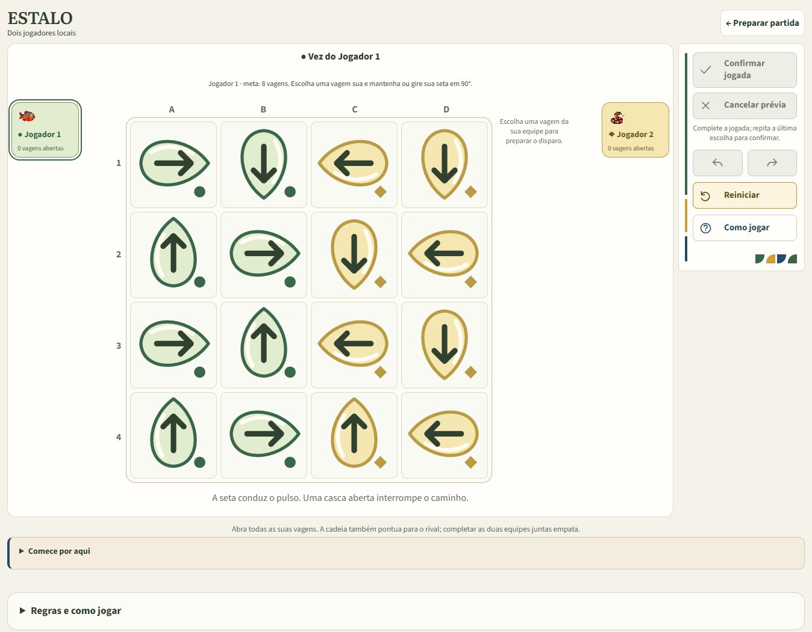
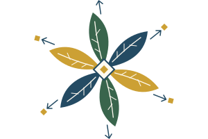

# ESTALO

[Catálogo atual](../README.md) · [Projeto](../../../README.md) · [Arquitetura](../../arquitetura/README.md)

Siga as setas e decida quem ganha com cada estalo.

## Área de jogo atual

Expandir Área de jogo atual

*Captura local do código atual, com estado de demonstração, sem cursor ou dados pessoais. [Proveniência e limites](../../imagens/galeria-atual/README.md). Não representa uma solução nem comprova todos os estados da partida.*

## Objetivo

Expandir Objetivo

**Abra todas as suas vagens antes do rival, planejando a sequência das setas.**

## Como começar

Expandir Como começar

1. Escolha uma vagem fechada sua. Você pode girar a seta 90° ou deixá-la como está.
2. Abra a vagem: o pulso segue as setas, abrindo as próximas em cadeia.
3. Cada vagem dá ponto ao próprio dono. A cadeia para na borda, num recorte vazio ou numa casa já aberta.

## Regras completas

Expandir Regras completas

1. Escolha uma vagem da sua cor. Mantenha a seta ou gire 90° para um dos lados. Veja a sequência prevista e confirme.
2. A vagem abre e a sequência segue a seta para a casa ao lado. Cada nova vagem alcançada abre e manda a sequência na direção da própria seta.
3. A sequência pode abrir vagens dos dois times. Ela para na borda, num recorte vazio ou numa casa que já foi aberta, inclusive se voltar a uma casa da mesma sequência.
4. Cada vagem aberta dá um ponto ao seu dono. Só depois de toda a sequência terminar se verifica a vitória: quem abrir todas as suas vagens vence. Se os dois completarem juntos, empata.

## Exemplo de raciocínio

Expandir Exemplo de raciocínio

No mapa Clássico, o pulso segue seis vagens e para ao reencontrar uma casa aberta: quatro pontos verdes e dois âmbar.

## O que observar

Expandir O que observar

A proposta é explorar decisões visíveis e consequências previsíveis em uma partida de duas pessoas, sem depender de reflexos ou precisão do mouse.

Não conclua uma solução apenas pela aparência. Leia as pistas da fase e confira a condição de término acima. O resultado depende do estado completo da partida, não de uma peça isolada. Mapas e grades disponíveis são os oferecidos pela preparação atual; não há campanha, desafio diário nem modo sem parar nesta família.

## Proposta pedagógica

Expandir Proposta pedagógica

Seguir percursos dirigidos e prever as interrupções criadas por uma cadeia.

Essas são intenções de design e oportunidades de prática, não resultados acadêmicos medidos.

## Identidade visual e leitura

Expandir Identidade visual e leitura

As cores, peças e ilustrações ajudam a distinguir estados e ações. A arte não concede poderes ou altera as regras. Veja a [galeria da identidade](../../identidade/README.md) e os [recursos de fauna e flora](../../../README.md#fauna-flora-e-objetos-com-funcao).

## Onde está implementado

Expandir Onde está implementado

- [dist/versus/games/estalo/engine.mjs](../../../dist/versus/games/estalo/engine.mjs)
- [dist/versus/games/estalo/view.mjs](../../../dist/versus/games/estalo/view.mjs)
- [dist/versus/games/estalo/maps.mjs](../../../dist/versus/games/estalo/maps.mjs)
- [dist/versus/CONTRACT.md](../../../dist/versus/CONTRACT.md)

As regras desta página foram confrontadas com os textos publicados em [game-info-content.mjs](../../../dist/game-info-content.mjs), os [guias rápidos](../../../dist/rules-quick-start.mjs) e os adaptadores próprios da família. Quantidades dependentes de mapa não devem ser tratadas como constantes universais.

## Preservação e verificação

Expandir Preservação e verificação

O progresso usa o armazenamento local e o [backup compartilhado](../../../dist/progress-backup.mjs). Não reutilize número editorial como identificador de save. Ao alterar este jogo, confira ações válidas e inválidas, retorno à seleção, desfazer/refazer quando oferecidos, conclusão ou término, restauração e telas estreitas.

[Guia de testes](../../../tests/README.md) · [Qualidade](../../qualidade/README.md). Uma captura demonstra apresentação, não comprova sozinha toda a mecânica. As regras documentadas devem acompanhar o código, não substituir testes do motor.

## AIIJ aprovada

Expandir AIIJ aprovada

Arquivo real aprovado, preservado em sua proporção original e com transparência. Esta ilustração pertence à identidade do jogo; não altera regras, controles, peças nem progresso. Não usar como miniatura do tabuleiro.

[Ver as 19 AIIJs e orientações de uso](../../identidade/aiij/README.md).

