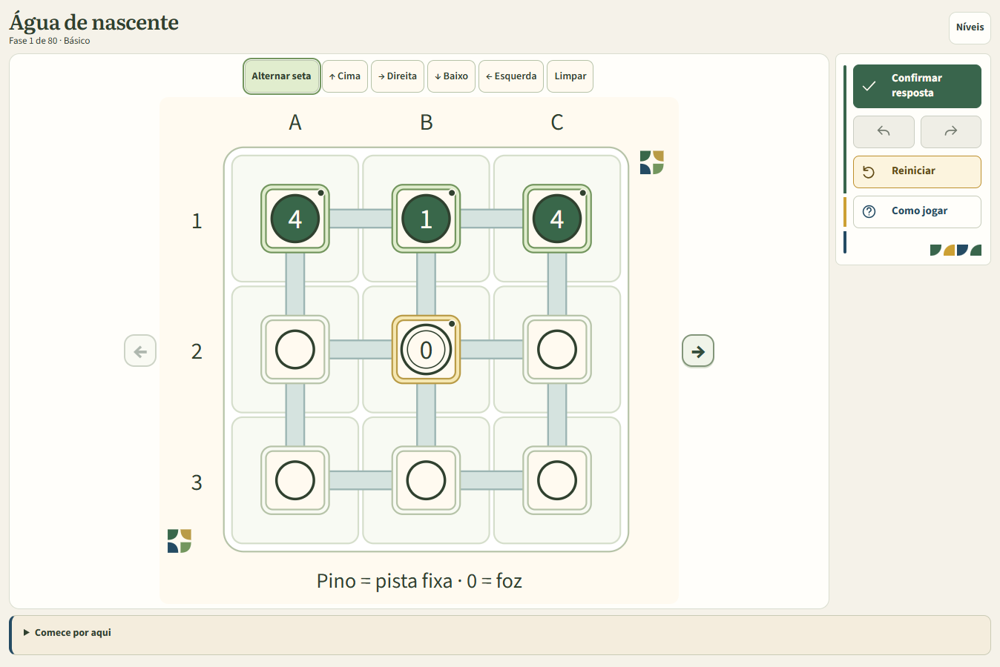
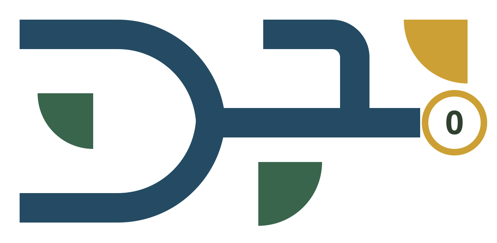

# FOZ

[Catálogo atual](../README.md) · [Projeto](../../../README.md) · [Arquitetura](../../arquitetura/README.md)

Oriente os canais para que toda gota alcance a foz, respeitando o número de passos indicado nas pistas.

## Área de jogo atual

Expandir Área de jogo atual

*Captura local do código atual, com estado de demonstração, sem cursor ou dados pessoais. [Proveniência e limites](../../imagens/galeria-atual/README.md). Não representa uma solução nem comprova todos os estados da partida.*

## Objetivo

Expandir Objetivo

**Faça todos os caminhos de água chegarem à foz, o ponto marcado com 0.**

## Como começar

Expandir Como começar

1. Em cada ponto, escolha uma seta para um vizinho ligado por um canal.
2. Siga as setas: o caminho precisa chegar ao 0, sem ficar dando voltas.
3. Um número conta os trechos até a foz. Caminhos podem se juntar.

## Regras completas

Expandir Regras completas

1. Toque em um ponto para escolher a seta, ou escolha uma direção na barra. A seta precisa apontar para um vizinho ligado por um canal.
2. Cada ponto tem uma seta, menos a foz 0. Seguindo as setas de qualquer ponto, você precisa chegar à foz.
3. Os caminhos podem se juntar, mas não podem dar voltas sem saída.
4. Os números mostram quantos trechos faltam até a foz. Conte os canais percorridos, não os pontos. Confira as pistas e confirme.

### Controles específicos

Clique em um ponto para alternar a seta. Você também pode escolher uma direção ou limpar o ponto. As setas só usam os canais desenhados; a foz permanece fixa.

## Exemplo de raciocínio

Expandir Exemplo de raciocínio

Da pista 2 até a foz são dois trechos: um para a direita e outro para baixo.

## O que observar

Expandir O que observar

Uma orientação local determina a distância de quem passa por ela. Os caminhos podem se juntar, mas todos precisam terminar na mesma foz.

Não conclua uma solução apenas pela aparência. Leia as pistas da fase e confira a condição de término acima. Pistas fixas e a identidade da fase devem ser preservadas. Dicas ou solução assistida não equivalem a uma conclusão independente.

## Proposta pedagógica

Expandir Proposta pedagógica

Praticar raciocínio sobre percursos, distâncias e prevenção de ciclos.

Essas são intenções de design e oportunidades de prática, não resultados acadêmicos medidos.

## Identidade visual e leitura

Expandir Identidade visual e leitura

As cores, peças e ilustrações ajudam a distinguir estados e ações. A arte não concede poderes ou altera as regras. Veja a [galeria da identidade](../../identidade/README.md) e os [recursos de fauna e flora](../../../README.md#fauna-flora-e-objetos-com-funcao).

## Onde está implementado

Expandir Onde está implementado

- [dist/logica/games/foz/engine.mjs](../../../dist/logica/games/foz/engine.mjs)
- [dist/logica/games/foz/view.mjs](../../../dist/logica/games/foz/view.mjs)
- [dist/logica/games/foz/index.mjs](../../../dist/logica/games/foz/index.mjs)
- [dist/logica/storage.mjs](../../../dist/logica/storage.mjs)

As regras desta página foram confrontadas com os textos publicados em [game-info-content.mjs](../../../dist/game-info-content.mjs), os [guias rápidos](../../../dist/rules-quick-start.mjs) e os adaptadores próprios da família. Quantidades dependentes de mapa não devem ser tratadas como constantes universais.

## Preservação e verificação

Expandir Preservação e verificação

O progresso usa o armazenamento local e o [backup compartilhado](../../../dist/progress-backup.mjs). Não reutilize número editorial como identificador de save. Ao alterar este jogo, confira ações válidas e inválidas, retorno à seleção, desfazer/refazer quando oferecidos, conclusão ou término, restauração e telas estreitas.

[Guia de testes](../../../tests/README.md) · [Qualidade](../../qualidade/README.md). Uma captura demonstra apresentação, não comprova sozinha toda a mecânica. As regras documentadas devem acompanhar o código, não substituir testes do motor.

## AIIJ aprovada

Expandir AIIJ aprovada

Arquivo real aprovado, preservado em sua proporção original e com transparência. Esta ilustração pertence à identidade do jogo; não altera regras, controles, peças nem progresso. Não usar como miniatura do tabuleiro.

[Ver as 19 AIIJs e orientações de uso](../../identidade/aiij/README.md).

