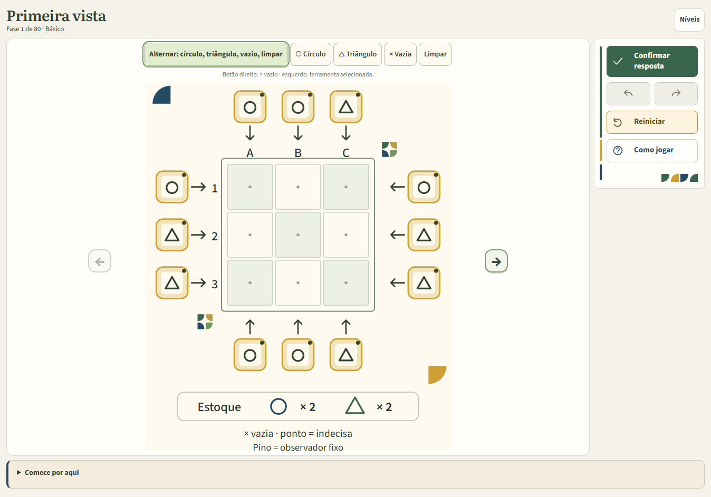
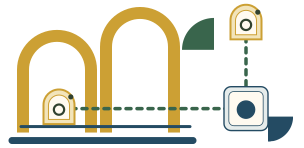

# MIRANTE

[Catálogo atual](../README.md) · [Projeto](../../../README.md) · [Arquitetura](../../arquitetura/README.md)

Distribua poucas peças para que todos os observadores vejam a forma certa, aproveitando a mesma peça em várias direções sem esconder quem ainda precisa ser visto.

## Área de jogo atual

Expandir Área de jogo atual

*Captura local do código atual, com estado de demonstração, sem cursor ou dados pessoais. [Proveniência e limites](../../imagens/galeria-atual/README.md). Não representa uma solução nem comprova todos os estados da partida.*

## Objetivo

Expandir Objetivo

**Coloque as formas para que cada seta da borda veja primeiro a forma pedida.**

## Como começar

Expandir Como começar

1. Use o estoque de círculos e triângulos. Marque casas vazias com ×.
2. Siga cada seta da borda: a primeira peça encontrada deve ser a forma indicada.
3. Cada peça precisa ser vista por pelo menos dois observadores. Vazios deixam a visão passar.

## Regras completas

Expandir Regras completas

1. Use exatamente as peças do estoque, no máximo uma por casa. Deixe as outras casas vazias.
2. Cada seta da borda olha em linha reta. Ela atravessa casas vazias e para na primeira peça: essa peça deve ser a forma pedida. Não há visão na diagonal.
3. Toda peça precisa ser vista por pelo menos duas setas. Setas de lados opostos contam separadamente; uma borda sem seta não conta.
4. Escolha uma forma ou marcação de vazio nos controles e toque na casa. No computador, o botão direito marca X; o esquerdo mantém a ação escolhida.
5. Uma linha de visão totalmente vazia não atende à pista. Confira o estoque e confirme a resposta.

### Controles específicos

Escolha uma ferramenta e use o botão esquerdo ou toque nas casas. O botão direito sempre marca × vazio, sem trocar a ferramenta. As placas âmbar são observadores fixos. Checar verifica estoque, primeiras vistas e as duas testemunhas.

## Exemplo de raciocínio

Expandir Exemplo de raciocínio

O círculo no meio é visto pelos observadores dos dois lados.

## O que observar

Expandir O que observar

Uma forma pode atender a vários olhares. O estoque e as oclusões permitem transformar pistas das bordas em decisões no interior.

Não conclua uma solução apenas pela aparência. Leia as pistas da fase e confira a condição de término acima. Pistas fixas e a identidade da fase devem ser preservadas. Dicas ou solução assistida não equivalem a uma conclusão independente.

## Proposta pedagógica

Expandir Proposta pedagógica

Praticar visibilidade, exclusão de posições e uso de um estoque global.

Essas são intenções de design e oportunidades de prática, não resultados acadêmicos medidos.

## Identidade visual e leitura

Expandir Identidade visual e leitura

As cores, peças e ilustrações ajudam a distinguir estados e ações. A arte não concede poderes ou altera as regras. Veja a [galeria da identidade](../../identidade/README.md) e os [recursos de fauna e flora](../../../README.md#fauna-flora-e-objetos-com-funcao).

## Onde está implementado

Expandir Onde está implementado

- [dist/logica/games/mirante/engine.mjs](../../../dist/logica/games/mirante/engine.mjs)
- [dist/logica/games/mirante/view.mjs](../../../dist/logica/games/mirante/view.mjs)
- [dist/logica/games/mirante/index.mjs](../../../dist/logica/games/mirante/index.mjs)
- [dist/logica/storage.mjs](../../../dist/logica/storage.mjs)

As regras desta página foram confrontadas com os textos publicados em [game-info-content.mjs](../../../dist/game-info-content.mjs), os [guias rápidos](../../../dist/rules-quick-start.mjs) e os adaptadores próprios da família. Quantidades dependentes de mapa não devem ser tratadas como constantes universais.

## Preservação e verificação

Expandir Preservação e verificação

O progresso usa o armazenamento local e o [backup compartilhado](../../../dist/progress-backup.mjs). Não reutilize número editorial como identificador de save. Ao alterar este jogo, confira ações válidas e inválidas, retorno à seleção, desfazer/refazer quando oferecidos, conclusão ou término, restauração e telas estreitas.

[Guia de testes](../../../tests/README.md) · [Qualidade](../../qualidade/README.md). Uma captura demonstra apresentação, não comprova sozinha toda a mecânica. As regras documentadas devem acompanhar o código, não substituir testes do motor.

## AIIJ aprovada

Expandir AIIJ aprovada

Arquivo real aprovado, preservado em sua proporção original e com transparência. Esta ilustração pertence à identidade do jogo; não altera regras, controles, peças nem progresso. Não usar como miniatura do tabuleiro.

[Ver as 19 AIIJs e orientações de uso](../../identidade/aiij/README.md).

