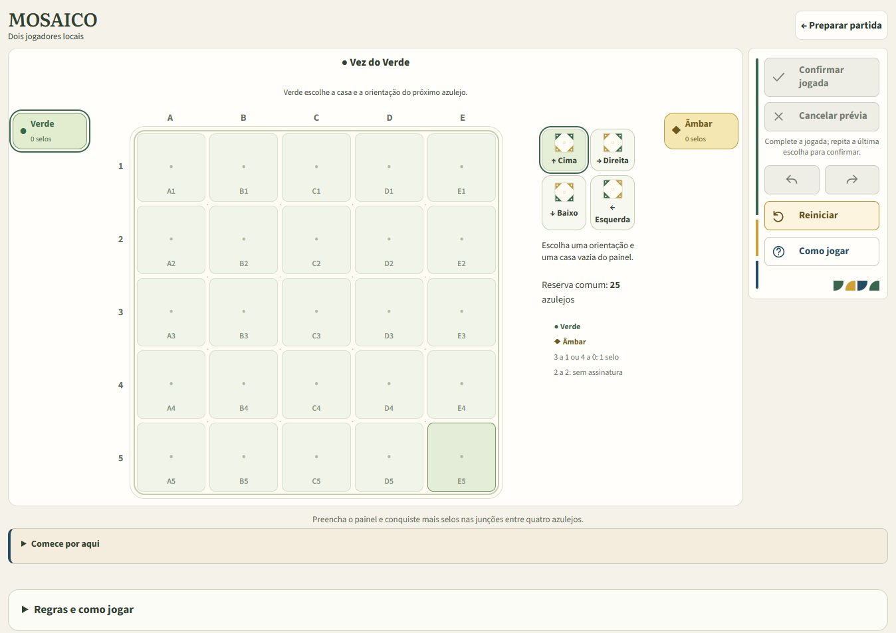

# MOSAICO

[Catálogo atual](../README.md) · [Projeto](../../../README.md) · [Arquitetura](../../arquitetura/README.md)

Oriente os azulejos. Conquiste os encontros.

## Área de jogo atual

*Captura local do código atual, com estado de demonstração, sem cursor ou dados pessoais. [Proveniência e limites](../../imagens/galeria-atual/README.md). Não representa uma solução nem comprova todos os estados da partida.*

## Objetivo

**Gire e coloque azulejos para formar encontros com mais cantos da sua cor.**

## Como começar

1. Escolha a orientação de um azulejo e coloque-o em uma casa vazia.
2. Quando quatro peças se encontram, conte os cantos voltados para o centro.
3. Três ou quatro cantos da mesma cor dão um selo a ela. Ao preencher tudo, vence quem tem mais selos.

## Regras completas

1. Escolha uma casa vazia e a orientação do azulejo. Confira a prévia e confirme a colocação.
2. Olhe onde quatro azulejos se encontram. Quando os quatro cantos desse encontro estiverem preenchidos, três ou quatro da mesma cor dão um selo para essa equipe.
3. Se houver dois cantos de cada cor, ninguém ganha o selo. Um azulejo pode completar mais de um encontro e também dar pontos ao rival.
4. Quando todas as casas jogáveis do mapa estiverem preenchidas, vence quem tiver mais selos. Quantidades iguais empatam.

## Exemplo de raciocínio

A última peça completa a junção: três cantos verdes e um âmbar dão um selo ao Verde.

## O que observar

A proposta é explorar decisões visíveis e consequências previsíveis em uma partida de duas pessoas, sem depender de reflexos ou precisão do mouse.

Não conclua uma solução apenas pela aparência. Leia as pistas da fase e confira a condição de término acima. O resultado depende do estado completo da partida, não de uma peça isolada. Mapas e grades disponíveis são os oferecidos pela preparação atual; não há campanha, desafio diário nem modo sem parar nesta família.

## Proposta pedagógica

Relacionar orientação espacial com maiorias em encontros compartilhados.

Essas são intenções de design e oportunidades de prática, não resultados acadêmicos medidos.

## Identidade visual e leitura

As cores, peças e ilustrações ajudam a distinguir estados e ações. A arte não concede poderes ou altera as regras. Veja a [galeria da identidade](../../identidade/README.md) e os [recursos de fauna e flora](../../../README.md#fauna-flora-e-objetos-com-funcao).

## Onde está implementado

- [dist/versus/games/mosaico/engine.mjs](../../../dist/versus/games/mosaico/engine.mjs)
- [dist/versus/games/mosaico/view.mjs](../../../dist/versus/games/mosaico/view.mjs)
- [dist/versus/games/mosaico/maps.mjs](../../../dist/versus/games/mosaico/maps.mjs)
- [dist/versus/CONTRACT.md](../../../dist/versus/CONTRACT.md)

As regras desta página foram confrontadas com os textos publicados em [game-info-content.mjs](../../../dist/game-info-content.mjs), os [guias rápidos](../../../dist/rules-quick-start.mjs) e os adaptadores próprios da família. Quantidades dependentes de mapa não devem ser tratadas como constantes universais.

## Preservação e verificação

O progresso usa o armazenamento local e o [backup compartilhado](../../../dist/progress-backup.mjs). Não reutilize número editorial como identificador de save. Ao alterar este jogo, confira ações válidas e inválidas, retorno à seleção, desfazer/refazer quando oferecidos, conclusão ou término, restauração e telas estreitas.

[Guia de testes](../../../tests/README.md) · [Qualidade](../../qualidade/README.md). Uma captura demonstra apresentação, não comprova sozinha toda a mecânica. As regras documentadas devem acompanhar o código, não substituir testes do motor.
