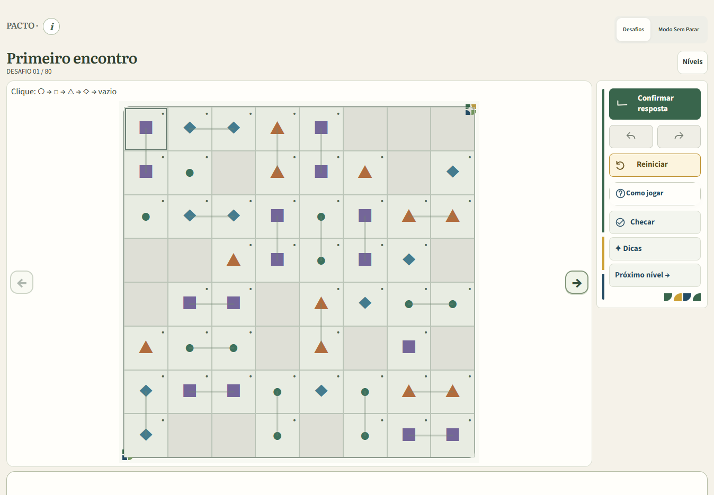

# PACTO

[Catálogo atual](../README.md) · [Projeto](../../../README.md) · [Arquitetura](../../arquitetura/README.md)

Um puzzle de dedução em que quatro símbolos precisam formar parcerias numa grade.

## Área de jogo atual

*Captura local do código atual, com estado de demonstração, sem cursor ou dados pessoais. [Proveniência e limites](../../imagens/galeria-atual/README.md). Não representa uma solução nem comprova todos os estados da partida.*

## Objetivo

**Forme duplas iguais e deixe dois de cada símbolo em toda linha e coluna.**

## Como começar

1. Escolha um símbolo e toque em uma casa livre, sem mudar as pistas fixas.
2. Cada linha e coluna precisa de dois círculos, dois triângulos, dois quadrados e dois losangos.
3. Cada símbolo deve tocar exatamente um igual pelos lados. Diagonais não valem.

## Regras completas

1. Preencha a grade com círculo, triângulo, quadrado e losango. Não altere as pistas fixas.
2. Cada linha e cada coluna precisam ter exatamente dois de cada símbolo.
3. Cada casa deve tocar exatamente uma casa com o mesmo símbolo pelos lados. Diagonais não contam; duplas valem, trios não.
4. Use o lápis só para anotar possibilidades. Quando toda a grade estiver correta, o jogo reconhece a vitória automaticamente.

## Exemplo de raciocínio

Dois círculos lado a lado formam uma dupla; um terceiro não pode encostar neles.

## O que observar

A proposta pedagógica é mostrar como regras simples se complementam: uma dupla possível num canto pode mudar as opções de toda uma linha ou coluna.

Não conclua uma solução apenas pela aparência. Leia as pistas da fase e confira a condição de término acima. Pistas fixas e a identidade da fase devem ser preservadas. Dicas ou solução assistida não equivalem a uma conclusão independente.

## Proposta pedagógica

Praticar contagem, exclusão de possibilidades e dedução, combinando uma regra de vizinhança com restrições de linhas e colunas.

Essas são intenções de design e oportunidades de prática, não resultados acadêmicos medidos.

## Identidade visual e leitura

As cores, peças e ilustrações ajudam a distinguir estados e ações. A arte não concede poderes ou altera as regras. Veja a [galeria da identidade](../../identidade/README.md) e os [recursos de fauna e flora](../../../README.md#fauna-flora-e-objetos-com-funcao).

## Onde está implementado

- [dist/pacto-check.mjs](../../../dist/pacto-check.mjs)
- [dist/pacto-campaign.mjs](../../../dist/pacto-campaign.mjs)

As regras desta página foram confrontadas com os textos publicados em [game-info-content.mjs](../../../dist/game-info-content.mjs), os [guias rápidos](../../../dist/rules-quick-start.mjs) e os adaptadores próprios da família. Quantidades dependentes de mapa não devem ser tratadas como constantes universais.

## Preservação e verificação

O progresso usa o armazenamento local e o [backup compartilhado](../../../dist/progress-backup.mjs). Não reutilize número editorial como identificador de save. Ao alterar este jogo, confira ações válidas e inválidas, retorno à seleção, desfazer/refazer quando oferecidos, conclusão ou término, restauração e telas estreitas.

[Guia de testes](../../../tests/README.md) · [Qualidade](../../qualidade/README.md). Uma captura demonstra apresentação, não comprova sozinha toda a mecânica. As regras documentadas devem acompanhar o código, não substituir testes do motor.

## Referência técnica complementar

Os links abaixo preservam o mapa técnico documentado do jogo. Relatórios datados mantêm o escopo da revisão original, não certificam automaticamente a versão atual.

## Como a implementação funciona

As restrições de quota e de vizinhança precisam ser satisfeitas ao mesmo tempo. Feedback local de erro explícito e dedução global são operações diferentes; um preenchimento ainda inconclusivo não deve ser marcado como definitivamente errado.

| Arquivo principal | Responsabilidade |
| --- | --- |
| [symbol-games.mjs](../../../dist/symbol-games.mjs) | Motor / validação |
| [pacto-campaign.mjs](../../../dist/pacto-campaign.mjs) | Catálogo / conteúdo |
| [pacto-check.mjs](../../../dist/pacto-check.mjs) | Interface / integração |
| [pacto-feedback.mjs](../../../dist/pacto-feedback.mjs) | Interface / integração |
| [pacto-progress.mjs](../../../dist/pacto-progress.mjs) | Progresso / compatibilidade |

### Pontos de entrada no código

- `symbol-games.mjs`: `symbolCandidates`, `validateSymbols`, `validateSymbolEditing`, `solveSymbols`, `symbolHint`, `profileSymbols`, `canonicalSymbols`.
- `pacto-check.mjs`: `comparePactoReference`, `createPactoCheck`.
- `pacto-feedback.mjs`: `createPactoFeedback`.
- `pacto-progress.mjs`: `migratePactoProgress`.

Os nomes acima são extraídos dos exports presentes nesta base. Antes de chamar uma função, confira parâmetros, retornos e casos de erro no módulo e em seus testes; não assuma que todos os jogos compartilham a mesma assinatura.

## Roteiro para estudar ou alterar

1. Leia as regras e identifique a condição de vitória ou encerramento.
2. Acompanhe a representação de fase/mapa e de estado no módulo principal.
3. Localize o caminho entre ação do usuário, validação, transição e renderização.
4. Observe como reset, undo/redo e restauração são oferecidos nesta interface.
5. Encontre um teste da regra alterada e reproduza um caso mínimo antes de editar.
6. Quando houver catálogo novo, confira IDs, soluções, contagem e impacto no save.

## Verificação e riscos específicos

Preservar pistas, quotas por linha e coluna, dupla ortogonal e conclusão automática. Testar a diferença entre lápis/anotação e valor confirmado e impedir contagem duplicada de vitória.

Use o [guia de testes](../../../tests/README.md) para diferenciar testes de regras, mocks de DOM e snapshots de entrega. Estes arquivos relacionados são pontos de investigação, não uma declaração de que todos passam na versão atual:

- [pacto-auto-victory.test.mjs](../../../tests/pacto-auto-victory.test.mjs)
- [pacto-check-tests.mjs](../../../tests/pacto-check-tests.mjs)
- [pacto-feedback-tests.mjs](../../../tests/pacto-feedback-tests.mjs)
- [pacto-live-tests.mjs](../../../tests/pacto-live-tests.mjs)
- [pacto80-budget-and-identities.mjs](../../../tests/pacto80-budget-and-identities.mjs)
- [pacto80-build-compact.mjs](../../../tests/pacto80-build-compact.mjs)
- [pacto80-build-recompose.mjs](../../../tests/pacto80-build-recompose.mjs)
- [pacto80-build.mjs](../../../tests/pacto80-build.mjs)
- [pacto80-direct-hints-tests.mjs](../../../tests/pacto80-direct-hints-tests.mjs)
- [pacto80-independent-editorial.mjs](../../../tests/pacto80-independent-editorial.mjs)
- [pacto80-independent-tests.mjs](../../../tests/pacto80-independent-tests.mjs)
- [pacto80-independent-trace-tests.mjs](../../../tests/pacto80-independent-trace-tests.mjs)
- [pacto80-legacy-rule-regression.mjs](../../../tests/pacto80-legacy-rule-regression.mjs)
- [pacto80-preservation-tests.mjs](../../../tests/pacto80-preservation-tests.mjs)
- [pacto80-progress-tests.mjs](../../../tests/pacto80-progress-tests.mjs)
- [pacto80-reasoning.mjs](../../../tests/pacto80-reasoning.mjs)

Quando a mudança é visual, valide entrada no jogo, leitura das regras, interação principal, retorno e tamanhos de tela. Quando toca regras ou saves, acrescente casos de entradas inválidas, repetição da ação e restauração. Não conclua que uma busca encontrou solução única se ela esgotou seu orçamento.

## Documentação de referência

- [dist/PACTO80-VALIDACAO.md](../../../dist/PACTO80-VALIDACAO.md)
- [dist/QA-PACTO-HACHURAS.md](../../../dist/QA-PACTO-HACHURAS.md)

## AIIJ aprovada

Arquivo real aprovado, preservado em sua proporção original e com transparência. Esta ilustração pertence à identidade do jogo; não altera regras, controles, peças nem progresso. Não usar como miniatura do tabuleiro.

[Ver as 19 AIIJs e orientações de uso](../../identidade/aiij/README.md).
