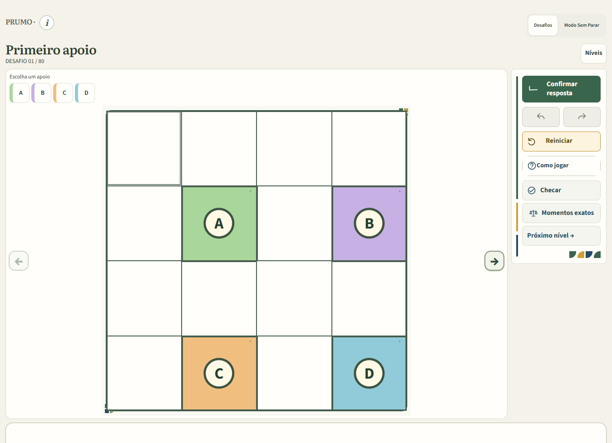
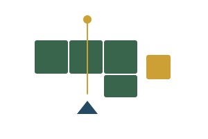

# PRUMO

[Catálogo atual](../README.md) · [Projeto](../../../README.md) · [Arquitetura](../../arquitetura/README.md)

Um puzzle de equilíbrio em que você desenha peças ao redor de seus apoios.

## Área de jogo atual

Expandir Área de jogo atual

*Captura local do código atual, com estado de demonstração, sem cursor ou dados pessoais. [Proveniência e limites](../../imagens/galeria-atual/README.md). Não representa uma solução nem comprova todos os estados da partida.*

## Objetivo

Expandir Objetivo

**Pinte uma peça para cada apoio. Todas precisam se equilibrar sobre ele.**

## Como começar

Expandir Como começar

1. Escolha um apoio e pinte as casas da peça dele.
2. Preencha a grade. Cada peça deve ser unida pelos lados e conter seu apoio.
3. Equilibre na horizontal e na vertical. Casas mais distantes puxam mais para aquele lado. Confira a resposta.

## Regras completas

Expandir Regras completas

1. Escolha um apoio e pinte sua peça. Preencha toda a grade, sem sobrepor peças. As casas da mesma peça se ligam pelos lados.
2. O apoio pertence à sua peça. Se ele fica entre casas, todas as casas que o tocam entram nessa peça.
3. Cada casa pesa o mesmo. O peso total precisa se equilibrar sobre o apoio, tanto da esquerda para a direita quanto de cima para baixo.
4. Conte também a distância: uma casa mais longe pesa mais para aquele lado. A peça não precisa ser simétrica. Confirme quando terminar de pintar.

## Exemplo de raciocínio

Expandir Exemplo de raciocínio

Uma casa à direita compensa a casa à esquerda, à mesma distância do apoio.

## O que observar

Expandir O que observar

A proposta pedagógica é permitir que o equilíbrio seja investigado com formas: uma peça não precisa ser simétrica para compensar seus dois lados.

Não conclua uma solução apenas pela aparência. Leia as pistas da fase e confira a condição de término acima. Pistas fixas e a identidade da fase devem ser preservadas. Dicas ou solução assistida não equivalem a uma conclusão independente.

## Proposta pedagógica

Expandir Proposta pedagógica

Praticar raciocínio espacial e explorar centro de massa, equilíbrio e compensação entre quantidade e distância.

Essas são intenções de design e oportunidades de prática, não resultados acadêmicos medidos.

## Identidade visual e leitura

Expandir Identidade visual e leitura

As cores, peças e ilustrações ajudam a distinguir estados e ações. A arte não concede poderes ou altera as regras. Veja a [galeria da identidade](../../identidade/README.md) e os [recursos de fauna e flora](../../../README.md#fauna-flora-e-objetos-com-funcao).

## Onde está implementado

Expandir Onde está implementado

- [dist/prumo-balance.mjs](../../../dist/prumo-balance.mjs)
- [dist/prumo-campaign.mjs](../../../dist/prumo-campaign.mjs)

As regras desta página foram confrontadas com os textos publicados em [game-info-content.mjs](../../../dist/game-info-content.mjs), os [guias rápidos](../../../dist/rules-quick-start.mjs) e os adaptadores próprios da família. Quantidades dependentes de mapa não devem ser tratadas como constantes universais.

## Preservação e verificação

Expandir Preservação e verificação

O progresso usa o armazenamento local e o [backup compartilhado](../../../dist/progress-backup.mjs). Não reutilize número editorial como identificador de save. Ao alterar este jogo, confira ações válidas e inválidas, retorno à seleção, desfazer/refazer quando oferecidos, conclusão ou término, restauração e telas estreitas.

[Guia de testes](../../../tests/README.md) · [Qualidade](../../qualidade/README.md). Uma captura demonstra apresentação, não comprova sozinha toda a mecânica. As regras documentadas devem acompanhar o código, não substituir testes do motor.

## Referência técnica complementar

Expandir Referência técnica complementar

Os links abaixo preservam o mapa técnico documentado do jogo. Relatórios datados mantêm o escopo da revisão original, não certificam automaticamente a versão atual.

## Como a implementação funciona

Expandir Como a implementação funciona

Para massas iguais, o centro é a média das coordenadas. O motor usa coordenadas duplicadas e momentos inteiros para representar apoios entre casas; assim, equilíbrio exato não depende de uma tolerância visual.

| Arquivo principal | Responsabilidade |
| --- | --- |
| [geometry-games.mjs](../../../dist/geometry-games.mjs) | Motor / validação |
| [prumo-balance.mjs](../../../dist/prumo-balance.mjs) | Interface / integração |
| [prumo-campaign.mjs](../../../dist/prumo-campaign.mjs) | Catálogo / conteúdo |
| [prumo-progress.mjs](../../../dist/prumo-progress.mjs) | Progresso / compatibilidade |
| [collection-ui.mjs](../../../dist/collection-ui.mjs) | Interface / integração |

### Pontos de entrada no código

- `geometry-games.mjs`: `supportCells`, `initialGeometryState`, `validateGeometry`, `geometryShapes`, `prumoDomains`, `solveGeometry`, `geometryHint`, `geometryCandidates`, `geometryLocalAnalysis`.
- `prumo-balance.mjs`: `prumoBalanceModel`, `prumoBalanceMarkup`.
- `prumo-progress.mjs`: `migratePrumoProgress`.
- `collection-ui.mjs`: `initCollection`.

Os nomes acima são extraídos dos exports presentes nesta base. Antes de chamar uma função, confira parâmetros, retornos e casos de erro no módulo e em seus testes; não assuma que todos os jogos compartilham a mesma assinatura.

## Roteiro para estudar ou alterar

Expandir Roteiro para estudar ou alterar

1. Leia as regras e identifique a condição de vitória ou encerramento.
2. Acompanhe a representação de fase/mapa e de estado no módulo principal.
3. Localize o caminho entre ação do usuário, validação, transição e renderização.
4. Observe como reset, undo/redo e restauração são oferecidos nesta interface.
5. Encontre um teste da regra alterada e reproduza um caso mínimo antes de editar.
6. Quando houver catálogo novo, confira IDs, soluções, contagem e impacto no save.

## Verificação e riscos específicos

Expandir Verificação e riscos específicos

Cobrir apoio entre casas, conectividade, sobreposição, grade completa e momento nos dois eixos. Grades da campanha chegam a 10×10; limites de importação e orçamento de busca são contratos separados.

Use o [guia de testes](../../../tests/README.md) para diferenciar testes de regras, mocks de DOM e snapshots de entrega. Estes arquivos relacionados são pontos de investigação, não uma declaração de que todos passam na versão atual:

- [prumo-balance.test.mjs](../../../tests/prumo-balance.test.mjs)
- [prumo80-audit-consistency.mjs](../../../tests/prumo80-audit-consistency.mjs)
- [prumo80-audit-export.mjs](../../../tests/prumo80-audit-export.mjs)
- [prumo80-build.mjs](../../../tests/prumo80-build.mjs)
- [prumo80-build.test.mjs](../../../tests/prumo80-build.test.mjs)
- [prumo80-campaign-ui-tests.mjs](../../../tests/prumo80-campaign-ui-tests.mjs)
- [prumo80-certificate-tests.mjs](../../../tests/prumo80-certificate-tests.mjs)
- [prumo80-document.mjs](../../../tests/prumo80-document.mjs)
- [prumo80-editorial-evidence.mjs](../../../tests/prumo80-editorial-evidence.mjs)
- [prumo80-editorial-review.mjs](../../../tests/prumo80-editorial-review.mjs)
- [prumo80-editorial-witness-tests.mjs](../../../tests/prumo80-editorial-witness-tests.mjs)
- [prumo80-interactions-tests.mjs](../../../tests/prumo80-interactions-tests.mjs)
- [prumo80-migration-ui-tests.mjs](../../../tests/prumo80-migration-ui-tests.mjs)
- [prumo80-preservation-tests.mjs](../../../tests/prumo80-preservation-tests.mjs)
- [prumo80-progress-tests.mjs](../../../tests/prumo80-progress-tests.mjs)
- [prumo80-solver-tests.mjs](../../../tests/prumo80-solver-tests.mjs)

Quando a mudança é visual, valide entrada no jogo, leitura das regras, interação principal, retorno e tamanhos de tela. Quando toca regras ou saves, acrescente casos de entradas inválidas, repetição da ação e restauração. Não conclua que uma busca encontrou solução única se ela esgotou seu orçamento.

## Documentação de referência

Expandir Documentação de referência

- [dist/PRUMO80-VALIDACAO.md](../../../dist/PRUMO80-VALIDACAO.md)
- [docs/prumo80-validation.md](../../../docs/prumo80-validation.md)

## AIIJ aprovada

Expandir AIIJ aprovada

Arquivo real aprovado, preservado em sua proporção original e com transparência. Esta ilustração pertence à identidade do jogo; não altera regras, controles, peças nem progresso. Não usar como miniatura do tabuleiro.

[Ver as 19 AIIJs e orientações de uso](../../identidade/aiij/README.md).

