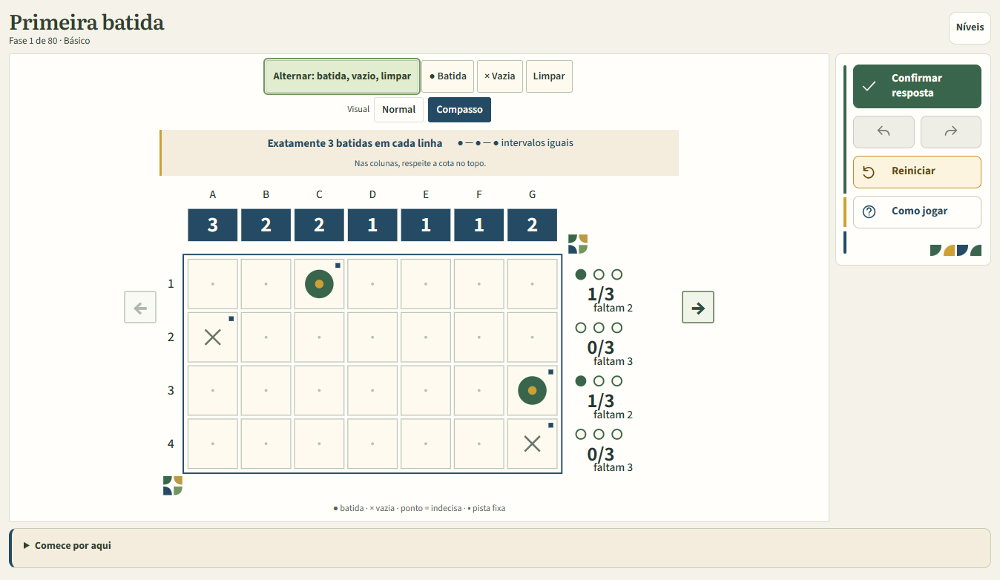
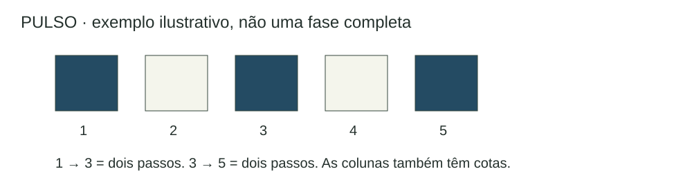
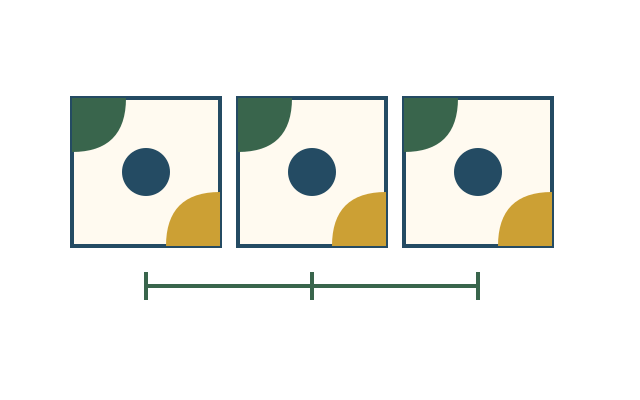

# PULSO

[Catálogo atual](../README.md) · [Projeto](../../../README.md) · [Arquitetura](../../arquitetura/README.md)

Marque três batidas igualmente espaçadas em cada linha e faça as colunas atingirem suas cotas.

## Área de jogo atual

Expandir Área de jogo atual

*Captura local do código atual, com estado de demonstração, sem cursor ou dados pessoais. [Proveniência e limites](../../imagens/galeria-atual/README.md). Não representa uma solução nem comprova todos os estados da partida.*

## Objetivo

Expandir Objetivo

**Coloque três marcas por linha, com o mesmo espaço entre elas, e acerte as quantidades das colunas.**

## Como começar

Expandir Como começar

1. Escolha Batida ou Vazia e marque as casas. Preserve as pistas fixas.
2. Em cada linha, deixe a mesma distância entre as três batidas.
3. Confira os totais das colunas e marque todos os vazios com ×.

## Regras completas

Expandir Regras completas

1. Em cada linha, coloque exatamente três marcas. Deixe o mesmo número de casas entre a primeira e a segunda e entre a segunda e a terceira.
2. Exemplo: marcar as posições 1, 3 e 5 funciona, pois os dois intervalos são iguais. Cada linha pode usar um intervalo diferente.
3. O número acima de cada coluna diz quantas marcas precisam ficar nela.
4. Use os controles para marcar cada casa como preenchida ou vazia. Preserve as pistas que já vieram prontas e confirme a resposta.

### Controles específicos

Escolha uma ferramenta e toque nas casas. Alterne entre batida, vazio e indecisa; Checar confere as regras. Dois intervalos iguais também podem ter distância 1.

## Exemplo de raciocínio

Expandir Exemplo de raciocínio

Nas casas 1, 3 e 5, as distâncias são iguais: duas casas de uma batida à outra.

*Esquema de regra, não uma fase completa nem uma captura do site.*

## O que observar

Expandir O que observar

Cada linha tem um ritmo próprio, mas todas compartilham as mesmas colunas. A solução aparece ao cruzar essas duas leituras.

Não conclua uma solução apenas pela aparência. Leia as pistas da fase e confira a condição de término acima. Pistas fixas e a identidade da fase devem ser preservadas. Dicas ou solução assistida não equivalem a uma conclusão independente.

## Proposta pedagógica

Expandir Proposta pedagógica

Praticar identificação de intervalos, contagem e comparação de capacidades compartilhadas.

Essas são intenções de design e oportunidades de prática, não resultados acadêmicos medidos.

## Identidade visual e leitura

Expandir Identidade visual e leitura

As cores, peças e ilustrações ajudam a distinguir estados e ações. A arte não concede poderes ou altera as regras. Veja a [galeria da identidade](../../identidade/README.md) e os [recursos de fauna e flora](../../../README.md#fauna-flora-e-objetos-com-funcao).

## Onde está implementado

Expandir Onde está implementado

- [dist/logica/games/pulso/engine.mjs](../../../dist/logica/games/pulso/engine.mjs)
- [dist/logica/games/pulso/view.mjs](../../../dist/logica/games/pulso/view.mjs)
- [dist/logica/games/pulso/index.mjs](../../../dist/logica/games/pulso/index.mjs)
- [dist/logica/storage.mjs](../../../dist/logica/storage.mjs)

As regras desta página foram confrontadas com os textos publicados em [game-info-content.mjs](../../../dist/game-info-content.mjs), os [guias rápidos](../../../dist/rules-quick-start.mjs) e os adaptadores próprios da família. Quantidades dependentes de mapa não devem ser tratadas como constantes universais.

## Preservação e verificação

Expandir Preservação e verificação

O progresso usa o armazenamento local e o [backup compartilhado](../../../dist/progress-backup.mjs). Não reutilize número editorial como identificador de save. Ao alterar este jogo, confira ações válidas e inválidas, retorno à seleção, desfazer/refazer quando oferecidos, conclusão ou término, restauração e telas estreitas.

[Guia de testes](../../../tests/README.md) · [Qualidade](../../qualidade/README.md). Uma captura demonstra apresentação, não comprova sozinha toda a mecânica. As regras documentadas devem acompanhar o código, não substituir testes do motor.

## AIIJ aprovada

Expandir AIIJ aprovada

Arquivo real aprovado, preservado em sua proporção original e com transparência. Esta ilustração pertence à identidade do jogo; não altera regras, controles, peças nem progresso. Não usar como miniatura do tabuleiro.

[Ver as 19 AIIJs e orientações de uso](../../identidade/aiij/README.md).

