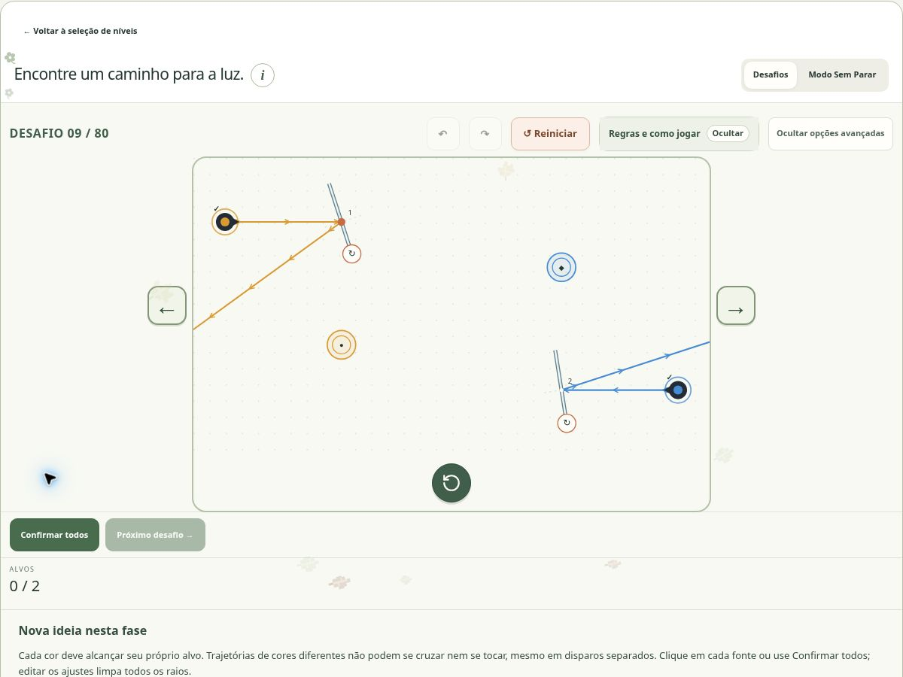

# Reflexos

[Catálogo dos jogos](../README.md) · [Apresentação](../../../README.md) · [Arquitetura](../../arquitetura/README.md)

**Luz, reflexão e planejamento de trajetórias.** Categoria: Intuição.

## O que o jogo faz

Um puzzle de luz e espelhos em que você constrói percursos para raios coloridos.

Gire espelhos para levar cada raio ao alvo da mesma cor e símbolo, sem encostar nas trajetórias de outras cores.

## O jogo em imagem

*Na imagem: fase 9, “Duas cores, dois destinos”. Os raios foram disparados para mostrar o efeito dos ângulos escolhidos; os dois alvos ainda precisam ser alcançados.*

Clique na imagem para ampliar. Captura real do site em **1º de novembro de 2026**; [origem e contexto das imagens](../../imagens/jogos/README.md).

## Problema e proposta pedagógica

Praticar orientação espacial, leitura de ângulos e planejamento de trajetórias. Observar uma tentativa e ajustar os espelhos convida a formular e revisar hipóteses.

A proposta pedagógica é tornar a reflexão da luz explorável: pequenas mudanças de direção produzem efeitos visíveis, e os percursos precisam funcionar em conjunto.

Esses objetivos descrevem a intenção de prática do jogo. Não são resultados de um estudo de aprendizagem com usuários.

## Como abrir

Execute o servidor pelo [guia de instalação](../../setup/README.md), abra a página inicial, escolha **Intuição** e depois **Reflexos**. O jogo participa da aplicação integrada; abrir um arquivo `.mjs` isolado não inicia sua interface.

## Regras e interação

1. Gire os espelhos para guiar a luz. As posições dos espelhos e das paredes são fixas; paredes e bordas interrompem os raios.
2. Cada raio precisa alcançar o alvo da mesma cor e símbolo. Trajetórias de cores diferentes não podem se cruzar nem se tocar, mesmo em disparos separados.
3. Quando houver portais, os que têm a mesma letra formam um par. A luz sai mantendo a direção; portais seletivos bloqueiam cores não permitidas. O salto entre portais não conta como trajetória de luz.
4. Clique em cada fonte para disparar ou use Confirmar todos. A tentativa só termina após todos os disparos; mudar um ajuste limpa os raios para uma nova tentativa.

## Exemplo de raciocínio

Um raio precisa contornar uma parede e alcançar seu alvo. Girar um espelho muda a direção refletida; com duas cores, resolver cada percurso isoladamente não basta, pois os percursos também precisam evitar contatos entre si.

O exemplo ilustra uma regra, não uma fase específica do catálogo. Para reproduzir uma fase concreta, use sua definição e seu ID junto com a solução de referência correspondente.

## Conteúdo ativo

80 fases em seis faixas (15/15/15/15/15/5). Modos livres e desafios gerados são separados da campanha.

A posição exibida na seleção não é a identidade persistente da definição. Alterar uma fase pode exigir um novo ID, enquanto registros da fase anterior continuam arquivados. Referências antigas de catálogo precisam ser lidas junto do commit em que eram vigentes.

## Como a implementação funciona

Separar geometria da renderização permite reproduzir percursos sem depender do desenho SVG. A direção após uma reflexão depende da orientação do espelho; um portal preserva a direção de saída, mas seu salto não forma um segmento físico entre os portais.

| Arquivo principal | Responsabilidade |
| --- | --- |
| [light-world.mjs](../../../dist/light-world.mjs) | Motor / validação |
| [light-campaign-progress.mjs](../../../dist/light-campaign-progress.mjs) | Catálogo / conteúdo |
| [light-levels.mjs](../../../dist/light-levels.mjs) | Catálogo / conteúdo |
| [light-render.mjs](../../../dist/light-render.mjs) | Interface / integração |
| [app.mjs](../../../dist/app.mjs) | Interface / integração |

### Pontos de entrada no código

- `light-world.mjs`: `lightScene`, `lightSegmentIntersection`, `traceLightWorld`, `traceLightAttempt`, `lightAttemptFrame`, `visibleLightSegments`.
- `light-campaign-progress.mjs`: `createLightCampaignProgress`.
- `light-render.mjs`: `lightRaysSVG`.

Os nomes acima são extraídos dos exports presentes nesta base. Antes de chamar uma função, confira parâmetros, retornos e casos de erro no módulo e em seus testes; não assuma que todos os jogos compartilham a mesma assinatura.

## Roteiro para estudar ou alterar

1. Leia as regras e identifique a condição de vitória ou encerramento.
2. Acompanhe a representação de fase/mapa e de estado no módulo principal.
3. Localize o caminho entre ação do usuário, validação, transição e renderização.
4. Observe como reset, undo/redo e restauração são oferecidos nesta interface.
5. Encontre um teste da regra alterada e reproduza um caso mínimo antes de editar.
6. Quando houver catálogo novo, confira IDs, soluções, contagem e impacto no save.

## Verificação e riscos específicos

Verificar contato entre raios, pares de portais, interrupção em paredes e reinício dos disparos após editar um ângulo. Um gabarito válido não prova que a solução é única.

Use o [guia de testes](../../../tests/README.md) para diferenciar testes de regras, mocks de DOM e snapshots de entrega. Estes arquivos relacionados são pontos de investigação, não uma declaração de que todos passam na versão atual:

- [light-spacious-history.mjs](../../../tests/light-spacious-history.mjs)
- [light-spacious-preservation.mjs](../../../tests/light-spacious-preservation.mjs)
- [light-spacious-static.mjs](../../../tests/light-spacious-static.mjs)
- [light-v4-artifacts.mjs](../../../tests/light-v4-artifacts.mjs)
- [light-v4-campaign-audit.mjs](../../../tests/light-v4-campaign-audit.mjs)
- [light-v4-campaign-ui.mjs](../../../tests/light-v4-campaign-ui.mjs)
- [light-v4-evidence-tests.mjs](../../../tests/light-v4-evidence-tests.mjs)
- [light-v4-history-tests.mjs](../../../tests/light-v4-history-tests.mjs)
- [light-v4-history.mjs](../../../tests/light-v4-history.mjs)
- [light-v4-integration-preservation.mjs](../../../tests/light-v4-integration-preservation.mjs)
- [light-v4-integration-progress.mjs](../../../tests/light-v4-integration-progress.mjs)
- [light-v4-integration-ui.mjs](../../../tests/light-v4-integration-ui.mjs)
- [light-v4-legacy-preservation-tests.mjs](../../../tests/light-v4-legacy-preservation-tests.mjs)
- [light-v4-record-validation.mjs](../../../tests/light-v4-record-validation.mjs)
- [light-v5-history-tests.mjs](../../../tests/light-v5-history-tests.mjs)
- [light-v5-history.mjs](../../../tests/light-v5-history.mjs)

Quando a mudança é visual, valide entrada no jogo, leitura das regras, interação principal, retorno e tamanhos de tela. Quando toca regras ou saves, acrescente casos de entradas inválidas, repetição da ação e restauração. Não conclua que uma busca encontrou solução única se ela esgotou seu orçamento.

## Documentação de referência

- [docs/reflexos80](../../../docs/reflexos80)
- [dist/development/reflexos80/README.md](../../../dist/development/reflexos80/README.md)

## Estado e limites

Guia da base `2354a3c`, reorganizada sem mudar código executável. Revisões posteriores só devem ser descritas depois de incorporadas e verificadas. Nenhuma publicação do site decorre deste manual. A organização local ainda precisa ser enviada ao repositório privado e passar pela revisão remota.
