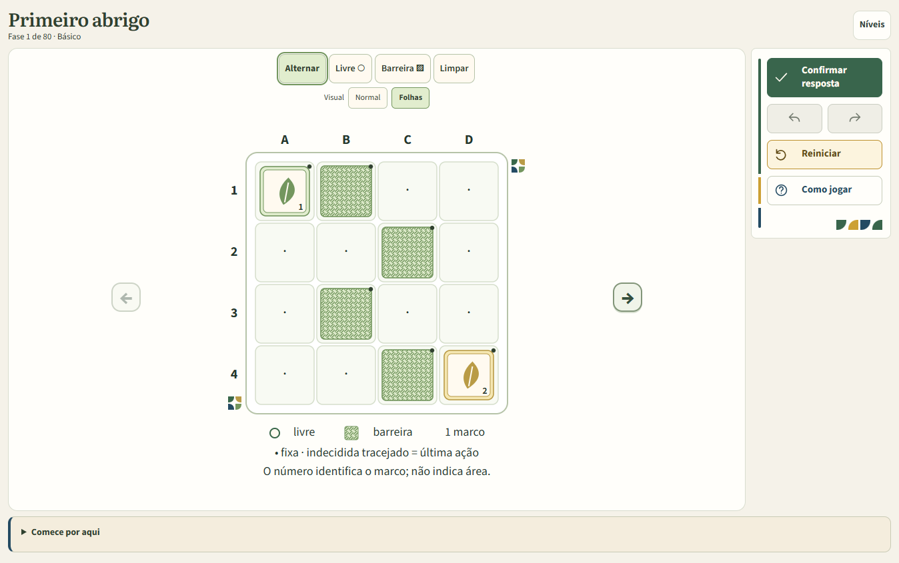
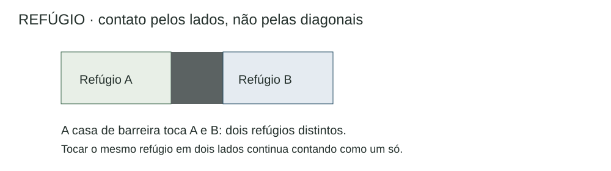
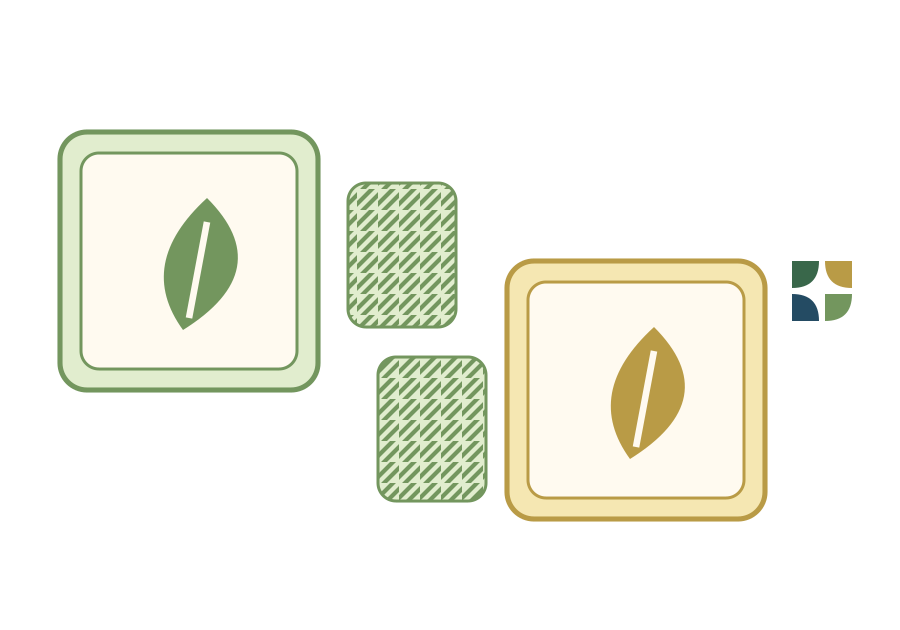

# REFÚGIO

[Catálogo atual](../README.md) · [Projeto](../../../README.md) · [Arquitetura](../../arquitetura/README.md)

Separe os marcos em espaços livres, usando apenas barreiras que realmente separam dois refúgios.

## Área de jogo atual

Expandir Área de jogo atual

*Captura local do código atual, com estado de demonstração, sem cursor ou dados pessoais. [Proveniência e limites](../../imagens/galeria-atual/README.md). Não representa uma solução nem comprova todos os estados da partida.*

## Objetivo

Expandir Objetivo

**Separe o espaço em refúgios. Cada um precisa ter um único marco.**

## Como começar

Expandir Como começar

1. Marque cada casa como Livre ou Barreira, sem alterar as pistas fixas.
2. Casas livres ligadas pelos lados formam uma região. Cada região deve ter um marco.
3. Cada barreira deve tocar exatamente duas regiões livres diferentes pelos lados.

## Regras completas

Expandir Regras completas

1. Marque as casas como livres ou barreiras. Preserve as pistas fixas; os marcos são sempre casas livres.
2. Casas livres que se tocam pelos lados formam um refúgio. Cada refúgio precisa conter exatamente um marco.
3. Cada casa de barreira deve tocar exatamente dois refúgios diferentes pelos lados. Tocar o mesmo refúgio duas vezes ainda conta como um só.
4. Diagonais não ligam casas nem contam como contato. Complete a marcação e confirme.

### Controles específicos

Escolha Livre ou Barreira e toque em uma casa, ou use Alternar. Círculo indica livre; hachura indica barreira; ponto central indica casa indecidida. Pinos identificam pistas fixas. Números identificam marcos, não áreas. Só lados conectam; o exterior não é uma região. As barreiras não precisam estar conectadas.

## Exemplo de raciocínio

Expandir Exemplo de raciocínio

A barreira do meio separa os marcos. Ela toca uma região livre de cada lado.

*Esquema de regra, não uma fase completa nem uma captura do site.*

## O que observar

Expandir O que observar

Uma barreira tem função precisa: separar duas regiões diferentes. Reconhecer a identidade dos espaços é tão importante quanto contar vizinhos.

Não conclua uma solução apenas pela aparência. Leia as pistas da fase e confira a condição de término acima. Pistas fixas e a identidade da fase devem ser preservadas. Dicas ou solução assistida não equivalem a uma conclusão independente.

## Proposta pedagógica

Expandir Proposta pedagógica

Praticar dedução sobre componentes conectados e separação de espaços.

Essas são intenções de design e oportunidades de prática, não resultados acadêmicos medidos.

## Identidade visual e leitura

Expandir Identidade visual e leitura

As cores, peças e ilustrações ajudam a distinguir estados e ações. A arte não concede poderes ou altera as regras. Veja a [galeria da identidade](../../identidade/README.md) e os [recursos de fauna e flora](../../../README.md#fauna-flora-e-objetos-com-funcao).

## Onde está implementado

Expandir Onde está implementado

- [dist/logica/games/refugio/engine.mjs](../../../dist/logica/games/refugio/engine.mjs)
- [dist/logica/games/refugio/view.mjs](../../../dist/logica/games/refugio/view.mjs)
- [dist/logica/games/refugio/index.mjs](../../../dist/logica/games/refugio/index.mjs)
- [dist/logica/storage.mjs](../../../dist/logica/storage.mjs)

As regras desta página foram confrontadas com os textos publicados em [game-info-content.mjs](../../../dist/game-info-content.mjs), os [guias rápidos](../../../dist/rules-quick-start.mjs) e os adaptadores próprios da família. Quantidades dependentes de mapa não devem ser tratadas como constantes universais.

## Preservação e verificação

Expandir Preservação e verificação

O progresso usa o armazenamento local e o [backup compartilhado](../../../dist/progress-backup.mjs). Não reutilize número editorial como identificador de save. Ao alterar este jogo, confira ações válidas e inválidas, retorno à seleção, desfazer/refazer quando oferecidos, conclusão ou término, restauração e telas estreitas.

[Guia de testes](../../../tests/README.md) · [Qualidade](../../qualidade/README.md). Uma captura demonstra apresentação, não comprova sozinha toda a mecânica. As regras documentadas devem acompanhar o código, não substituir testes do motor.

## AIIJ aprovada

Expandir AIIJ aprovada

Arquivo real aprovado, preservado em sua proporção original e com transparência. Esta ilustração pertence à identidade do jogo; não altera regras, controles, peças nem progresso. Não usar como miniatura do tabuleiro.

[Ver as 19 AIIJs e orientações de uso](../../identidade/aiij/README.md).

