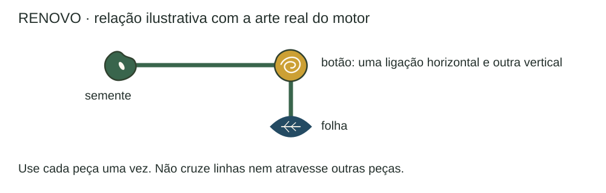

# RENOVO

[Catálogo atual](../README.md) · [Projeto](../../../README.md) · [Arquitetura](../../arquitetura/README.md)

Una cada semente a uma folha por um botão, formando trios que dobram uma vez e não se cruzam.

## Objetivo

**Ligue semente, botão e folha em trios, sem cruzar as linhas.**

## Como começar

1. Arraste pelas peças para criar o caminho, ou clique nas duas pontas de uma ligação.
2. No botão, faça uma curva de 90°: uma ligação horizontal e outra vertical.
3. Use cada peça uma vez. As linhas não podem cruzar, se sobrepor nem atravessar outras peças.

## Regras completas

1. Cada botão deve se ligar a uma semente e a uma folha. Use todas as peças, uma única vez.
2. As duas ligações do botão formam um L: uma horizontal e outra vertical. Cada trecho termina na primeira peça que encontra naquela direção.
3. As linhas não podem cruzar, passar por outra peça nem ficar uma sobre a outra. Só as duas linhas do mesmo trio se encontram, no botão.
4. Trace uma ligação entre as peças ou toque nas duas pontas alinhadas. Você pode retirar um trecho tocando nas pontas novamente. Complete os trios e confirme.

### Controles específicos

Arraste com o mouse ou dedo da semente ou folha até o botão; você pode virar e continuar até o outro extremo. Solte para confirmar. Repetir o traçado mantém os trechos existentes. Ou clique em duas peças alinhadas para ligar; repita os dois cliques para remover. Enter ou Espaço também selecionam peças. Escape cancela o gesto; clicar novamente na peça selecionada cancela a seleção. Limpar peça remove seus trechos.

## Exemplo de raciocínio

A semente chega pela esquerda do botão; a folha se liga por baixo.

*Esquema de regra, não uma fase completa nem uma captura do site.*

## O que observar

Uma ligação pode consumir o parceiro de outro botão ou bloquear seu trecho. As escolhas simples precisam coexistir sem cruzamento.

Não conclua uma solução apenas pela aparência. Leia as pistas da fase e confira a condição de término acima. Pistas fixas e a identidade da fase devem ser preservadas. Dicas ou solução assistida não equivalem a uma conclusão independente.

## Proposta pedagógica

Praticar associação de parceiros, planejamento e leitura de conflitos geométricos. As sementes, os botões e as folhas também ilustram temas reais de biologia vegetal: a germinação, que dá início ao desenvolvimento de uma nova planta; as folhas, que realizam fotossíntese; e os botões florais, que podem se abrir em flores ligadas à reprodução. Esses elementos aproximam o raciocínio lógico da observação das plantas e convidam a reconhecer suas diferentes funções. As ligações do tabuleiro são uma metáfora visual: não representam a ordem de crescimento nem o transporte de água ou nutrientes de uma planta real.

Essas são intenções de design e oportunidades de prática, não resultados acadêmicos medidos.

## Identidade visual e leitura

As cores, peças e ilustrações ajudam a distinguir estados e ações. A arte não concede poderes ou altera as regras. Veja a [galeria da identidade](../../identidade/README.md) e os [recursos de fauna e flora](../../../README.md#fauna-flora-e-objetos-com-funcao).

## Onde está implementado

- [dist/logica/games/renovo/engine.mjs](../../../dist/logica/games/renovo/engine.mjs)
- [dist/logica/games/renovo/view.mjs](../../../dist/logica/games/renovo/view.mjs)
- [dist/logica/games/renovo/index.mjs](../../../dist/logica/games/renovo/index.mjs)
- [dist/logica/storage.mjs](../../../dist/logica/storage.mjs)

As regras desta página foram confrontadas com os textos publicados em [game-info-content.mjs](../../../dist/game-info-content.mjs), os [guias rápidos](../../../dist/rules-quick-start.mjs) e os adaptadores próprios da família. Quantidades dependentes de mapa não devem ser tratadas como constantes universais.

## Preservação e verificação

O progresso usa o armazenamento local e o [backup compartilhado](../../../dist/progress-backup.mjs). Não reutilize número editorial como identificador de save. Ao alterar este jogo, confira ações válidas e inválidas, retorno à seleção, desfazer/refazer quando oferecidos, conclusão ou término, restauração e telas estreitas.

[Guia de testes](../../../tests/README.md) · [Qualidade](../../qualidade/README.md). Uma captura demonstra apresentação, não comprova sozinha toda a mecânica. As regras documentadas devem acompanhar o código, não substituir testes do motor.
