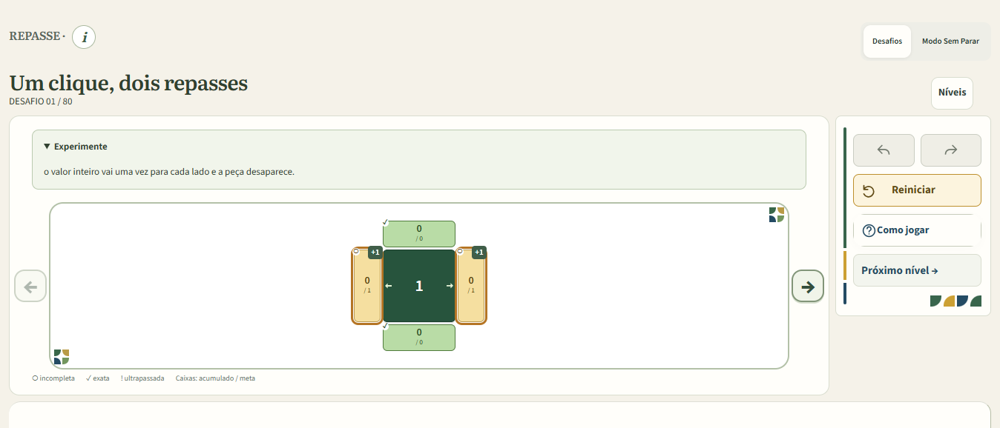
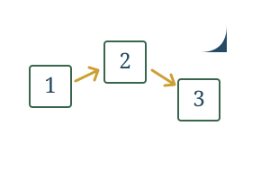

# REPASSE

[Catálogo atual](../README.md) · [Projeto](../../../README.md) · [Arquitetura](../../arquitetura/README.md)

Um puzzle de planejamento em que retirar uma peça transforma os valores e os caminhos das próximas.

## Área de jogo atual

Expandir Área de jogo atual

*Captura local do código atual, com estado de demonstração, sem cursor ou dados pessoais. [Proveniência e limites](../../imagens/galeria-atual/README.md). Não representa uma solução nem comprova todos os estados da partida.*

## Objetivo

Expandir Objetivo

**Retire todas as peças e faça cada caixa da borda receber o valor exato da meta.**

## Como começar

Expandir Como começar

1. Toque em uma peça para retirá-la e enviar seu valor nas direções das setas.
2. O valor inteiro soma na primeira peça encontrada. Se não houver peça, chega à borda.
3. Planeje a ordem para atingir cada meta exatamente, inclusive as metas zero.

## Regras completas

Expandir Regras completas

1. Toque em uma peça para retirá-la. O valor inteiro dela segue uma vez por cada seta, sem ser dividido.
2. O valor atravessa casas vazias e soma na primeira peça que encontra. Essa peça espera sua vez com o novo valor; as setas dela não mudam o recebimento.
3. Se não houver peça no caminho, o valor vai para a caixa da borda. Cada caixa mostra quanto já recebeu e quanto precisa receber, inclusive quando a meta é zero.
4. Esvazie a grade com todas as metas exatas. Se passar de uma meta, use Desfazer e tente outra ordem.
5. As posições e as setas são fixas. Você também pode selecionar peças com as setas do teclado e retirar com Enter ou espaço; a prévia mostra quem vai receber.

## Exemplo de raciocínio

Expandir Exemplo de raciocínio

Retirar o 2 envia seu valor ao 3: a peça que fica passa a valer 5.

## O que observar

Expandir O que observar

Uma peça pode precisar receber primeiro e desaparecer depois para liberar um caminho. Comparar as metas com essas funções convida a formular, testar e revisar hipóteses.

Não conclua uma solução apenas pela aparência. Leia as pistas da fase e confira a condição de término acima. Pistas fixas e a identidade da fase devem ser preservadas. Dicas ou solução assistida não equivalem a uma conclusão independente.

## Proposta pedagógica

Expandir Proposta pedagógica

Praticar planejamento de ordem, antecipação de consequências e leitura de relações entre valores, receptores e metas.

Essas são intenções de design e oportunidades de prática, não resultados acadêmicos medidos.

## Identidade visual e leitura

Expandir Identidade visual e leitura

As cores, peças e ilustrações ajudam a distinguir estados e ações. A arte não concede poderes ou altera as regras. Veja a [galeria da identidade](../../identidade/README.md) e os [recursos de fauna e flora](../../../README.md#fauna-flora-e-objetos-com-funcao).

## Onde está implementado

Expandir Onde está implementado

- [dist/repasse/engine.mjs](../../../dist/repasse/engine.mjs)
- [dist/repasse/ui.mjs](../../../dist/repasse/ui.mjs)
- [dist/repasse/README.md](../../../dist/repasse/README.md)

As regras desta página foram confrontadas com os textos publicados em [game-info-content.mjs](../../../dist/game-info-content.mjs), os [guias rápidos](../../../dist/rules-quick-start.mjs) e os adaptadores próprios da família. Quantidades dependentes de mapa não devem ser tratadas como constantes universais.

## Preservação e verificação

Expandir Preservação e verificação

O progresso usa o armazenamento local e o [backup compartilhado](../../../dist/progress-backup.mjs). Não reutilize número editorial como identificador de save. Ao alterar este jogo, confira ações válidas e inválidas, retorno à seleção, desfazer/refazer quando oferecidos, conclusão ou término, restauração e telas estreitas.

[Guia de testes](../../../tests/README.md) · [Qualidade](../../qualidade/README.md). Uma captura demonstra apresentação, não comprova sozinha toda a mecânica. As regras documentadas devem acompanhar o código, não substituir testes do motor.

## Referência técnica complementar

Expandir Referência técnica complementar

Os links abaixo preservam o mapa técnico documentado do jogo. Relatórios datados mantêm o escopo da revisão original, não certificam automaticamente a versão atual.

## Como a implementação funciona

Expandir Como a implementação funciona

Cada retirada é uma transição atômica. O primeiro receptor em cada direção é calculado na configuração atual; vazios são atravessados. A ordem de remoção altera os receptores e, portanto, os totais finais.

| Arquivo principal | Responsabilidade |
| --- | --- |
| [engine.mjs](../../../dist/repasse/engine.mjs) | Motor / validação |
| [campaign.mjs](../../../dist/repasse/campaign.mjs) | Catálogo / conteúdo |
| [certification.mjs](../../../dist/repasse/certification.mjs) | Interface / integração |
| [service.mjs](../../../dist/repasse/service.mjs) | Interface / integração |
| [ui.mjs](../../../dist/repasse/ui.mjs) | Interface / integração |

### Pontos de entrada no código

- `repasse/engine.mjs`: `configurationOf`, `validateLevel`, `validateState`, `initialState`, `preview`, `evaluateState`, `isWon`, `stateKey`, `transition`, `replay`.
- `repasse/certification.mjs`: `configurationOf`, `certifyGenerated`, `certifyAnalysis`.
- `repasse/service.mjs`: `createRepasseService`.
- `repasse/ui.mjs`: `freshRepasseData`, `normalizeRepasseData`, `restoreRepasseSession`, `serializeRepasseSession`, `commitRepasseCommand`, `recordRepasseCompletion`, `endlessOptions`, `initRepasse`.

Os nomes acima são extraídos dos exports presentes nesta base. Antes de chamar uma função, confira parâmetros, retornos e casos de erro no módulo e em seus testes; não assuma que todos os jogos compartilham a mesma assinatura.

## Roteiro para estudar ou alterar

Expandir Roteiro para estudar ou alterar

1. Leia as regras e identifique a condição de vitória ou encerramento.
2. Acompanhe a representação de fase/mapa e de estado no módulo principal.
3. Localize o caminho entre ação do usuário, validação, transição e renderização.
4. Observe como reset, undo/redo e restauração são oferecidos nesta interface.
5. Encontre um teste da regra alterada e reproduza um caso mínimo antes de editar.
6. Quando houver catálogo novo, confira IDs, soluções, contagem e impacto no save.

## Verificação e riscos específicos

Expandir Verificação e riscos específicos

Cobrir metas zero, excesso, retirada repetida, receptor ausente e inteiros seguros. Grade vazia só é vitória quando todas as metas de borda são exatas.

Use o [guia de testes](../../../tests/README.md) para diferenciar testes de regras, mocks de DOM e snapshots de entrega. Estes arquivos relacionados são pontos de investigação, não uma declaração de que todos passam na versão atual:

- [repasse-audit.mjs](../../../tests/repasse-audit.mjs)
- [repasse-build-campaign.mjs](../../../tests/repasse-build-campaign.mjs)
- [repasse-catalog.test.mjs](../../../tests/repasse-catalog.test.mjs)
- [repasse-engine.test.mjs](../../../tests/repasse-engine.test.mjs)
- [repasse-frame-inset.test.mjs](../../../tests/repasse-frame-inset.test.mjs)
- [repasse-independent-audit.mjs](../../../tests/repasse-independent-audit.mjs)
- [repasse-integration.test.mjs](../../../tests/repasse-integration.test.mjs)
- [repasse-service.test.mjs](../../../tests/repasse-service.test.mjs)
- [repasse-size-refinement.test.mjs](../../../tests/repasse-size-refinement.test.mjs)
- [repasse-ui-state.test.mjs](../../../tests/repasse-ui-state.test.mjs)
- [repasse80-build.mjs](../../../tests/repasse80-build.mjs)
- [repasse80-independent.mjs](../../../tests/repasse80-independent.mjs)
- [repasse80-preservation.mjs](../../../tests/repasse80-preservation.mjs)
- [repasse80-progress.test.mjs](../../../tests/repasse80-progress.test.mjs)
- [repasse80-ui.mjs](../../../tests/repasse80-ui.mjs)

Quando a mudança é visual, valide entrada no jogo, leitura das regras, interação principal, retorno e tamanhos de tela. Quando toca regras ou saves, acrescente casos de entradas inválidas, repetição da ação e restauração. Não conclua que uma busca encontrou solução única se ela esgotou seu orçamento.

## Documentação de referência

Expandir Documentação de referência

- [docs/repasse-contract.md](../../../docs/repasse-contract.md)
- [docs/repasse80/README.md](../../../docs/repasse80/README.md)

## AIIJ aprovada

Expandir AIIJ aprovada

Arquivo real aprovado, preservado em sua proporção original e com transparência. Esta ilustração pertence à identidade do jogo; não altera regras, controles, peças nem progresso. Não usar como miniatura do tabuleiro.

[Ver as 19 AIIJs e orientações de uso](../../identidade/aiij/README.md).

