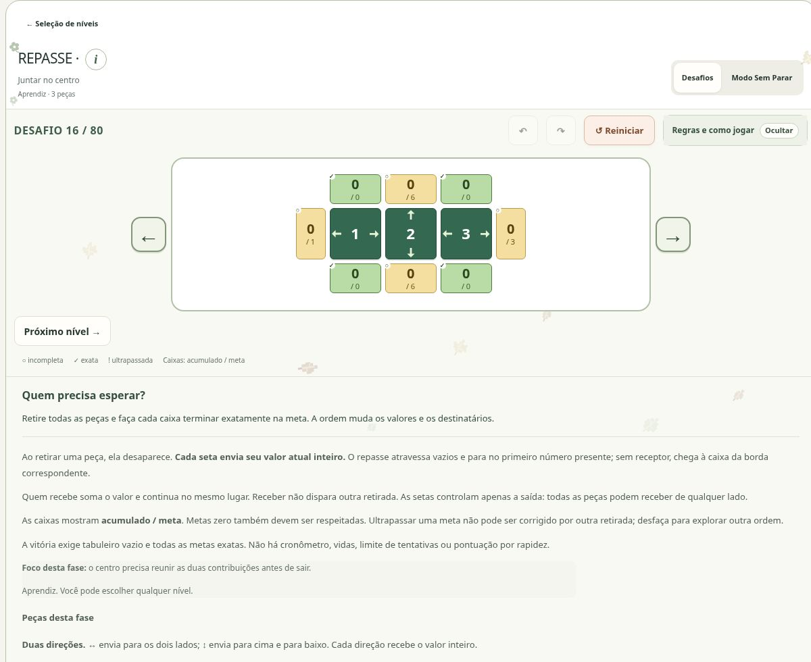

# REPASSE

[Catálogo dos jogos](../README.md) · [Apresentação](../../../README.md) · [Arquitetura](../../arquitetura/README.md)

**Ordem de remoção e propagação de valores.** Categoria: Raciocínio lógico.

## O que o jogo faz

Um puzzle de planejamento em que retirar uma peça transforma os valores e os caminhos das próximas.

Retire todas as peças e complete exatamente as metas das bordas. Decida quem precisa receber, esperar ou sair para abrir passagem.

## O jogo em imagem

*Na imagem: fase 16, “Juntar no centro”. As peças laterais podem contribuir para o valor da peça central antes de ela sair.*

Clique na imagem para ampliar. Captura real do site em **1º de novembro de 2026**; [origem e contexto das imagens](../../imagens/jogos/README.md).

## Problema e proposta pedagógica

Praticar planejamento de ordem, antecipação de consequências e leitura de relações entre valores, receptores e metas.

Uma peça pode precisar receber primeiro e desaparecer depois para liberar um caminho. Comparar as metas com essas funções convida a formular, testar e revisar hipóteses.

Esses objetivos descrevem a intenção de prática do jogo. Não são resultados de um estudo de aprendizagem com usuários.

## Como abrir

Execute o servidor pelo [guia de instalação](../../setup/README.md), abra a página inicial, escolha **Raciocínio lógico** e depois **REPASSE**. O jogo participa da aplicação integrada; abrir um arquivo `.mjs` isolado não inicia sua interface.

## Regras e interação

1. Clique ou toque em uma peça para retirá-la. Seu valor atual inteiro é enviado uma vez em cada direção indicada pelas setas; ele não é dividido.
2. Cada repasse atravessa vazios e para na primeira peça presente. Quem recebe soma o valor e continua esperando sua vez, independentemente da orientação das próprias setas.
3. Se não houver receptor, o valor chega à caixa correspondente na borda. Todas as caixas mostram acumulado / meta, inclusive as de meta zero.
4. Você vence quando a grade estiver vazia e todas as metas forem exatas. Um excesso pode ser revisto com Desfazer; experimentar outra ordem faz parte do jogo.
5. As setas e posições são fixas. Ao longo da campanha aparecem peças de uma seta, duas setas perpendiculares e quatro setas, sempre com a mesma regra de repasse.
6. Use o mouse, toque ou navegue pelas peças com as setas do teclado e retire com Enter ou espaço. A prévia mostra os destinatários atuais. Explore 80 fases ou continue com desafios novos no Modo Sem Parar, sem cronômetro.

## Exemplo de raciocínio

Uma peça de valor 3 com setas para cima e para a direita envia 3 em cada direção, e não 1,5. Se o receptor à direita tiver valor 2, passa a ter 5. Remover esse receptor antes muda o destino do próximo envio.

O exemplo ilustra uma regra, não uma fase específica do catálogo. Para reproduzir uma fase concreta, use sua definição e seu ID junto com a solução de referência correspondente.

## Conteúdo ativo

80 fases em seis faixas (15/15/15/15/15/5). Modos livres e desafios gerados são separados da campanha.

A posição exibida na seleção não é a identidade persistente da definição. Alterar uma fase pode exigir um novo ID, enquanto registros da fase anterior continuam arquivados. Referências antigas de catálogo precisam ser lidas junto do commit em que eram vigentes.

## Como a implementação funciona

Cada retirada é uma transição atômica. O primeiro receptor em cada direção é calculado na configuração atual; vazios são atravessados. A ordem de remoção altera os receptores e, portanto, os totais finais.

| Arquivo principal | Responsabilidade |
| --- | --- |
| [engine.mjs](../../../dist/repasse/engine.mjs) | Motor / validação |
| [campaign.mjs](../../../dist/repasse/campaign.mjs) | Catálogo / conteúdo |
| [certification.mjs](../../../dist/repasse/certification.mjs) | Interface / integração |
| [service.mjs](../../../dist/repasse/service.mjs) | Interface / integração |
| [ui.mjs](../../../dist/repasse/ui.mjs) | Interface / integração |

### Pontos de entrada no código

- `repasse/engine.mjs`: `configurationOf`, `validateLevel`, `validateState`, `initialState`, `preview`, `evaluateState`, `isWon`, `stateKey`, `transition`, `replay`.
- `repasse/certification.mjs`: `configurationOf`, `certifyGenerated`, `certifyAnalysis`.
- `repasse/service.mjs`: `createRepasseService`.
- `repasse/ui.mjs`: `freshRepasseData`, `normalizeRepasseData`, `restoreRepasseSession`, `serializeRepasseSession`, `commitRepasseCommand`, `recordRepasseCompletion`, `endlessOptions`, `initRepasse`.

Os nomes acima são extraídos dos exports presentes nesta base. Antes de chamar uma função, confira parâmetros, retornos e casos de erro no módulo e em seus testes; não assuma que todos os jogos compartilham a mesma assinatura.

## Roteiro para estudar ou alterar

1. Leia as regras e identifique a condição de vitória ou encerramento.
2. Acompanhe a representação de fase/mapa e de estado no módulo principal.
3. Localize o caminho entre ação do usuário, validação, transição e renderização.
4. Observe como reset, undo/redo e restauração são oferecidos nesta interface.
5. Encontre um teste da regra alterada e reproduza um caso mínimo antes de editar.
6. Quando houver catálogo novo, confira IDs, soluções, contagem e impacto no save.

## Verificação e riscos específicos

Cobrir metas zero, excesso, retirada repetida, receptor ausente e inteiros seguros. Grade vazia só é vitória quando todas as metas de borda são exatas.

Use o [guia de testes](../../../tests/README.md) para diferenciar testes de regras, mocks de DOM e snapshots de entrega. Estes arquivos relacionados são pontos de investigação, não uma declaração de que todos passam na versão atual:

- [repasse-audit.mjs](../../../tests/repasse-audit.mjs)
- [repasse-build-campaign.mjs](../../../tests/repasse-build-campaign.mjs)
- [repasse-catalog.test.mjs](../../../tests/repasse-catalog.test.mjs)
- [repasse-engine.test.mjs](../../../tests/repasse-engine.test.mjs)
- [repasse-frame-inset.test.mjs](../../../tests/repasse-frame-inset.test.mjs)
- [repasse-independent-audit.mjs](../../../tests/repasse-independent-audit.mjs)
- [repasse-integration.test.mjs](../../../tests/repasse-integration.test.mjs)
- [repasse-service.test.mjs](../../../tests/repasse-service.test.mjs)
- [repasse-size-refinement.test.mjs](../../../tests/repasse-size-refinement.test.mjs)
- [repasse-ui-state.test.mjs](../../../tests/repasse-ui-state.test.mjs)
- [repasse80-build.mjs](../../../tests/repasse80-build.mjs)
- [repasse80-independent.mjs](../../../tests/repasse80-independent.mjs)
- [repasse80-preservation.mjs](../../../tests/repasse80-preservation.mjs)
- [repasse80-progress.test.mjs](../../../tests/repasse80-progress.test.mjs)
- [repasse80-ui.mjs](../../../tests/repasse80-ui.mjs)

Quando a mudança é visual, valide entrada no jogo, leitura das regras, interação principal, retorno e tamanhos de tela. Quando toca regras ou saves, acrescente casos de entradas inválidas, repetição da ação e restauração. Não conclua que uma busca encontrou solução única se ela esgotou seu orçamento.

## Documentação de referência

- [docs/repasse-contract.md](../../../docs/repasse-contract.md)
- [docs/repasse80/README.md](../../../docs/repasse80/README.md)

## Estado e limites

Guia da base `2354a3c`, reorganizada sem mudar código executável. Revisões posteriores só devem ser descritas depois de incorporadas e verificadas. Nenhuma publicação do site decorre deste manual. A organização local ainda precisa ser enviada ao repositório privado e passar pela revisão remota.
