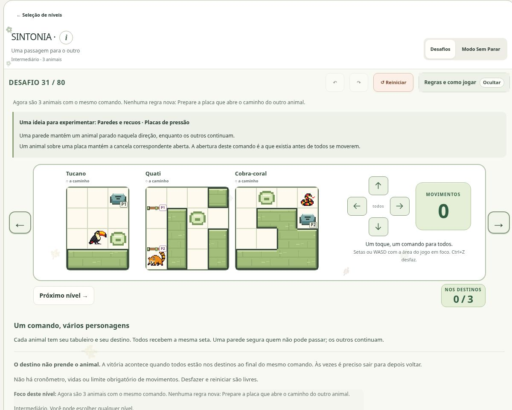

# SINTONIA

[Catálogo dos jogos](../README.md) · [Apresentação](../../../README.md) · [Arquitetura](../../arquitetura/README.md)

**Comandos simultâneos e coordenação de estados.** Categoria: Raciocínio lógico.

## O que o jogo faz

Um puzzle de coordenação em que um único comando move vários animais, cada um no seu tabuleiro.

Leve todos aos seus destinos na mesma configuração. Use paredes e mecanismos para combinar os caminhos.

## O jogo em imagem

*Na imagem: fase 31, “Uma passagem para o outro”, antes do primeiro movimento. Placas de pressão e cancelas conectam as decisões entre os tabuleiros.*

Clique na imagem para ampliar. Captura real do site em **1º de novembro de 2026**; [origem e contexto das imagens](../../imagens/jogos/README.md).

## Problema e proposta pedagógica

Praticar planejamento, antecipação de consequências e raciocínio espacial, articulando objetivos individuais com uma condição conjunta.

Cada seta pode ajudar um animal e afastar outro do destino. Experimentar paredes, apoios e sequências convida a pensar nas relações entre os caminhos.

Esses objetivos descrevem a intenção de prática do jogo. Não são resultados de um estudo de aprendizagem com usuários.

## Como abrir

Execute o servidor pelo [guia de instalação](../../setup/README.md), abra a página inicial, escolha **Raciocínio lógico** e depois **SINTONIA**. O jogo participa da aplicação integrada; abrir um arquivo `.mjs` isolado não inicia sua interface.

## Regras e interação

1. Use as setas, WASD ou o controle direcional. Todos recebem o mesmo comando; cada animal tenta andar uma casa. Quem encontra um bloqueio permanece parado.
2. Todos precisam ocupar seus destinos ao final de um comando. Chegar antes não prende ninguém: um animal pode sair do destino e voltar depois.
3. Observe os símbolos das placas, cancelas e objetos. Uma passagem aberta no início do comando pode ser atravessada enquanto outro animal sai da placa que a mantinha aberta.
4. As mecânicas aparecem aos poucos, com explicações na própria fase. Desfaça e reinicie livremente; não há cronômetro, vidas ou limite obrigatório de movimentos.
5. Explore 80 desafios em seis faixas ou escolha o Modo Sem Parar para continuar com novas combinações. Paredes, placas, interruptores, chaves e gelo criam apoios e revezamentos; as dicas consideram a configuração atual dos tabuleiros.

## Exemplo de raciocínio

Ao apertar direita, um animal encostado na parede permanece parado enquanto outro avança. Essa assimetria permite ajustar as posições relativas. Todos precisam estar nos destinos no mesmo estado; chegar antes não imobiliza um animal.

O exemplo ilustra uma regra, não uma fase específica do catálogo. Para reproduzir uma fase concreta, use sua definição e seu ID junto com a solução de referência correspondente.

## Conteúdo ativo

80 fases em seis faixas (15/15/15/15/15/5). Modos livres e desafios gerados são separados da campanha.

A posição exibida na seleção não é a identidade persistente da definição. Alterar uma fase pode exigir um novo ID, enquanto registros da fase anterior continuam arquivados. Referências antigas de catálogo precisam ser lidas junto do commit em que eram vigentes.

## Como a implementação funciona

A transição recebe um comando comum e resolve os tabuleiros segundo o estado inicial do passo. Mecanismos de placa e cancela exigem uma ordem de avaliação consistente; animar um animal antes do outro não deve mudar as regras.

| Arquivo principal | Responsabilidade |
| --- | --- |
| [engine.mjs](../../../dist/sintonia/engine.mjs) | Motor / validação |
| [active-rules.mjs](../../../dist/sintonia/active-rules.mjs) | Motor / validação |
| [campaign.mjs](../../../dist/sintonia/campaign.mjs) | Catálogo / conteúdo |
| [service.mjs](../../../dist/sintonia/service.mjs) | Interface / integração |
| [ui.mjs](../../../dist/sintonia/ui.mjs) | Interface / integração |

### Pontos de entrada no código

- `sintonia/engine.mjs`: `invalidateLevelCache`, `initialState`, `stateKey`, `isWon`, `gateIsOpen`, `canCross`, `transition`, `validateLevel`, `validateState`, `replay`.
- `sintonia/active-rules.mjs`: `removedSintoniaMechanics`, `goalButtonSintoniaOverlaps`, `validateActiveSintoniaLevel`.
- `sintonia/service.mjs`: `sintoniaDefinitionKey`, `isRetainedSintoniaAttempt`, `persistableSintoniaLevel`, `restoreSintoniaSession`, `serializeSintoniaSession`, `commitSintoniaCommand`, `archivedSintoniaLevel`, `previouslyLearnedSintoniaMechanics`, `resolveArchivedSintoniaAttempt`, `resolveSintoniaCampaignAttempt`.
- `sintonia/ui.mjs`: `updatedSintoniaCampaignIndex`, `freshSintoniaData`, `normalizeSintoniaData`, `endlessOptions`, `initSintonia`.

Os nomes acima são extraídos dos exports presentes nesta base. Antes de chamar uma função, confira parâmetros, retornos e casos de erro no módulo e em seus testes; não assuma que todos os jogos compartilham a mesma assinatura.

## Roteiro para estudar ou alterar

1. Leia as regras e identifique a condição de vitória ou encerramento.
2. Acompanhe a representação de fase/mapa e de estado no módulo principal.
3. Localize o caminho entre ação do usuário, validação, transição e renderização.
4. Observe como reset, undo/redo e restauração são oferecidos nesta interface.
5. Encontre um teste da regra alterada e reproduza um caso mínimo antes de editar.
6. Quando houver catálogo novo, confira IDs, soluções, contagem e impacto no save.

## Verificação e riscos específicos

Cobrir bloqueios, portas, placas, chaves, gelo e separação entre destino e mecanismo. Há uma correção de idempotência de migração documentada na revisão f0e7fcf, ainda ausente desta base: não declarar essa correção incorporada.

Use o [guia de testes](../../../tests/README.md) para diferenciar testes de regras, mocks de DOM e snapshots de entrega. Estes arquivos relacionados são pontos de investigação, não uma declaração de que todos passam na versão atual:

- [sintonia-accessory-art.test.mjs](../../../tests/sintonia-accessory-art.test.mjs)
- [sintonia-accessory-palette.test.mjs](../../../tests/sintonia-accessory-palette.test.mjs)
- [sintonia-accessory-preservation.test.mjs](../../../tests/sintonia-accessory-preservation.test.mjs)
- [sintonia-active-migration.test.mjs](../../../tests/sintonia-active-migration.test.mjs)
- [sintonia-animal-roster-ui.test.mjs](../../../tests/sintonia-animal-roster-ui.test.mjs)
- [sintonia-animal-roster.test.mjs](../../../tests/sintonia-animal-roster.test.mjs)
- [sintonia-animal-scale.test.mjs](../../../tests/sintonia-animal-scale.test.mjs)
- [sintonia-audit-purpose.mjs](../../../tests/sintonia-audit-purpose.mjs)
- [sintonia-bottom-surface.test.mjs](../../../tests/sintonia-bottom-surface.test.mjs)
- [sintonia-build-80.mjs](../../../tests/sintonia-build-80.mjs)
- [sintonia-build-campaign.mjs](../../../tests/sintonia-build-campaign.mjs)
- [sintonia-catalog.test.mjs](../../../tests/sintonia-catalog.test.mjs)
- [sintonia-cell-size.test.mjs](../../../tests/sintonia-cell-size.test.mjs)
- [sintonia-commitment.test.mjs](../../../tests/sintonia-commitment.test.mjs)
- [sintonia-compact-controls.test.mjs](../../../tests/sintonia-compact-controls.test.mjs)
- [sintonia-content-migration-ui.test.mjs](../../../tests/sintonia-content-migration-ui.test.mjs)

Quando a mudança é visual, valide entrada no jogo, leitura das regras, interação principal, retorno e tamanhos de tela. Quando toca regras ou saves, acrescente casos de entradas inválidas, repetição da ação e restauração. Não conclua que uma busca encontrou solução única se ela esgotou seu orçamento.

## Documentação de referência

- [docs/sintonia-contract.md](../../../docs/sintonia-contract.md)
- [docs/sintonia-goals-v5.md](../../../docs/sintonia-goals-v5.md)

## Estado e limites

Guia da base `2354a3c`, reorganizada sem mudar código executável. Revisões posteriores só devem ser descritas depois de incorporadas e verificadas. Nenhuma publicação do site decorre deste manual. A organização local ainda precisa ser enviada ao repositório privado e passar pela revisão remota.
