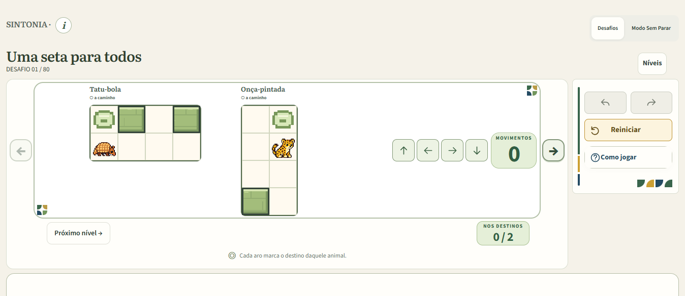

# SINTONIA

[Catálogo atual](../README.md) · [Projeto](../../../README.md) · [Arquitetura](../../arquitetura/README.md)

Um puzzle de coordenação em que um único comando move vários animais, cada um no seu tabuleiro.

## Área de jogo atual

*Captura local do código atual, com estado de demonstração, sem cursor ou dados pessoais. [Proveniência e limites](../../imagens/galeria-atual/README.md). Não representa uma solução nem comprova todos os estados da partida.*

## Objetivo

**Leve todos os animais aos seus destinos ao mesmo tempo.**

## Como começar

1. Use as setas ou WASD. O mesmo comando vale para todos os animais.
2. Cada um anda uma casa; quem encontra uma parede fica parado.
3. Use essas diferenças para alinhar os caminhos. Todos devem terminar nos destinos juntos.

## Regras completas

1. Use as setas, WASD ou o controle na tela. O mesmo comando faz todos tentarem andar uma casa.
2. Quem encontra uma parede ou bloqueio fica parado; os outros podem avançar. Use isso para ajustar os caminhos.
3. Todos precisam terminar o mesmo comando sobre seus destinos. Um animal que chegou pode sair e voltar depois.
4. Placas, cancelas, interruptores, chaves e gelo aparecem aos poucos e têm explicações na fase. Uma passagem aberta no início do comando ainda pode ser atravessada enquanto outro animal sai da placa.
5. Desfaça ou reinicie para experimentar. Não há cronômetro, vidas ou limite obrigatório de movimentos. As dicas consideram a posição atual dos animais.

## Exemplo de raciocínio

Com o comando →, um animal avança e o outro fica parado diante da parede.

## O que observar

Cada seta pode ajudar um animal e afastar outro do destino. Experimentar paredes, apoios e sequências convida a pensar nas relações entre os caminhos.

Não conclua uma solução apenas pela aparência. Leia as pistas da fase e confira a condição de término acima. Pistas fixas e a identidade da fase devem ser preservadas. Dicas ou solução assistida não equivalem a uma conclusão independente.

## Proposta pedagógica

Praticar planejamento, antecipação de consequências e raciocínio espacial, articulando objetivos individuais com uma condição conjunta.

Essas são intenções de design e oportunidades de prática, não resultados acadêmicos medidos.

## Identidade visual e leitura

As cores, peças e ilustrações ajudam a distinguir estados e ações. A arte não concede poderes ou altera as regras. Veja a [galeria da identidade](../../identidade/README.md) e os [recursos de fauna e flora](../../../README.md#fauna-flora-e-objetos-com-funcao).

## Onde está implementado

- [dist/sintonia/engine.mjs](../../../dist/sintonia/engine.mjs)
- [dist/sintonia/ui.mjs](../../../dist/sintonia/ui.mjs)
- [dist/sintonia/README.md](../../../dist/sintonia/README.md)

As regras desta página foram confrontadas com os textos publicados em [game-info-content.mjs](../../../dist/game-info-content.mjs), os [guias rápidos](../../../dist/rules-quick-start.mjs) e os adaptadores próprios da família. Quantidades dependentes de mapa não devem ser tratadas como constantes universais.

## Preservação e verificação

O progresso usa o armazenamento local e o [backup compartilhado](../../../dist/progress-backup.mjs). Não reutilize número editorial como identificador de save. Ao alterar este jogo, confira ações válidas e inválidas, retorno à seleção, desfazer/refazer quando oferecidos, conclusão ou término, restauração e telas estreitas.

[Guia de testes](../../../tests/README.md) · [Qualidade](../../qualidade/README.md). Uma captura demonstra apresentação, não comprova sozinha toda a mecânica. As regras documentadas devem acompanhar o código, não substituir testes do motor.

## Referência técnica complementar

Os links abaixo preservam o mapa técnico documentado do jogo. Relatórios datados mantêm o escopo da revisão original, não certificam automaticamente a versão atual.

## Como a implementação funciona

A transição recebe um comando comum e resolve os tabuleiros segundo o estado inicial do passo. Mecanismos de placa e cancela exigem uma ordem de avaliação consistente; animar um animal antes do outro não deve mudar as regras.

| Arquivo principal | Responsabilidade |
| --- | --- |
| [engine.mjs](../../../dist/sintonia/engine.mjs) | Motor / validação |
| [active-rules.mjs](../../../dist/sintonia/active-rules.mjs) | Motor / validação |
| [campaign.mjs](../../../dist/sintonia/campaign.mjs) | Catálogo / conteúdo |
| [service.mjs](../../../dist/sintonia/service.mjs) | Interface / integração |
| [ui.mjs](../../../dist/sintonia/ui.mjs) | Interface / integração |

### Pontos de entrada no código

- `sintonia/engine.mjs`: `invalidateLevelCache`, `initialState`, `stateKey`, `isWon`, `gateIsOpen`, `canCross`, `transition`, `validateLevel`, `validateState`, `replay`.
- `sintonia/active-rules.mjs`: `removedSintoniaMechanics`, `goalButtonSintoniaOverlaps`, `validateActiveSintoniaLevel`.
- `sintonia/service.mjs`: `sintoniaDefinitionKey`, `isRetainedSintoniaAttempt`, `persistableSintoniaLevel`, `restoreSintoniaSession`, `serializeSintoniaSession`, `commitSintoniaCommand`, `archivedSintoniaLevel`, `previouslyLearnedSintoniaMechanics`, `resolveArchivedSintoniaAttempt`, `resolveSintoniaCampaignAttempt`.
- `sintonia/ui.mjs`: `updatedSintoniaCampaignIndex`, `freshSintoniaData`, `normalizeSintoniaData`, `endlessOptions`, `initSintonia`.

Os nomes acima são extraídos dos exports presentes nesta base. Antes de chamar uma função, confira parâmetros, retornos e casos de erro no módulo e em seus testes; não assuma que todos os jogos compartilham a mesma assinatura.

## Roteiro para estudar ou alterar

1. Leia as regras e identifique a condição de vitória ou encerramento.
2. Acompanhe a representação de fase/mapa e de estado no módulo principal.
3. Localize o caminho entre ação do usuário, validação, transição e renderização.
4. Observe como reset, undo/redo e restauração são oferecidos nesta interface.
5. Encontre um teste da regra alterada e reproduza um caso mínimo antes de editar.
6. Quando houver catálogo novo, confira IDs, soluções, contagem e impacto no save.

## Verificação e riscos específicos

Cobrir bloqueios, portas, placas, chaves, gelo e separação entre destino e mecanismo. Há uma correção de idempotência de migração documentada na revisão f0e7fcf, ainda ausente desta base: não declarar essa correção incorporada.

Use o [guia de testes](../../../tests/README.md) para diferenciar testes de regras, mocks de DOM e snapshots de entrega. Estes arquivos relacionados são pontos de investigação, não uma declaração de que todos passam na versão atual:

- [sintonia-accessory-art.test.mjs](../../../tests/sintonia-accessory-art.test.mjs)
- [sintonia-accessory-palette.test.mjs](../../../tests/sintonia-accessory-palette.test.mjs)
- [sintonia-accessory-preservation.test.mjs](../../../tests/sintonia-accessory-preservation.test.mjs)
- [sintonia-active-migration.test.mjs](../../../tests/sintonia-active-migration.test.mjs)
- [sintonia-animal-roster-ui.test.mjs](../../../tests/sintonia-animal-roster-ui.test.mjs)
- [sintonia-animal-roster.test.mjs](../../../tests/sintonia-animal-roster.test.mjs)
- [sintonia-animal-scale.test.mjs](../../../tests/sintonia-animal-scale.test.mjs)
- [sintonia-audit-purpose.mjs](../../../tests/sintonia-audit-purpose.mjs)
- [sintonia-bottom-surface.test.mjs](../../../tests/sintonia-bottom-surface.test.mjs)
- [sintonia-build-80.mjs](../../../tests/sintonia-build-80.mjs)
- [sintonia-build-campaign.mjs](../../../tests/sintonia-build-campaign.mjs)
- [sintonia-catalog.test.mjs](../../../tests/sintonia-catalog.test.mjs)
- [sintonia-cell-size.test.mjs](../../../tests/sintonia-cell-size.test.mjs)
- [sintonia-commitment.test.mjs](../../../tests/sintonia-commitment.test.mjs)
- [sintonia-compact-controls.test.mjs](../../../tests/sintonia-compact-controls.test.mjs)
- [sintonia-content-migration-ui.test.mjs](../../../tests/sintonia-content-migration-ui.test.mjs)

Quando a mudança é visual, valide entrada no jogo, leitura das regras, interação principal, retorno e tamanhos de tela. Quando toca regras ou saves, acrescente casos de entradas inválidas, repetição da ação e restauração. Não conclua que uma busca encontrou solução única se ela esgotou seu orçamento.

## Documentação de referência

- [docs/sintonia-contract.md](../../../docs/sintonia-contract.md)
- [docs/sintonia-goals-v5.md](../../../docs/sintonia-goals-v5.md)
