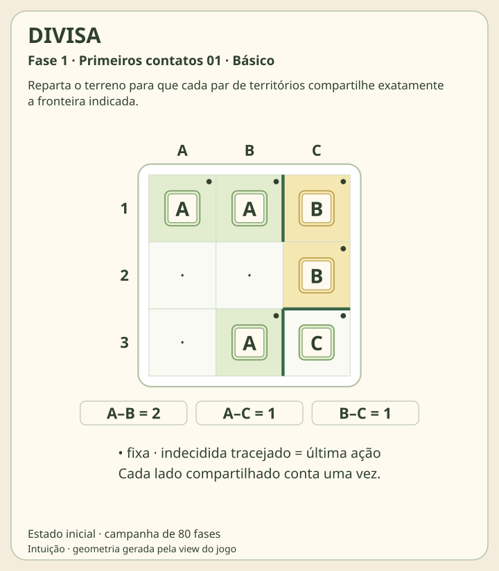
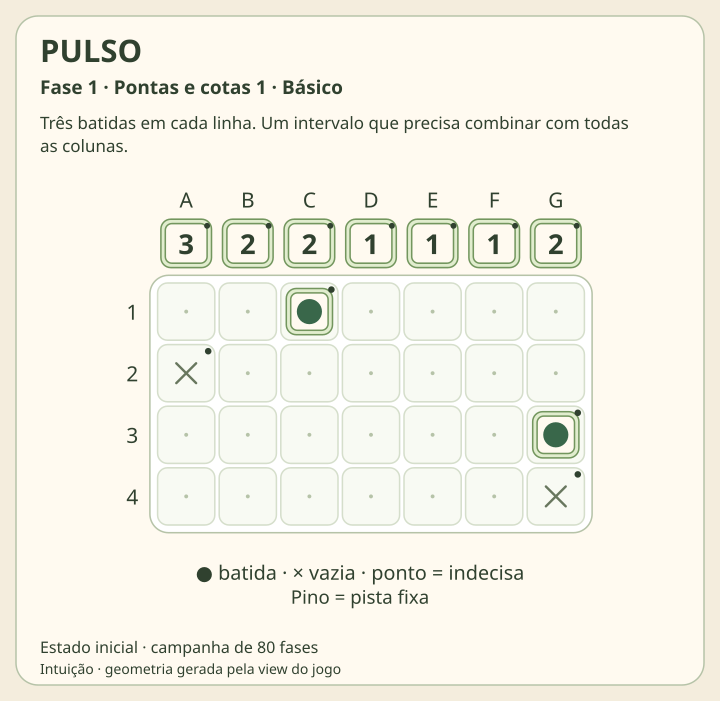
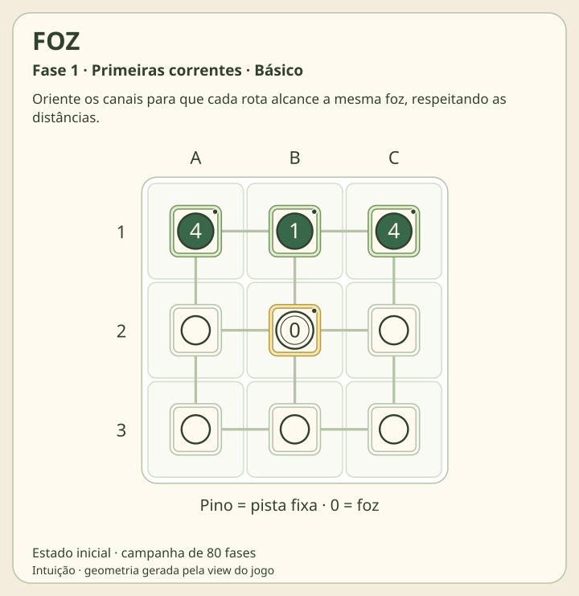
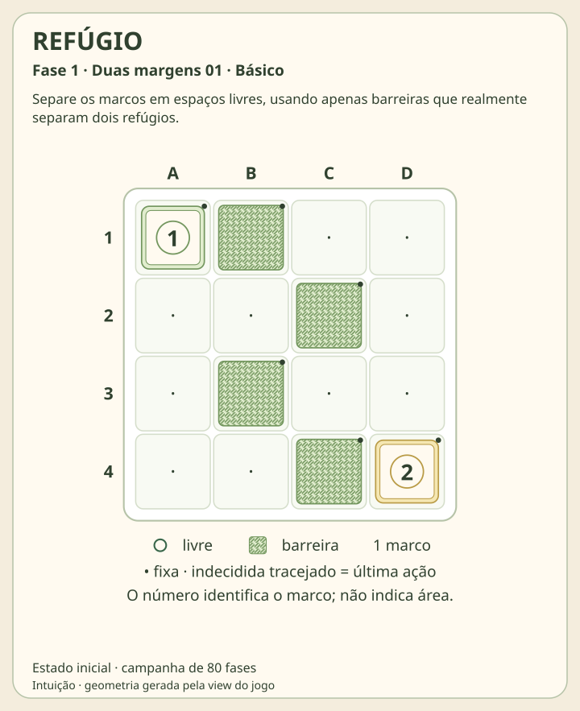
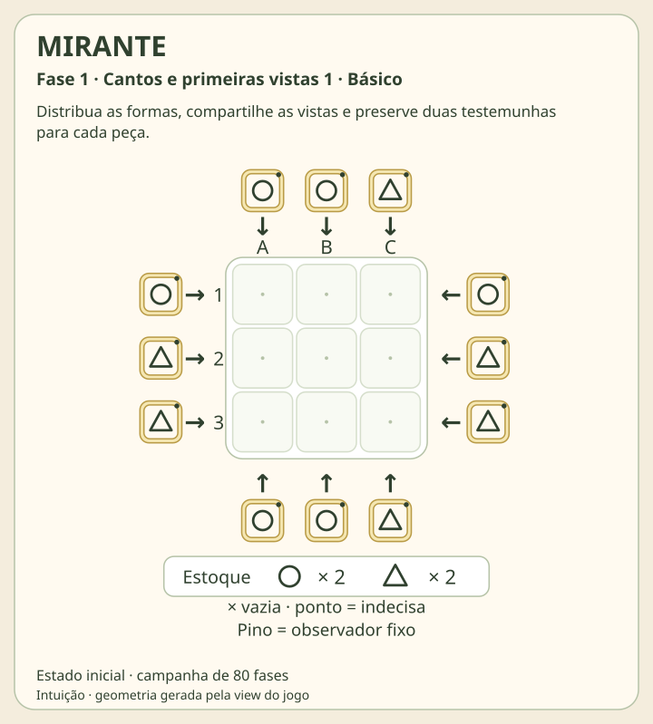
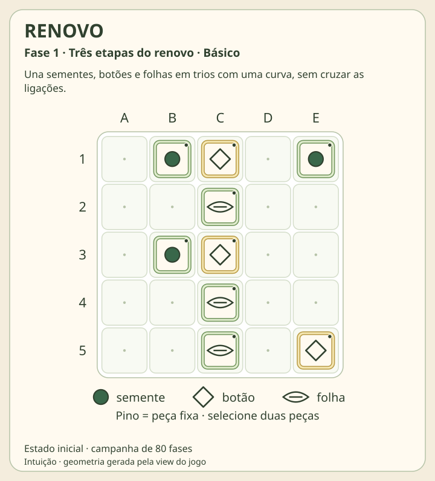

# Seis jogos de raciocínio lógico

DIVISA, PULSO, FOZ, REFÚGIO, MIRANTE e RENOVO acrescentam seis campanhas à coleção Intuição. Cada campanha tem **80 fases**: 15 Básico, 15 Aprendiz, 15 Intermediário, 15 Avançado, 15 Mestre e 5 Modo Sábio. São 480 desafios nesta família. LAÇO e RODÍZIO não fazem parte desta implementação.

As regras continuam as das concepções aprovadas. A apresentação segue CERCO: fundo marfim, painéis creme, placas claras, molduras sálvia/âmbar, peças de centro claro e pistas com pino. Letras, números, formas e hachuras preservam o significado sem depender da cor. Em DIVISA, os territórios permanecem contínuos para manter seus lados compartilhados contáveis.

## Os jogos e seus tabuleiros reais

As imagens abaixo mostram **a fase 1 no estado inicial**, gerada pela mesma função de renderização usada na aplicação. Os títulos das fases, pistas e coordenadas vêm do catálogo ativo; não são mockups nem respostas ilustrativas inventadas.

### DIVISA

Preencha todas as casas com letras de território, respeitando as pistas fixas. Cada letra forma uma única região conectada por lados. O número de lados unitários compartilhados por cada par de territórios deve corresponder ao painel. Diagonais e borda externa não entram na conta; não existe uma exigência de área ou forma retangular.



[Regras, dados, geração e limites de DIVISA](../../dist/logica/games/divisa/README.md).

### PULSO

Marque exatamente três batidas em cada linha, mantendo intervalos iguais entre elas. As colunas precisam alcançar suas cotas. Preserve as casas fixas e confirme as demais como batida ou vazia; distância 1 é permitida.



[Regras, dados, geração e limites de PULSO](../../dist/logica/games/pulso/README.md).

### FOZ

Cada ponto, exceto a foz 0, recebe uma seta para um vizinho ligado por canal. Todos os percursos precisam chegar à foz, sem ciclos; caminhos podem se juntar. Uma pista numérica conta os trechos percorridos até a foz, não a quantidade de pontos.



[Regras, dados, geração e limites de FOZ](../../dist/logica/games/foz/README.md).

### REFÚGIO

Marque cada casa como livre ou barreira, preservando as pistas e mantendo os marcos livres. Cada região livre conectada por lados deve conter exatamente um marco. Cada barreira deve tocar exatamente **duas regiões livres distintas**: duas casas da mesma região não bastam. Os números identificam marcos, não áreas; o exterior não é uma região.



[Regras, dados, geração e limites de REFÚGIO](../../dist/logica/games/refugio/README.md).

### MIRANTE

Distribua exatamente o estoque de círculos e triângulos. Cada observador deve encontrar a forma indicada como a primeira peça na direção de sua seta; vazios deixam a vista passar. Toda peça precisa ser vista por pelo menos dois observadores. Lados opostos contam separadamente; uma borda sem observador não fornece visão. Não há diagonais nem quota por linha.



[Regras, dados, geração e limites de MIRANTE](../../dist/logica/games/mirante/README.md).

### RENOVO

Ligue cada botão a uma semente e a uma folha, usando todas as peças uma única vez. As duas ligações do botão devem ser perpendiculares; cada segmento segue horizontal ou verticalmente até a primeira peça. Não pode haver cruzamento, sobreposição ou passagem por outra peça. O único encontro permitido é entre os dois segmentos do mesmo trio, no seu botão.



[Regras, dados, geração e limites de RENOVO](../../dist/logica/games/renovo/README.md).

## Campanhas, progressão e certificação

As definições são geradas e certificadas offline. O navegador carrega as fases prontas; abrir um jogo não resolve nem gera sua campanha. Cada nível tem identidade estável ligada à definição, versão, número de apresentação e faixa editorial. Reordenar uma fase não deve transferir uma conclusão para outro problema.

Os verificadores avaliam as próprias regras, sem comparar a tentativa com o campo `solution`. O gabarito é reservado à ajuda explícita e aos testes. A certificação exige existência e unicidade; uma busca interrompida não é apresentada como prova. Filtros de diversidade recusam equivalências relevantes de cada jogo, como rotação/reflexão, renomeação de territórios ou permutação de linhas de PULSO.

| Jogo | Relações trabalhadas ao avançar |
| --- | --- |
| DIVISA | Limites de fronteira, conexão possível e contradições curtas; quatro territórios na faixa final |
| PULSO | Intervalos e cotas, cadeias entre linhas, comparação de capacidades de duas e três colunas |
| FOZ | Distâncias locais, comprimentos derivados, rotas que precisam se unir e exclusão de ciclos |
| REFÚGIO | Acesso aos marcos, separação de componentes, barreiras redundantes e contradições curtas |
| MIRANTE | Estoque e primeiras vistas, segunda testemunha indispensável e proteção de corredores |
| RENOVO | Parceiros obrigatórios, cobertura de sementes/folhas e compatibilidade geométrica dos trios |

As faixas são editoriais e não foram calibradas com jogadores. Quantidade de candidatos, passagens do propagador ou profundidade de busca não equivale a tempo humano. O roteiro de deduções e o enumerador de unicidade têm funções diferentes; quando uma fase usa busca para certificação, isso não é chamado de explicação humana. Os READMEs dos jogos e os relatórios específicos em `tests/logica/` registram os métodos e seus limites.

## Controles e conclusão

Todas as fases estão disponíveis desde a seleção. Escolha uma ferramenta e toque/clique na casa ou peça. FOZ oferece setas diretas e alternância; RENOVO liga duas peças com dois cliques, e repetir a ligação a remove. Pinos indicam pistas fixas. Casas indecisas precisam ser resolvidas quando o jogo exige preencher a grade.

Tab percorre os controles; Enter ou espaço aciona o alvo focado. Desfazer usa Ctrl/⌘ Z; refazer usa Ctrl/⌘ Shift Z ou Ctrl/⌘ Y. Há botões de histórico, reinício, fase anterior/seguinte e retorno aos níveis. Algumas grades mantêm rolagem horizontal em telas estreitas para preservar a leitura.

Uma edição só dispara vitória automática quando o motor reconhece uma configuração **completa e correta**. Experimentar, desenhar ou apagar não aumenta o contador de erros. **Checar** avalia a tentativa atual e explica o que falta ou qual regra foi infringida; uma checagem não válida, inclusive incompleta, registra uma tentativa sem sucesso.

Depois de três checagens sem sucesso, **Ver gabarito** fica disponível. Sua aplicação é explícita, valida a solução antes de usá-la e marca a tentativa como **assistida**. A interface pede Checar para confirmar esse resultado. Reiniciar preserva a contagem de ajuda/checagens da tentativa, sem apagar conclusões já registradas.

## Desafio do dia e Surpreenda-me

**Desafio do dia** escolhe deterministicamente uma fase do próprio catálogo para cada jogo e data no fuso `America/Sao_Paulo`. Não cria uma fase nova nem progresso paralelo. Pode apontar para uma fase que você já concluiu.

**Surpreenda-me** sorteia uma fase ainda não concluída do catálogo ativo. Se todas estiverem concluídas, sorteia entre as 80 para permitir revisitar a campanha. Essas opções não são geradores infinitos e usam os mesmos IDs, regras e registros da seleção normal.

## Progresso local, backup e conquistas

Tentativas e conclusões ficam no navegador, em `intuicao.logica.v1`. O registro guarda ID e versão da fase, posição atual e marca assistida. Todas as 80 tentativas de cada jogo podem ser preservadas; as oito mais recentes mantêm o histórico de desfazer/refazer, e as anteriores mantêm o estado atual, a ajuda e o contador de checagens. Os dados não são sincronizados entre dispositivos. Limpar o armazenamento do navegador pode removê-los; exporte o backup quando quiser preservá-los fora dele.

O store dos seis jogos participa da exportação/restauração de progresso. A restauração verifica a estrutura e, antes de reabrir uma tentativa, cada motor valida seu estado. A proteção de escrita impede que uma aba antiga sobrescreva uma restauração mais recente. Se o armazenamento não puder ser usado, a partida permanece disponível na aba e a interface informa a limitação.

As conquistas leem conclusões das definições ativas. Uma fase conta uma única vez; repetir, abrir ou tentar não cria conclusão. Conclusões assistidas continuam identificadas no registro e seguem o critério geral de contagem da coleção. Desafio do dia e Surpreenda-me não duplicam esse progresso.

## Galeria: autoria e proveniência programática

Os seis SVGs desta página são produzidos por [`tools/logica/render-gallery.mjs`](../../tools/logica/render-gallery.mjs), que importa `initialState`, `renderBoard` e os dados de cada jogo. Não há captura de navegador, fotografia, imagem gerada por IA ou sprite externo nesses diagramas. As formas geométricas, letras, números, linhas e hachuras são construídas pelo código das views.

Cada SVG contém metadados de proveniência: módulo de origem, ID e versão da fase, número, título, faixa, indicação de estado inicial e SHA-256 do SVG original devolvido pela view. A ferramenta não modifica campanhas nem usa o gabarito para desenhar a galeria. Os títulos e descrições vêm dos módulos reais, evitando divergência entre documentação e jogo.

A galeria integra o projeto Intuição de Luigi Scofano de Araujo, com implementação e composição programática assistidas por ferramentas de IA. A identidade visual deriva da referência CERCO aprovada. Esta nota registra a origem técnica dos arquivos; não constitui declaração jurídica assinada nem concede permissões adicionais sobre a marca ou os recursos visuais. A reserva de direitos dos elementos visuais do projeto permanece aplicável.

Para regenerar a galeria completa, na raiz do repositório:

```sh
node tools/logica/render-gallery.mjs
```

Durante a implementação, `--available` gera somente campanhas já presentes e relata as ausentes; não deve substituir a execução completa no fechamento. `--games=divisa,pulso` permite uma seleção explícita.

[Verificação da edição: testes, navegador e limites](VERIFICACAO.md).

[Arquitetura técnica da família](../../dist/logica/README.md).
