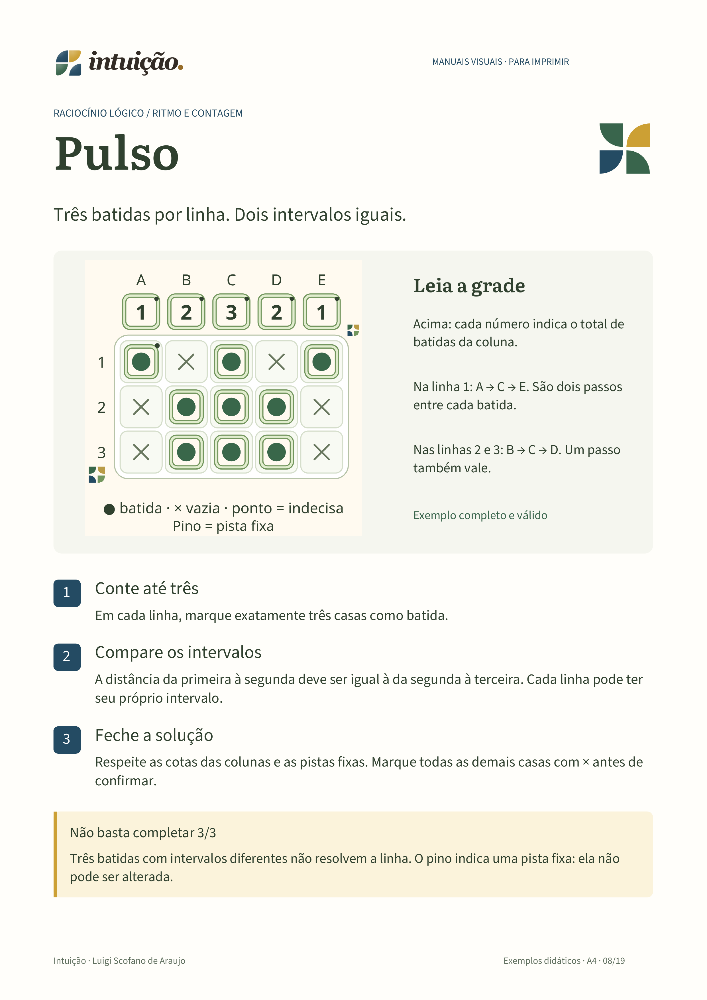

# Manuais visuais para impressão

Coleção dos **19 jogos ativos do Intuição**, com uma folha A4 por jogo. A coleção acrescenta documentação ao projeto: não muda jogos, regras, controles, progresso ou páginas do site.

**[Baixar coleção completa em PDF · 19 páginas](pdf/Intuicao_Manuais_Visuais_19_Jogos.pdf)**

## Formato e proposta

Expandir Formato e proposta

Cada folha apresenta o objetivo, um exemplo visual, três ações principais e uma observação importante. Os diagramas são **exemplos didáticos** e não capturas da interface. Alguns mostram apenas uma situação local, e não uma fase completa. Pulso usa a versão **Normal**, não Compasso. Não há ponteiro de mouse nas imagens.

A identidade mantém logo de azulejos, verde mata, azul profundo, amarelo e fundo claro, com títulos Literata e texto Source Sans 3. Os exemplos não dependem apenas da cor: há símbolos, rótulos e relações antes/depois. Sintonia usa o atlas ativo de sprites, não desenhos legados.

## Índice completo

Expandir Índice completo

| Nº | Jogo | Categoria | Imagem | Impressão | Referência |
|---|---|---|---|---|---|
| 01 | Reflexos | Intuição | [PNG 300 dpi](png/01-light.png) | [PDF A4](pdf/01-light.pdf) | [Regras e código](../jogos/reflexos/README.md) |
| 02 | Corte certo | Intuição | [PNG 300 dpi](png/02-cut.png) | [PDF A4](pdf/02-cut.pdf) | [Regras e código](../jogos/corte/README.md) |
| 03 | Elo | Raciocínio lógico | [PNG 300 dpi](png/03-elo.png) | [PDF A4](pdf/03-elo.pdf) | [Regras e código](../jogos/elo/README.md) |
| 04 | Prumo | Raciocínio lógico | [PNG 300 dpi](png/04-prumo.png) | [PDF A4](pdf/04-prumo.pdf) | [Regras e código](../jogos/prumo/README.md) |
| 05 | Pacto | Raciocínio lógico | [PNG 300 dpi](png/05-pacto.png) | [PDF A4](pdf/05-pacto.pdf) | [Regras e código](../jogos/pacto/README.md) |
| 06 | Sintonia | Raciocínio lógico | [PNG 300 dpi](png/06-sintonia.png) | [PDF A4](pdf/06-sintonia.pdf) | [Regras e código](../jogos/sintonia/README.md) |
| 07 | Repasse | Raciocínio lógico | [PNG 300 dpi](png/07-repasse.png) | [PDF A4](pdf/07-repasse.pdf) | [Regras e código](../jogos/repasse/README.md) |
| 08 | Pulso | Raciocínio lógico | [PNG 300 dpi](png/08-pulso.png) | [PDF A4](pdf/08-pulso.pdf) | [Regras e código](../jogos/pulso/README.md) |
| 09 | Foz | Raciocínio lógico | [PNG 300 dpi](png/09-foz.png) | [PDF A4](pdf/09-foz.pdf) | [Regras e código](../jogos/foz/README.md) |
| 10 | Refúgio | Raciocínio lógico | [PNG 300 dpi](png/10-refugio.png) | [PDF A4](pdf/10-refugio.pdf) | [Regras e código](../jogos/refugio/README.md) |
| 11 | Mirante | Raciocínio lógico | [PNG 300 dpi](png/11-mirante.png) | [PDF A4](pdf/11-mirante.pdf) | [Regras e código](../jogos/mirante/README.md) |
| 12 | Renovo | Raciocínio lógico | [PNG 300 dpi](png/12-renovo.png) | [PDF A4](pdf/12-renovo.pdf) | [Regras e código](../jogos/renovo/README.md) |
| 13 | Desvio | Versus | [PNG 300 dpi](png/13-desvio.png) | [PDF A4](pdf/13-desvio.pdf) | [Regras e código](../jogos/desvio/README.md) |
| 14 | Broto | Versus | [PNG 300 dpi](png/14-broto.png) | [PDF A4](pdf/14-broto.pdf) | [Regras e código](../jogos/broto/README.md) |
| 15 | Cerco | Versus | [PNG 300 dpi](png/15-cerco.png) | [PDF A4](pdf/15-cerco.pdf) | [Regras e código](../jogos/cerco/README.md) |
| 16 | Mosaico | Versus | [PNG 300 dpi](png/16-mosaico.png) | [PDF A4](pdf/16-mosaico.pdf) | [Regras e código](../jogos/mosaico/README.md) |
| 17 | Quinhão | Versus | [PNG 300 dpi](png/17-quinhao.png) | [PDF A4](pdf/17-quinhao.pdf) | [Regras e código](../jogos/quinhao/README.md) |
| 18 | Estalo | Versus | [PNG 300 dpi](png/18-estalo.png) | [PDF A4](pdf/18-estalo.pdf) | [Regras e código](../jogos/estalo/README.md) |
| 19 | Acorde | Versus | [PNG 300 dpi](png/19-acorde.png) | [PDF A4](pdf/19-acorde.pdf) | [Regras e código](../jogos/acorde/README.md) |

## Como imprimir

Expandir Como imprimir

Use o PDF em papel A4, orientação retrato, escala 100% ou “tamanho real”, sem cabeçalhos extras do navegador. As margens fazem parte do layout. Os PNGs têm 2481 × 3508 pixels (aproximadamente 300 dpi em A4) e podem ser usados individualmente em materiais de apoio. Em impressoras com área útil reduzida, use “ajustar à área imprimível” sem cortar a folha. As páginas são guias de consulta; não são tabuleiros para jogar no papel.

## Leitura e acessibilidade

Expandir Leitura e acessibilidade

O PDF contém texto selecionável; os arquivos `conteudo.json` e os guias individuais dos jogos oferecem versões textuais. Os exemplos visuais têm explicações adjacentes. O PDF não é uma versão certificada PDF/UA; para leitores de tela, prefira os READMEs de cada jogo. As ilustrações estáticas não têm movimento nem efeitos luminosos.

## Origem e validação

Expandir Origem e validação

A coleção foi conferida com o catálogo e os exemplos da revisão `ad124fe604162b76d404749292700d5dad845bc5` do repositório. Fontes principais: `dist/game-catalog.mjs`, `dist/rules-examples.mjs`, `dist/rules-logic-examples.mjs`, `dist/rules-versus-examples.mjs`, `dist/rules-quick-start.mjs` e motores correspondentes.

Foram executados os testes dos exemplos lógicos, exemplos versus e introduções rápidas: **32 testes aprovados, nenhum reprovado**. O registro está em [testes-exemplos.log](testes-exemplos.log). Houve também revisão dos estados especiais ilustrados de Pulso Normal, Renovo e Cerco, e inspeção visual das 19 páginas renderizadas. Os testes das fontes incluem exemplos históricos além dos jogos ativos; o catálogo desta coleção tem apenas os 19 ativos. Uma alteração posterior de regras exige nova revisão dos manuais.

## Arquivos e manutenção

Expandir Arquivos e manutenção

- `png/`: uma imagem final por jogo, 300 dpi.
- `pdf/`: coleção completa e uma folha individual por jogo.
- `diagramas/`: diagramas estáticos usados nas folhas, em SVG quando disponível e PNG de renderização.
- `fontes/`: fontes incorporadas e logo, com as licenças OFL das famílias tipográficas.
- `conteudo.json`: texto estruturado da coleção. Pulso, Renovo e Cerco têm composições especiais no gerador para preservar as folhas aprovadas.
- `guias-origem.json`: trechos das instruções que serviram de base para a edição didática.
- `gerar_pdf.py`: geração do PDF com ReportLab. Requer Python e ReportLab; use `python gerar_pdf.py` nesta pasta. Os diagramas e fontes já estão incluídos; a execução não acessa serviços externos.

Para regenerar PNGs, use Poppler: `pdftoppm -r 300 -png pdf/Intuicao_Manuais_Visuais_19_Jogos.pdf manual`. Renomeie as páginas conforme o índice. Se o conteúdo mudar, reveja todos os limites e quebras do PDF antes de substituir os arquivos. As fontes TTF são instâncias estáticas derivadas das fontes variáveis existentes no projeto; suas licenças acompanham o material. Os direitos da identidade visual e dos assets do projeto seguem os termos do repositório.

