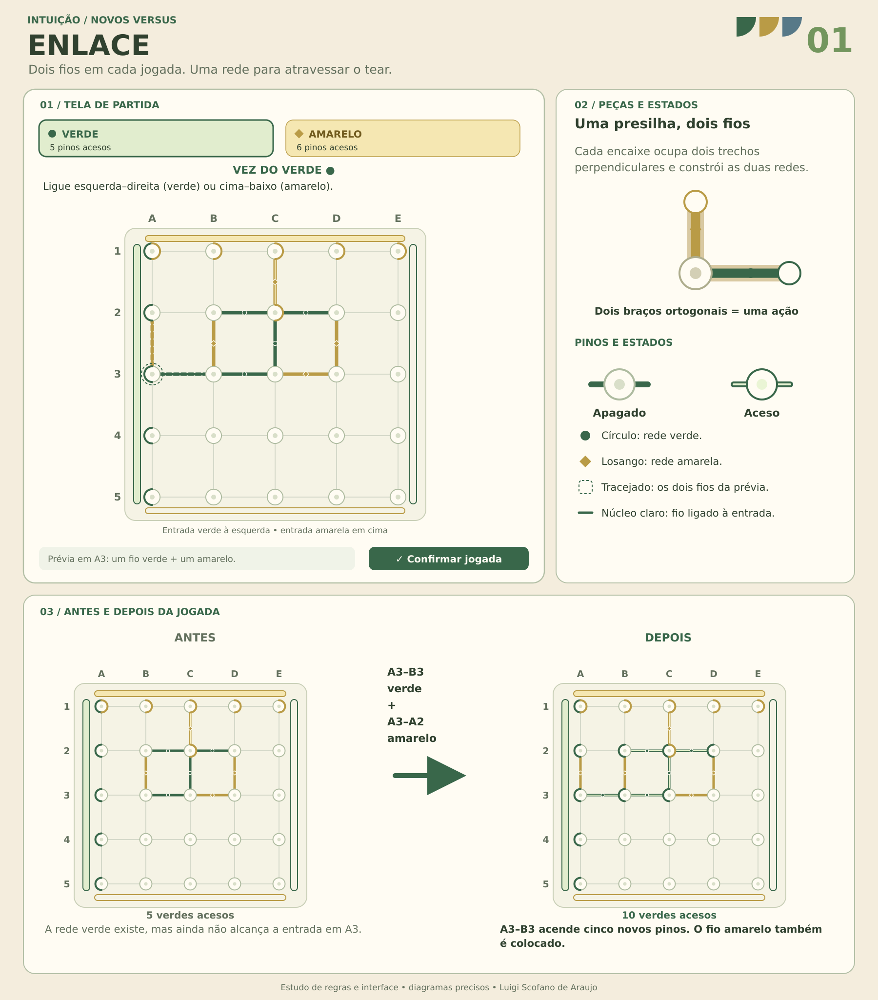
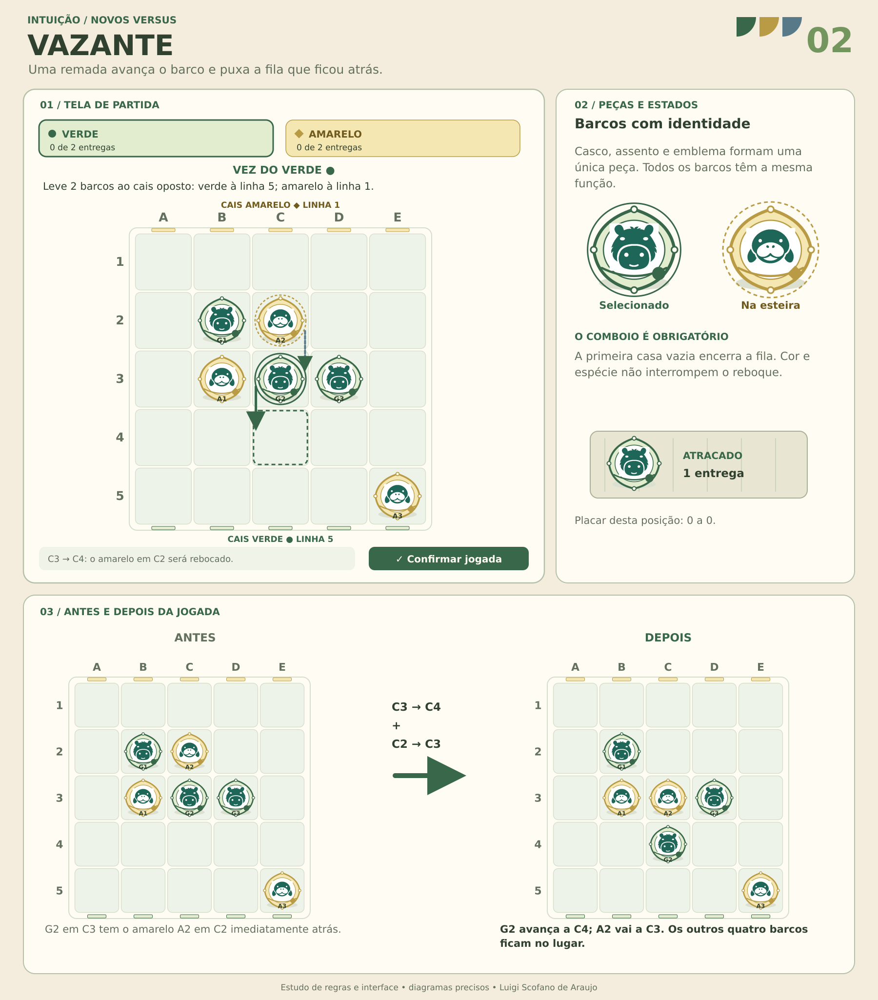
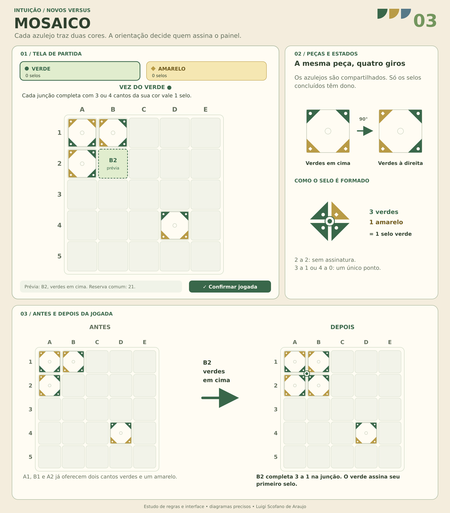
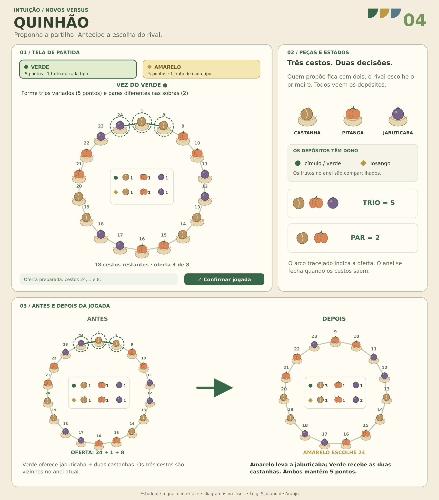
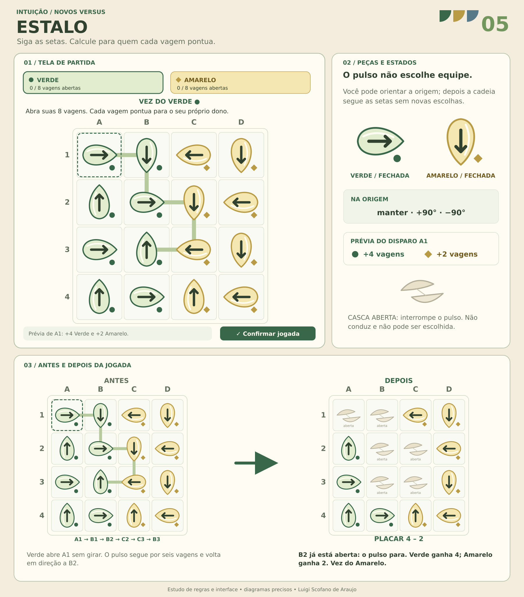
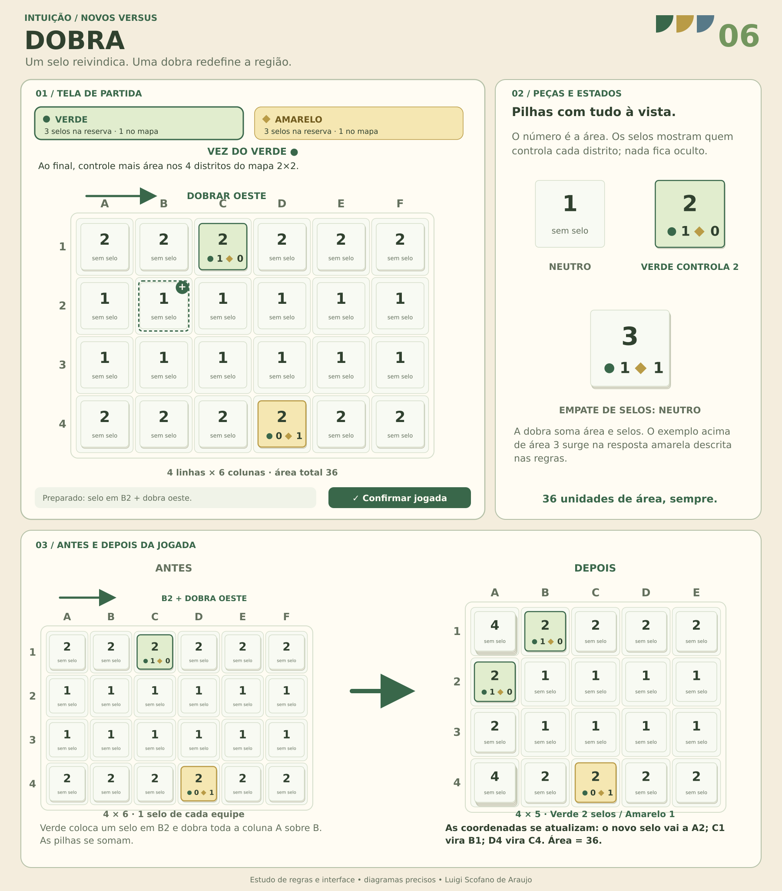
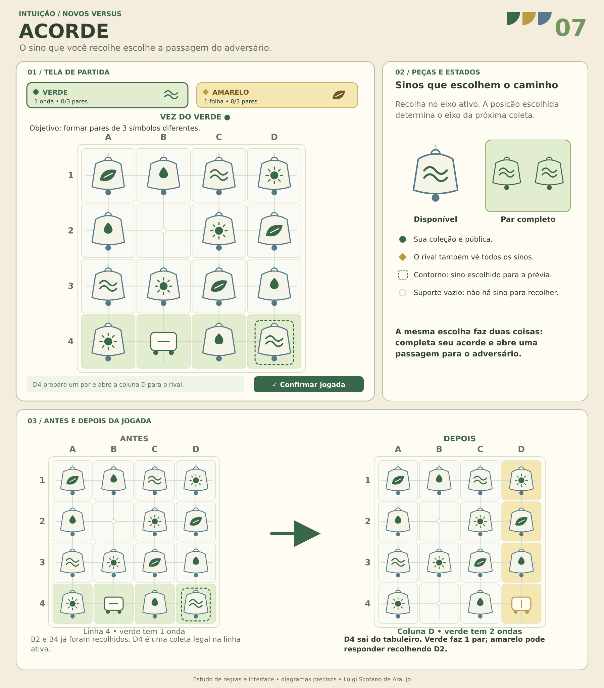
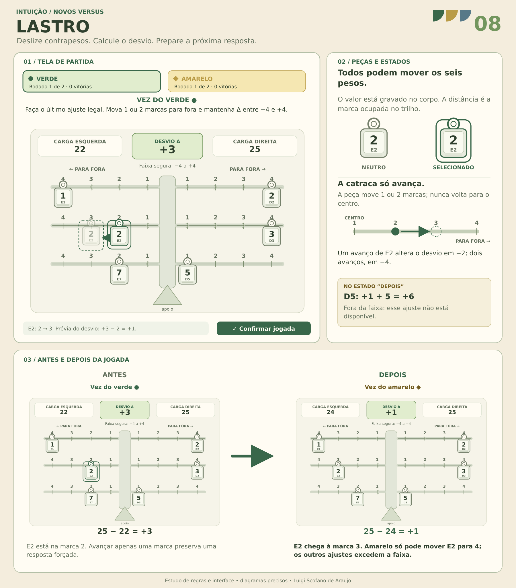

# Oito novos jogos versus do Intuição

A coleção amplia os duelos do Intuição com oito formas diferentes de raciocinar: conectar redes, conduzir comboios, orientar azulejos, repartir recursos, prever cadeias, transformar mapas, direcionar escolhas e controlar um sistema numérico.

Todas as partidas têm dois participantes, informação aberta e consequências determinísticas. A decisão é preparada em uma prévia e aplicada somente após a confirmação. Verde e círculo identificam uma equipe; âmbar e losango identificam a outra. Os animais, quando presentes, integram peças completas e não concedem poderes diferentes às espécies.

**As oito imagens desta página são pranchas conceituais aprovadas, não screenshots.** Cada prancha reúne a tela proposta, detalhes dos componentes e um exemplo de antes/depois. Elas documentam a relação entre regras e linguagem visual; os READMEs de implementação explicam os módulos utilizados no site.

## Visão da coleção

| Jogo | Decisão principal | Interação | Como vencer |
| --- | --- | --- | --- |
| [ENLACE](#enlace) | Colocar dois fios acoplados | Cada lance constrói as duas redes | Atravessar o tear; sem encaixes, iluminar mais pinos |
| [VAZANTE](#vazante) | Mover um barco e rebocar sua fila | A esteira também desloca adversários | Entregar dois barcos no cais oposto |
| [MOSAICO](#mosaico) | Orientar e colocar um azulejo comum | Cada canto afeta uma disputa de maioria | Assinar mais selos ao completar o painel |
| [QUINHÃO](#quinhão) | Oferecer três cestos e escolher um | O adversário escolhe primeiro; você fica com dois | Montar a colheita com maior pontuação por diversidade |
| [ESTALO](#estalo) | Orientar uma origem e disparar | A reação em cadeia abre vagens de ambas as equipes | Abrir todas as oito vagens próprias |
| [DOBRA](#dobra) | Marcar um painel e dobrar uma borda | A dobra soma áreas e reivindicações rivais | Controlar a maior área no atlas final |
| [ACORDE](#acorde) | Recolher um sino no eixo ativo | A casa escolhida define o eixo disponível ao rival | Formar pares de três símbolos diferentes |
| [LASTRO](#lastro) | Avançar um contrapeso uma ou duas marcas | O desvio resultante limita os próximos ajustes | Fazer o último ajuste de cada rodada e vencer as duas |

## ENLACE

Dois ateliês montam uma iluminação sobre um tear de 25 pinos. A presilha vem com dois braços inseparáveis: um verde e um âmbar. Colocá-la exige decidir ao mesmo tempo como desenvolver a própria rede e qual ligação oferecer ao adversário.

Em cada turno, o jogador escolhe um pino e dois trechos vazios perpendiculares. Fios da mesma cor se conectam nos pinos; as cores mantêm canais separados, mesmo quando compartilham um encontro. Verde procura ligar a esquerda à direita; âmbar procura ligar cima e baixo. A rede que atravessar vence, inclusive se recebeu o último fio de uma jogada rival. Duas travessias simultâneas empatam. Se nenhum encaixe restar, conta-se o alcance das redes a partir das entradas.

O raciocínio combina construção de rotas, bloqueio de trechos e antecipação de conexões presenteadas. Pinos acesos, fios com núcleo claro e barramentos de entrada tornam esse estado visível.

[Regras, estado, arquitetura e testes de ENLACE](../../dist/versus/games/enlace/README.md)

## VAZANTE

Duas equipes transportam seus mascotes em barcos de folha. O casco, o assento e o emblema fazem parte da peça; o animal permanece acomodado dentro dela. Os três barcos de uma equipe têm o mesmo movimento.

Uma remada leva um barco a uma casa ortogonal vizinha vazia. Toda a fila contígua imediatamente atrás é rebocada uma casa na mesma direção, sem distinção de equipe. Um espaço vazio interrompe a esteira. Os deslocamentos são simultâneos: o seguidor ocupa a origem do barco que estava à sua frente.

Verde atraca em qualquer casa da linha 5; âmbar, em qualquer casa da linha 1. Vence quem completar duas entregas. A profundidade vem de avançar, escapar de esteiras e reposicionar barcos rivais com a mesma ação. A prévia mostra o comboio inteiro antes da confirmação. Repetição tripla e limite de 80 turnos encerram perseguições sem conclusão.

[Regras, estado, arquitetura e testes de VAZANTE](../../dist/versus/games/vazante/README.md)

## MOSAICO

Duas oficinas constroem um painel de cerâmica usando a mesma reserva de azulejos. Cada peça tem dois cantos verdes adjacentes e dois cantos âmbar adjacentes. A escolha da orientação determina quais cantos participam das junções ao redor.

O jogador coloca uma peça em qualquer casa vazia do painel 5×5, girando-a antes de confirmar. Quando um bloco 2×2 fica completo, seus quatro cantos voltados para o centro formam um selo: uma maioria de três ou quatro cantos da mesma cor vale um ponto para aquela oficina. Dois cantos de cada cor deixam a junção sem assinatura. Uma colocação pode concluir vários selos e pontuar para as duas equipes.

Depois dos 25 azulejos, vence quem tiver mais selos; igualdade empata. A decisão local precisa considerar até quatro disputas vizinhas. As peças continuam compartilhadas: a autoria pertence aos selos, não a quem colocou cada azulejo.

[Regras, estado, arquitetura e testes de MOSAICO](../../dist/versus/games/mosaico/README.md)

## QUINHÃO

A colheita comunitária fica em 24 cestos distribuídos em um anel. Há castanhas, pitangas e jabuticabas, oito frutos de cada tipo. O objetivo é compor uma colheita variada.

O proponente oferece três cestos vizinhos. O adversário escolhe um e recebe seu fruto; o proponente fica com os outros dois. Os três cestos saem do anel, criando novas vizinhanças, e a função de propor alterna. A escolha do convidado é parte da mesma oferta, portanto a interface separa claramente as duas decisões.

Ao final de oito ofertas, cada equipe recebeu 12 frutos. Primeiro são formados todos os trios possíveis com um fruto de cada tipo, valendo cinco pontos cada. Depois, pares de tipos diferentes entre as sobras valem dois pontos. Frutos isolados não pontuam. O planejamento envolve o valor da divisão atual e os próximos grupos que surgirão no anel.

[Regras, estado, arquitetura e testes de QUINHÃO](../../dist/versus/games/quinhao/README.md)

## ESTALO

Um canteiro 4×4 contém oito vagens de cada equipe. Cada vagem possui uma seta que indica para onde o pulso seguirá quando ela se abrir.

O jogador escolhe uma vagem própria como origem, mantém sua direção ou a gira 90° para um dos lados e dispara. A abertura segue as setas e pode atingir vagens de ambas as equipes. Uma casca já aberta ou a borda interrompe o caminho. A cadeia é resolvida por inteiro antes da apuração do resultado.

Vence a equipe cujas oito vagens estiverem abertas ao final da cadeia. Se ambas completarem a semeadura nessa mesma reação, ocorre empate. É preciso prever o percurso completo, os pontos concedidos ao adversário e como as novas cascas modificarão os disparos seguintes. A interface numera a ordem das aberturas e mostra o ganho das duas equipes.

[Regras, estado, arquitetura e testes de ESTALO](../../dist/versus/games/estalo/README.md)

## DOBRA

O tabuleiro é um atlas de papel que começa com 36 painéis. Cada painel registra sua área e os selos depositados pelas duas equipes. A cada turno, o mapa muda de forma.

O jogador coloca um selo em qualquer painel e escolhe uma borda para dobrar para dentro. Painéis sobrepostos somam suas áreas e os selos de ambas as equipes. O mapa perde uma linha ou coluna, conservando a área total de 36. A prévia mostra o novo formato, as pilhas resultantes e as coordenadas atualizadas.

Quando o atlas chega a 2×2, a maioria de selos de cada distrito define quem controla toda sua área; empate de selos deixa o distrito neutro. Vence quem controla mais área na soma final. O desafio é prever fusões: uma dobra pode fortalecer uma região própria e, ao mesmo tempo, reunir selos que beneficiam o adversário.

[Regras, estado, arquitetura e testes de DOBRA](../../dist/versus/games/dobra/README.md)

## ACORDE

Um pequeno carrinho percorre um painel 4×4 de sinos. Há quatro símbolos — folha, onda, sol e gota — e quatro sinos de cada tipo. As coleções são abertas e as peças retiradas não voltam.

Verde recolhe um sino na linha horizontal ativa; âmbar recolhe um na coluna vertical ativa. A posição escolhida passa a ser a posição do carrinho: uma coleta verde define a coluna oferecida ao âmbar, e uma coleta âmbar define a próxima linha do verde.

Vence quem primeiro reúne pares de três símbolos diferentes. Ter mais de dois sinos do mesmo símbolo não cria pares adicionais daquele tipo. Se o eixo ativo ficar vazio, o passe é obrigatório; esgotamento dos sinos ou dois passes seguidos encerram pela quantidade de símbolos já pareados. Cada coleta precisa equilibrar o valor do próprio sino com as opções que abre ao rival.

[Regras, estado, arquitetura e testes de ACORDE](../../dist/versus/games/acorde/README.md)

## LASTRO

Um aparelho possui seis contrapesos compartilhados em trilhos independentes. Seus valores e suas distâncias do centro determinam um desvio numérico exato. O visual de equilíbrio acompanha as contas, sem depender de reflexos ou de simulação física.

À esquerda ficam pesos de valores 1, 2 e 7; à direita, 2, 3 e 5. Todos começam na marca 1. Em uma jogada, qualquer peso pode avançar uma ou duas marcas para fora, até a marca 4, desde que o desvio final permaneça entre −4 e +4. Não se pode recuar, trocar de trilho ou passar.

Quem não tiver ajuste legal perde a rodada. O duelo contém duas rodadas com o mesmo aparelho inicial e alternância de quem começa: duas vitórias dão a vitória no duelo; 1–1 é empate. Como as distâncias só aumentam, cada rodada termina em até 18 ajustes. O raciocínio combina cálculo de consequências e análise das respostas disponíveis.

[Regras, estado, arquitetura e testes de LASTRO](../../dist/versus/games/lastro/README.md)

## Estrutura de implementação

Cada jogo possui um motor puro e uma camada de apresentação separados. O motor cria o estado, enumera jogadas legais, aplica ações sem modificar o estado recebido, calcula o resultado e fornece uma avaliação determinística. A apresentação transforma seleção em prévia e explica suas consequências; a confirmação, o histórico e a persistência pertencem ao controlador compartilhado.

Os testes dos jogos ficam em `tests/versus/` e incluem sequências das pranchas, situações de vitória ou empate e invariantes específicos, como a conservação de área em DOBRA ou a resolução simultânea de um comboio em VAZANTE. Esses testes verificam a implementação das regras. Equilíbrio estratégico e experiência com participantes são avaliações distintas.

**Intuição — Luigi Scofano de Araujo.**
