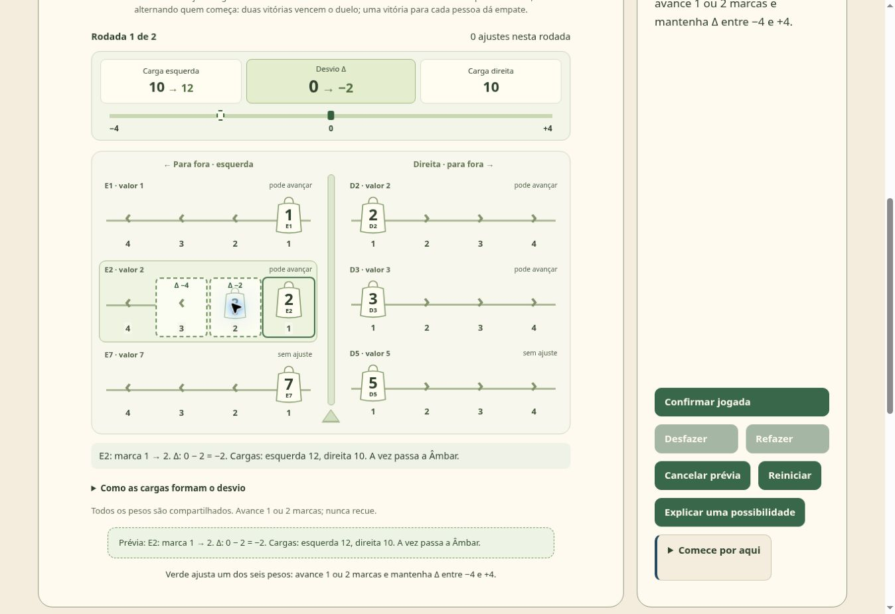

# Verificação dos oito duelos — 11/11/2026

## Recorte executado

A implementação parte da versão 188 do site. No GitHub, preserva a revisão
`28d1b498153780d618476a2cbd903faab2f7a711`, incluindo documentação, organização e
mudanças de apresentação que já compõem o site. Os oito jogos novos passam a
ocupar as posições 18 a 25 do catálogo.

Foram aprovados **341 testes selecionados**, sem falhas: 247 testes dos motores
anteriores, campanhas e plataforma, mais 94 testes dos novos duelos e serviços
compartilhados, incluindo seis de cancelamento e contingência da busca. O recorte é reproduzido pelos comandos abaixo e pela CI.

```bash
node --test tests/broto-engine.test.mjs tests/cerco-engine.test.mjs tests/sintonia-engine.test.mjs tests/repasse-engine.test.mjs tests/orbita-engine.test.mjs
node --test tests/logica/*.test.mjs tests/approved-opening.test.mjs tests/approved-game-shell.test.mjs tests/contextual-guidance.test.mjs tests/library-navigation.test.mjs tests/achievements.test.mjs tests/progress-backup.test.mjs
node --test tests/versus/*.test.mjs
```

As verificações de referência visual usam fixtures versionadas, independentes
dos hashes do histórico privado de publicação. A comparação conserva conteúdo e
atributos dos cartões antigos, normalizando apenas formatação de HTML.

## Evidência por área

| Área | Resultado observado |
| --- | --- |
| Catálogo | 25 jogos, sendo 2 em Intuição, 12 em Raciocínio lógico e 11 em Versus. |
| Regras | Exemplos aprovados, ações inválidas, empates e términos dos oito jogos. |
| Imutabilidade | Prévia, busca e aplicação não modificam a posição recebida. |
| QUINHÃO | O decisor pode escolher e preparar a oferta seguinte; a busca não força alternância. |
| DOBRA | A área permanece 36; dobras atualizam dimensões, selos e coordenadas. |
| LASTRO | 1.214 posições alcançáveis de aparelho, três terminais, duas rodadas e resultados 2–0/1–1. |
| Histórico | Replay, desfazer/refazer, descarte apenas do futuro substituído e retorno a decisões humanas. |
| Backup | Oito sessões reais preservadas, inclusive jogadas futuras disponíveis para refazer. |
| Busca | Jogadas legais, orçamento limitado, cancelamento, rejeição de respostas antigas e contingência sem Worker. |
| Temporizadores | Cancelamento e falha síncrona de postMessage não deixam fallback antigo agendado. |

## Conferência real no navegador

A inspeção usou a prévia local servida pelo fluxo de publicação. Foram realizadas
jogadas pelos controles da interface, sem injetar estado ou chamar motores pelo
console do navegador.

- **ENLACE:** A1–B1 verde e A1–A2 âmbar resultaram em alcance 6–6; desfazer e refazer por acordo restauraram a posição.
- **VAZANTE:** seleção de mascote, A1→A2, prévia e confirmação conservaram os seis barcos e nenhuma entrega.
- **MOSAICO:** orientação alterada antes de confirmar; A1 com verdes para baixo foi preservada depois de recarregar e retomar.
- **QUINHÃO:** duas ofertas e escolhas produziram 5–5, mantendo corretamente o decisor que passa de escolha a oferta.
- **ESTALO:** a cadeia de A1 abriu seis vagens e levou a 4–2; a ação em D3 levou a 4–5.
- **DOBRA:** quatro dobras do exemplo produziram mapa 3×5, área 36, B1 neutra com área 3 e placar 6–2.
- **ACORDE:** B2→B4→D4, primeiro par, desfazer acordado, retomada e resposta legal do computador.
- **LASTRO:** primeira rodada 1–0, pausa sem resultado final antecipado, reinício do aparelho com Âmbar e conclusão em empate 1–1; retomada durante a segunda rodada preservou a posição.

O treino preserva a seleção das sugestões para permitir editar giro, borda ou
destino antes de confirmar. Em LASTRO, a prévia sugerida E2→3 pôde ser trocada
por E2→2, sem consumir ajuste. O computador também respondeu legalmente a E1→2.
A navegação de volta aos jogos anteriores foi conferida em PRUMO.

## Captura da interface implementada

A captura abaixo foi feita na prévia local durante a conferência real de LASTRO.
Ela mostra uma sugestão editada antes da confirmação: o aparelho continua com
zero ajustes, enquanto a prévia apresenta as novas cargas e o desvio.



## Limites da verificação

A validação visual foi realizada no viewport desktop disponível. Há regras CSS
responsivas e suporte à preferência por movimento reduzido; não foi realizada
emulação móvel com alteração de viewport. Os testes selecionados não representam
a execução de todos os scripts históricos do repositório.

Os níveis do computador usam heurísticas e busca limitada. A posição inicial de
LASTRO favorece quem inicia a rodada sob jogo perfeito, conforme a análise das
regras aprovadas. A alternância de início nas duas rodadas não é prova de equilíbrio.
Duração estimada, dificuldade e diversão ainda precisam de avaliação com jogadores.
